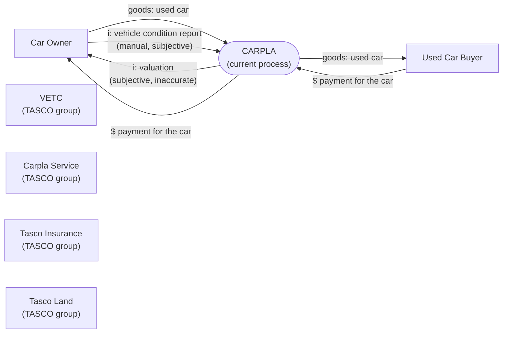
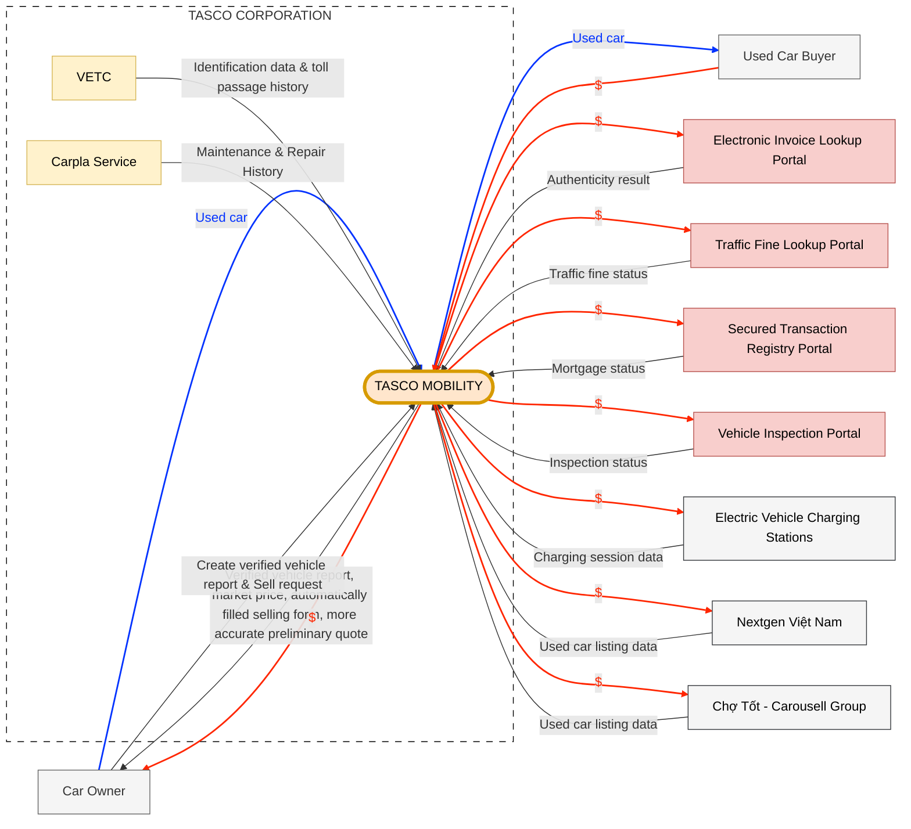

# CVCA: Vehicle Passport

The Customer Value Chain Analysis (CVCA) lists every stakeholder of the project and what flows
between them: money (`$`), information and goods or services. It is drawn before the system is
designed, to find the problems and opportunities.

| Field | Value |
|---|---|
| Project | Verified Vehicle Report (TASCO MOBILITY) |
| Version | v8.0 - Reviewed |
| Next | [Context Diagram](https://github.com/giangnhk63db/DBIZ-2_GROUP-A/blob/54dfee8446b27095bd1a4cd3b07deadc3627deb5/Context/Context%20Diagram.md) |

## 1. Value chain (with the old system)

Edge labels say what flows: `$` money, `i:` information, `goods:` or `service:` goods or services.

In the old system value chain, the car owner manually inputs a subjective vehicle condition
report to CARPLA and gets an inaccurate and subjective valuation. VETC, Carpla Service, Tasco
Insurance and Tasco Land are part of TASCO CORPORATION, but no data flows from them to the car owner
or to the valuation.

## 2. Value chain (with the new system)

With Verified Vehicle Report integrated in Tasco mobility app, the system collects identification data and toll passage history from VETC, maintenance and repair history from Carpla Service, and status data from the lookup portals and the listing partners. It gives the car owner a verified vehicle report, the market price, an automatically filled selling form and a more accurate preliminary quote.

## 3. Problems and opportunities

| # | Stakeholder | Problem or opportunity |
|---|---|---|
| P-1 | Car Owner | The owner has to input the vehicle condition by hand although these data is almost available in Tasco subsidiaries and partners |
| P-2 | Car Owner | The valuation is subjective and inaccurate, so the owner cannot trust the price. |
| P-3 | Car Owner | No market data reaches the owner, so the owner does not know the market price of the car or its trend. |
| P-4 | Car Owner | Car Owner has to to open many apps and webs to check all their car information and status. No unified data app exists for them to monitor car. |
| P-5 | Tasco Corporations (VETC, Carpla Service) | Data that the group already holds (toll passage history, maintenance and repair history) does not reach the valuation. |

## 4. Stakeholder requirements

Written as "<stakeholder> shall be able to ...". Each one comes from a problem of section 3.
StR means Stakeholder Requirement. They become system requirements in the architecture.

| ID | Stakeholder requirement | From |
|---|---|---|
| StR-01 | Car owners shall be able to get a verified vehicle report without filling in the vehicle condition by hand. | P-1, P-5 |
| StR-02 | Car owners shall be able to see the market price of their car and its trend. | P-3 |
| StR-03 | Car owners shall be able to see the legal status of the car (inspection, unpaid fines, mortgage) before selling. | P-4 |
| StR-04 | Car owners shall be able to send a sale request with the information already filled in from the report. | P-1 |
| StR-05 | Car owners shall be able to receive a more accurate preliminary quote for their sale request. | P-2 |
| StR-06 | Carpla staff shall be able to see the verified report and the market price of a sale request before sending a quote. | P-2, P-3 |
