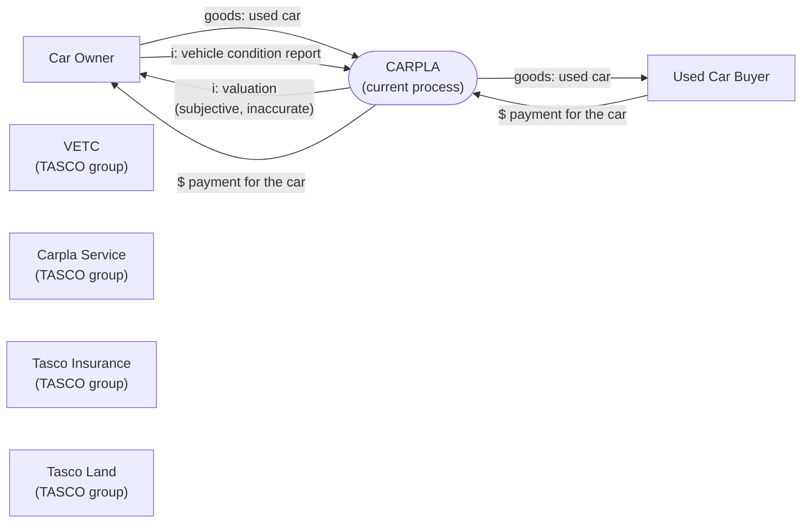

# CVCA: Vehicle Passport

The Customer Value Chain Analysis (CVCA) lists every stakeholder of the project and what flows
between them: money (`$`), information and goods or services. It is drawn before the system is
designed, to find the problems and opportunities.

| Field | Value |
|---|---|
| Project | Verified Vehicle Report (TASCO MOBILITY) |
| Version | v8.0 - Reviewed |
| Next | [Context Diagram](https://github.com/giangnhk63db/DBIZ-2_GROUP-A/blob/54dfee8446b27095bd1a4cd3b07deadc3627deb5/Context/Context%20Diagram.md) |

## 1. Value chain (with the old system)

Edge labels say what flows: `$` money, `i:` information, `goods:` or `service:` goods or services.



In the old system value chain, the car owner manually inputs a subjective vehicle condition
report to CARPLA and gets an inaccurate and subjective valuation. VETC, Carpla Service, Tasco
Insurance and Tasco Land are part of Tasco Corporations, but no data flows from them to the car owner
or to the valuation.

## 2. Value chain (with the new system)

```mermaid
flowchart LR
  CO["Car Owner"]
  BUYER["Used Car Buyer"]
  VETC["VETC<br>(TASCO group)"]
  CS["Carpla Service<br>(TASCO group)"]
  INV["Electronic Invoice<br>Lookup Portal"]
  FINE["Traffic Fine<br>Lookup Portal"]
  REG["Secured Transaction<br>Registry Portal"]
  INSP["Vehicle Inspection<br>Portal"]
  EV["Electric Vehicle<br>Charging Stations"]
  NEXT["Nextgen Việt Nam"]
  CHO["Chợ Tốt -<br>Carousell Group"]
  MOB(["TASCO MOBILITY<br>(new system)"])
  STAFF ["Carpla Staff"]

  CO -->|"goods: used car"| MOB
  MOB -->|"goods: used car"| BUYER
  BUYER -->|"$ payment for the car"| MOB
  MOB -->|"$ payment for the car"| CO
  CO -->|"i: request to create a verified<br>vehicle report, sale request"| MOB
  MOB -->|"i: unified verified vehicle report, market price,<br>automatically filled selling form,<br>more accurate preliminary quote"| CO
  VETC -->|"i: identification data,<br>toll passage history"| MOB
  CS -->|"i: maintenance and repair history"| MOB
  EV -->|"i: charging session data"| MOB
  NEXT -->|"i: used car listing data"| MOB
  CHO -->|"i: used car listing data"| MOB
  INV -->|"i: invoice authenticity result"| MOB
  FINE -->|"i: traffic fine status"| MOB
  REG -->|"i: mortgage status"| MOB
  INSP -->|"i: inspection status"| MOB
   MOB -->|"i: verified vehicle report and sale request"| STAFF
  STAFF -->|"i: preliminary quote"| MOB
  CO -->|"i: external invoice upload"| MOB
  MOB -->|"i: invoice data scanned by OCR"| CO
  CO -->|"i: invoice data checked and edited by owner"| MOB
  MOB -->|"$ fee"| INV
  MOB -->|"$ fee"| FINE
  MOB -->|"$ fee"| REG
  MOB -->|"$ fee"| INSP
  MOB -->|"$ fee"| EV
  MOB -->|"$ fee"| NEXT
  MOB -->|"$ fee"| CHO
```

With Verified Vehicle Report integrated in Tasco mobility app, the system collects identification data and toll passage history from VETC, maintenance and repair history from Carpla Service and invoice uploaded, and legal status data (inspection, unpaid traffic fines and mortgage) from the lookup portals and the listing partners. When the car owner uploads external maintenance invoices; the system scans them with OCR , and the car owner checks and edits the scanned data before the invoice is verified through the Electronic Invoice Lookup Portal. When the car owner submits a sale request, the system sends the sale request and the verified vehicle report to Carpla staff, who review them and send back a preliminary quote, which the system shows to the car owner. The Verified Vehicle Report system gives the car owner a verified vehicle report, the market price for reference, an automatically filled selling form and especially a more accurate preliminary quote.

## 3. Problems and opportunities

| # | Stakeholder | Problem or opportunity |
|---|---|---|
| P-1 | Car Owner | Car Owner has to open many apps and webs to manage all their car information and status. No unified data app exists for them to monitor car. |
| P-2 | Tasco Corporations (VETC, Carpla Service) | Data that the group already holds (toll passage history, maintenance and repair history) is not taken full advantage to improve user experiment and make profits |
| P-3 | Car Owner | No market data reaches the owner, so the owner does not know the market price of the car or its trend. The car owners often have to ask some car dealers to estimate price for reference before they want to sell their car. |
| P-4 | Car Owner | The owner has to input the vehicle information by hand to submit sale request although these data is almost available in Tasco subsidiaries and partners. This manually input so many fields of information discourages the car owner from the next steps to sell their car |
| P-5 | Car Owner | The preliminary quote is currently subjective and inaccurate. In the fact cases, after the car directly inspected, the price is quoted much higher than the initial preliminary quote, making car user frustrated and cannot trust the preliminary quote |

## 4. Stakeholder requirements

Written as "<stakeholder> shall be able to ...". Each one comes from a problem of section 3.
StR means Stakeholder Requirement. They become system requirements in the architecture.

| ID | Stakeholder requirement | From |
|---|---|---|
| StR-01 | Car owners shall be able to get a unified verified vehicle report app to manage all their car information. | P-1, P-2 |
| StR-02 | Car owners shall be able to see the market price of their car and its trend. | P-3 |
| StR-03 | Car owners shall be able to send a sale request with most information already filled in from the report. | P-4|
| StR-04 | Car owners shall be able to receive a more accurate preliminary quote for their sale request. | P-5 |
