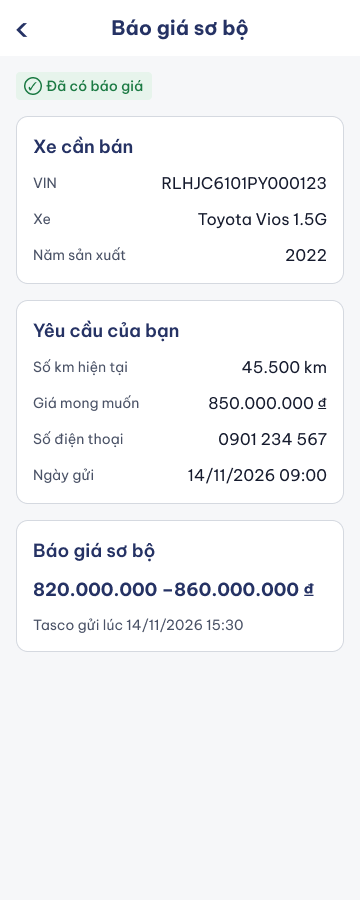
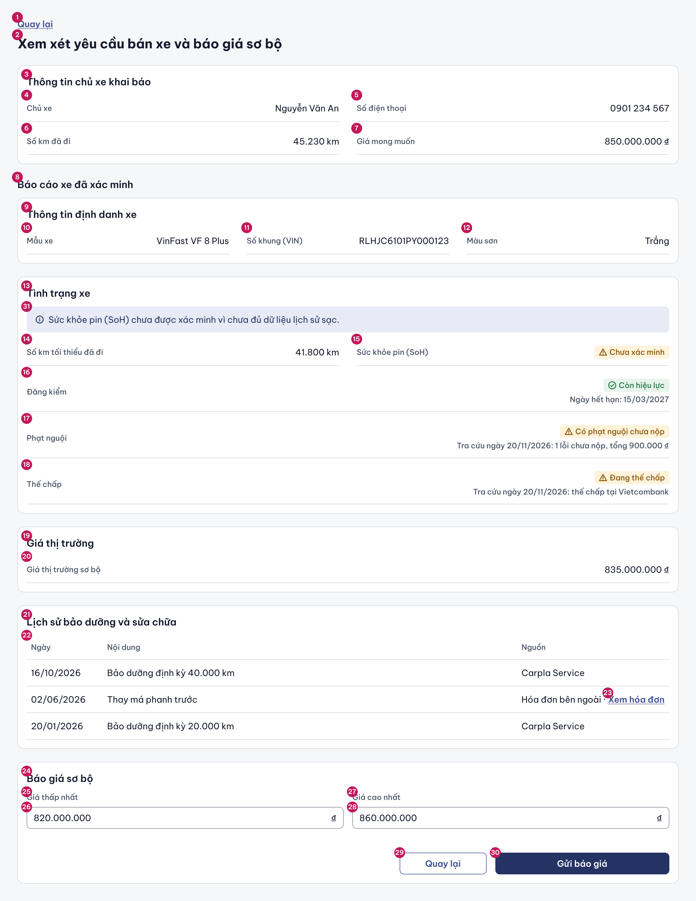
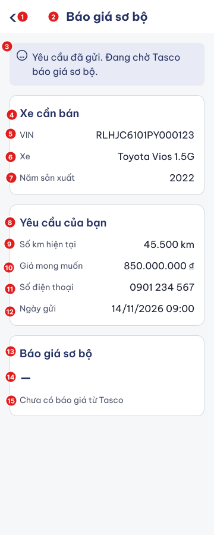
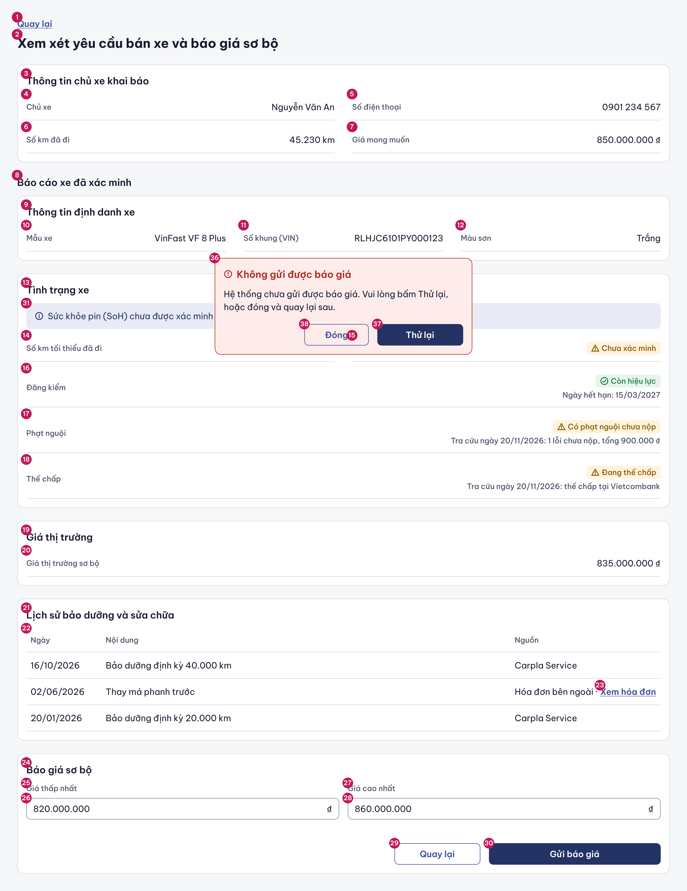
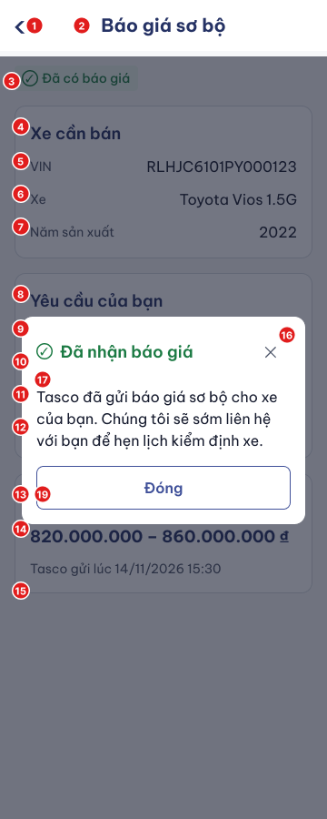

**Screen Spec: S-F03-03 View preliminary quote**

**1\. Purpose**

| Field | Value |
| ----- | ----- |
| Screen ID | S-F03-04 |
| Screen name | Receive Preliminary Quote (Vietnamese UI title in Top bar: "Báo giá sơ bộ") |
| Actor | Car Owner |
| Priority | Should |
| Feature | F-03 Sale Request |
| Activity diagrams | AD-UC-3.09: view preliminary quote  |
| Linked requirements | FR-03-06 View preliminary quote (Should), see section 7 |
| Mockup images | img/S-F03-04-default.png, img/img-numbered/S-F03-04-default-numbered.png, four state images (section 2\) |
| Frame width | 360px |
| Figma frame | [Verified Vehicle Report \- S-F03-03](https://www.figma.com/design/C0hM92cku1UhbITMOXxvgD/Verified-Vehicle-Report---S-F03-01--S-F03-03--5-states-?node-id=28-314&t=wpsxsdbmviJiQl5m-0), node-id 28-314 |
| Status | Reviewed |

**Shown when:** the car owner taps the fixed bottom button "Xem yêu cầu bán xe" of S-F01-02 (this button replaces "Gửi yêu cầu bán xe" once a sale request exists), or closes the success popup of S-F03-01 right after sending the request. The screen shows the vehicle, the request that the car owner sent and the preliminary quote from Carpla, or a waiting message when the quote has not been sent yet.

**The user leaves this screen when:** the car owner goes back to S-F01-02 with the Back arrow of the Top bar.

**2\. Mockup**

**Numbered:** each number is the \# of the element inventory in section 3\. Elements 16 to 19 (popup) appear only in the error and success states. The numbers are the same in all states: element 3 and element 14 change their content by state, and the elements that do not appear in a state are not numbered on its image.

Default, numbered | Loading, numbered | Error API, numbered | Success, numbered |
| ----- | ----- | ----- | ----- |
|  |  |  |  |

| State | Image |
| :---- | :---- |
| Default | img/S-F03-04-default.png |
| Empty | not used (see section 4\) |
| Loading  | img/S-F03-04-loading.png |
| Error (API) | img/S-F03-04-error-API.png (system error popup, FR-03-06) |
| Success | img/S-F03-04-success.png |

All colours, fonts and corners come from the design tokens in [ui-conventions-car-owner](https://github.com/giangnhk63db/DBIZ-2_GROUP-A/blob/856166f4d066a07c84b66f96b604380801b82088/External%20Design/ui-conventions-car-owner.md).

**3\. Element inventory**

This screen is read-only: it has no Input, Date time, Upload or Security element, so no textbox or textarea.

| \# | Element | Category | Type | Content / data source | Required | Validation |
| ----- | ----- | ----- | ----- | ----- | ----- | ----- |
| 1 | Back | Selection | Top bar, back arrow (button) | static | Yes | none |
| 2 | Title | Display | Read-only text (Top bar screen name) | static: "Báo giá sơ bộ" | Yes | none |
| 3 | Quote status | Display  | Status badge (icon \+ text) in the default and success states; Banner (info, icon \+ read-only text, no button) in the loading state | Default and success: badge "Đã có báo giá" with a check icon (a quote has been sent).  Loading: banner "Yêu cầu đã gửi. Đang chờ Tasco báo giá sơ bộ." (FR-03-06: "waiting for Carpla").  Error: badge "Chờ Tasco báo giá" with an info icon. The banner sits at the top of the content, above the vehicle card | Yes | none |
| 4 | Vehicle card title | Display | Read-only text (Section card title) | static: "Xe cần bán" | Yes | none |
| 5 | VIN | Display | Label \+ read-only text | label "VIN";  value vehicle.vin (for example "RLHJC6101PY000123") | Yes | none |
| 6 | Vehicle name | Display | Label \+ read-only text | label "Xe";  value vehicle.make, vehicle.model, vehicle.variant (for example "Toyota Vios 1.5G") | Yes | none |
| 7 | Manufacturing year | Display | Label \+ read-only text | label "Năm sản xuất";  value vehicle.manufacturing\_year (for example "2022") | Yes | none |
| 8 | Request card title | Display | Read-only text (Section card title) | static: "Yêu cầu của bạn" | Yes | none |
| 9 | Current mileage | Display | Label \+ read-only text | label "Số km hiện tại";  value sale\_request.current\_mileage; format 45.500 km | Yes | none |
| 10 | Desired price | Display | Label \+ read-only text | label "Giá mong muốn";  value sale\_request.desired\_price; format 850.000.000 ₫ | Yes | none |
| 11 | Phone number | Display | Label \+ read-only text | label "Số điện thoại";  value sale\_request.phone\_number; shown in groups,  (for example 0901 234 567\) | Yes | none |
| 12 | Sent date | Display | Label \+ read-only text | label "Ngày gửi";  value sale\_request.submitted\_at; format 14/11/2026 09:00 | Yes | none |
| 13 | Quote card title | Display | Read-only text (Section card title) | static: "Báo giá sơ bộ" | Yes | none |
| 14 | Preliminary quote | Display | Read-only text | Display quote.min\_amount – quote.max\_amount (FR-03-06); format 820.000.000 – 860.000.000 ₫; Displays "—" when no quote has been sent | Yes | none |
| 15 | Quote sent time | Display | Read-only text | Quote sent: "Tasco gửi lúc " \+ quote.sent\_at,  format 14/11/2026 15:30.  No quote: static "Chưa có báo giá từ Tasco" | Yes | none |
| 16 | Close popup | Selection | Icon button (X) in the Modal | static | No | none |
| 17 | Notification message | Dialogue | Modal (popup), title \+ read-only text | Success: title "Đã nhận báo giá" with check icon, text "Tasco đã gửi báo giá sơ bộ cho xe của bạn. Chúng tôi sẽ sớm liên hệ với bạn để hẹn lịch kiểm định xe."  Error: title "Chưa lấy được báo giá" with warning icon, text "Hệ thống chưa lấy được báo giá từ Tasco. Vui lòng bấm Thử lại, hoặc đóng và quay lại sau." | No | none |
| 18 | Retry | Selection | Primary button in the Modal | static: "Thử lại"; error popup only | No | none |
| 19 | Close | Selection | Secondary (outlined) button in the Modal | static: "Đóng"; in both the success and the error popup | No | none |

**Note**: vehicle., sale\_request., quote. are the fields sourced from tables in the data source. The field names are proposed and will be finalized with the data dictionary.

**4\. States**

| State | What the user sees | Trigger |
| ----- | ----- | ----- |
| Default | Badge "Đã có báo giá" (3); vehicle card (4 to 7); request card (8 to 12); quote card with the price range (14) and the sent time (15). No banner and no popup. | The car owner opens the screen, the sale request exists, Carpla has sent the quote and the data is loaded |
| Empty  | Not used. | The screen opens only from the button "Xem yêu cầu bán xe" of S-F01-02 or after the success popup of S-F03-01, and both exist only after a sale request has been sent, so the car owner never opens this screen without a request |
| Loading (waiting for Carpla) | Banner (3) at the top of the content. Vehicle card and request card are filled.  The quote card shows "—" (14) and the text "Chưa có báo giá từ Tasco" (15).  | The car owner opens the screen, the sale request exists but Carpla has not sent a quote yet (FR-03-06: "waiting for Carpla"), or the data is being fetched |
| Error  (API) | Error popup (16 to 19\) with warning icon, title "Chưa lấy được báo giá", message, button "Thử lại" and button "Đóng" (and X). Behind it the quote area shows "—" (14) and the text (15); the content cannot be used while the popup is open. | The system could not get the quote data from the server after the maximum retries |
| Success | Success popup (16, 17, 19\) with check icon, title "Đã nhận báo giá", the message and button "Đóng" (and X). Behind it the badge (3), the price range (14) and the sent time (15) are filled. | The quote is received while the car owner is on this screen |

**5\. Interactions and navigation**

| \# | Element | User action | System response | Goes to screen |
| ----- | ----- | ----- | ----- | ----- |
| 1 | Back (1) | tap | Returns without any change | S-F01-02 |
| 2 | Retry (18) | tap (error popup) | Closes the popup, shows the loading state and sends the request again | stays (loading, then default, or loading then  error) |
| 3 | Close (19) | tap (error or success popup) | Closes the popup. After an error the screen keeps "—" in place of the quote; after a success the quote stays visible | stays |
| 4 | Close popup (16) | tap (error or success popup) | Same as Close (19) | stays |

The other elements are read-only and have no interaction.

**6\. Screen-level rules**

| Rule ID | Rule | Source |
| :---- | :---- | :---- |
| SR-001 | The screen is read-only. It shows the vehicle, the sale request that the car owner sent and the preliminary quote that Carpla staff sent; the car owner cannot change any of them here. | FR-03-06 |
| SR-002 | The screen opens only when a sale request exists (from the button "Xem yêu cầu bán xe" of S-F01-02, or after the success popup of S-F03-01). Therefore there is no Empty state. | FR-03-06 |
| SR-003 | The quote card has two modes.  Quote sent: the price range and the sent time.  Quote not sent: "—" and the text "Chưa có báo giá từ Tasco", and the banner (element 3\) tells that the request is waiting for Carpla. | FR-03-06 |
| SR-004 | Waiting is shown as a Banner, not a popup. The banner has no button and disappears when the quote is available. While the quote is not available, the quote shows "—". | FR-03-06, ui-conventions §4 |
| SR-005 | A system error is shown as a popup only after the maximum retries, with the buttons "Thử lại" and "Đóng". The popup buttons only retry or close the popup; they do not open another screen. | ui-conventions §3, §4 |
| SR-006 | A success popup confirms that the quote has arrived while the car owner is on this screen. It has one button "Đóng". | ui-conventions §4 |
| SR-007 | While a popup is open, the controls behind it cannot be used. | ui-conventions §3 (Modal) |
| SR-008 | Formats: price range 820.000.000 – 860.000.000 ₫  (en dash with one space on each side, unit written once at the end); desired price 850.000.000 ₫; mileage 45.500 km; phone number in groups 0901 234 567; date and time 14/11/2026 15:30. | ui-conventions §2 |
| SR-009 | The status badge is an icon \+ text. Information is never carried by colour alone. | ui-conventions §4 |
| SR-010 | This screen has no button to book an inspection. Booking an inspection is a separate use case and is not part of this screen. | FR-03-06 (scope decision) |
| SR-011 | The quote is entered and sent by Carpla staff. This screen only displays it. | FR-03-05 |

**7\. Linked requirements**

| FR ID (L2) | What this screen does for it | L3 work items (IDs as written in the Function List) |
| :---- | :---- | :---- |
| FR-03-06 View preliminary quote | Displays the preliminary quote when Carpla has sent it; displays that the request is waiting for Carpla when it has not | FR-03-06-FE (display), FR-03-06-BE (read the quote) |
| FR-03-05 Send preliminary quote to car owner | Background, no UI on this screen. Stores the quote and notifies the car owner | FR-03-05-BE (not part of this screen) |
| FR-03-01 Submit sale request | Source of the request data shown in the request card (element 9 to 12\) | FR-03-01-FE (S-F03-01, not part of this screen) |

**8\. Responsive and accessibility notes**

* Smallest supported width: 360px, single column, vertical scroll only; no horizontal scroll.  
* On a narrow screen the labels and values of the cards stay on one row; a long value wraps to the next line and does not cut the label.  
* Information is never carried by colour alone: the status badge and the banner have an icon and text; the popups have an icon and text.  
* Text contrast at least 4.5:1; body text at least 14 px; layout must not break when the system font is enlarged.  
* Tap targets at least 44 x 44 px: Back arrow (1), popup X (16), "Thử lại" (18), "Đóng" (19).  
* The waiting banner and the popups must be readable by a screen reader (info icon, check icon and warning icon have a text alternative).

**9\. Open questions**

| \# | Question | Blocking? | Status |
| :---- | :---- | :---- | :---- |
| 1 | \[NEEDS CLARIFICATION: confirm that AD-UC-3.09 exists and that it covers this screen.  | No | Open. Default: Yes |
| 2 | \[NEEDS CLARIFICATION: the Function List still says FR-03-06-FE "Display preliminary quote and button book an inspection" and FR-03-06-BE "API: read the quote and book an inspection". This screen has no booking button (SR-010). Remove "book an inspection" from both items.\] | No | Open. Default: no booking on this screen. Remove book an inspection in the Function lits. |
| 3 | \[NEEDS CLARIFICATION: how does the screen know that the quote has arrived while the car owner is on it (success popup): automatic refresh, a push, or the car owner coming back? The Function List only says the system notifies the car owner (FR-03-05-BE).\] | No | Open. Default: the popup is shown when the quote is first loaded while the car owner is on this screen |
| 4 | \[NEEDS CLARIFICATION: the mockup and the texts of elements 3, 15 and 17 write "Tasco", while ui-conventions writes "Carpla" ("Đang chờ Carpla báo giá sơ bộ"). Use one name.\] | No | Open. Default: Tasco |
| 5 | \[NEEDS CLARIFICATION: in the error state the mockup shows the badge "Chờ Tasco báo giá" behind the popup, while the loading state shows a banner. Keep the badge, or show only "—" as the S-F02-01 error state does?\] | No | Open. Default: Keep the badge |
| 7 | \[NEEDS CLARIFICATION: S-F01-02 must show the button "Xem yêu cầu bán xe" instead of "Gửi yêu cầu bán xe" once a request exists. Update the Screen Spec of S-F01-02. If one car can have several sale requests, this screen needs a way to choose one.\] | No | Open. Default: one sale request per car |

**Completion checklist**

* \[x\] The mockup is a separate cropped image file, named with the Screen ID, at the frame width. (Export from Figma, node-id 28-314.)  
* \[x\] The numbered image exists, and its numbers match the \# column of the element inventory.  
* \[x\] Every visible element in the mockup appears in the element inventory.  
* \[x\] Every colour in the mockup is a design token from ui-conventions-car-owner.md.  
* \[x\] Every input element has a validation rule or an explicit "none". (This screen has no input; the column says "none".)  
* \[x\] All states are filled in (Empty is not used and the reason is written).  
* \[x\] Every navigation target is a Screen ID that exists in the Screen List (S-F01-02).  
* \[x\] Every element that displays data names the field it displays.  
* \[x\] Every linked FR exists in the Function List (FR-03-06, FR-03-05, FR-03-01).  
* \[ \] Every action of this screen in AD-UC-3.09 is covered. (Pending section 9, question 1.)

