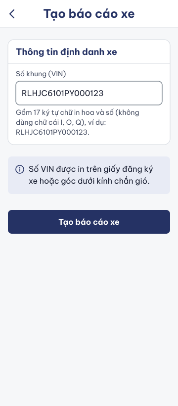
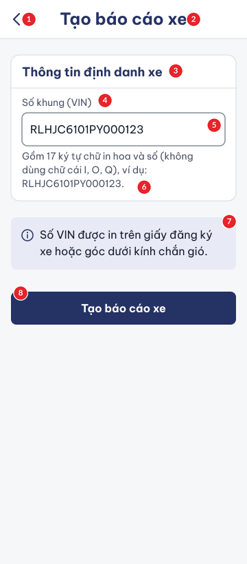
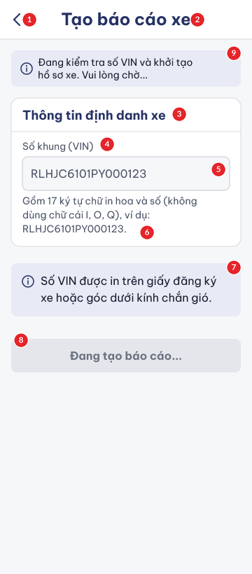
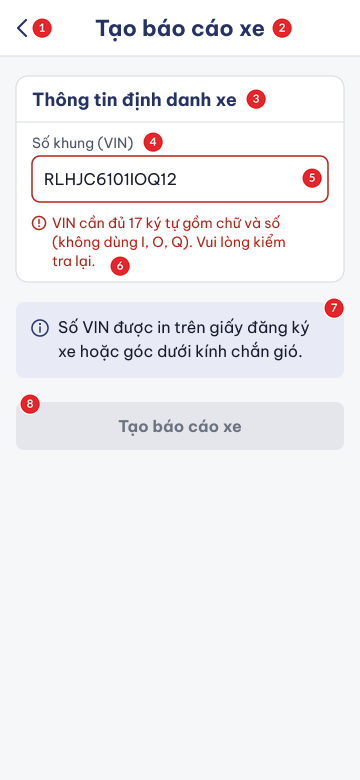
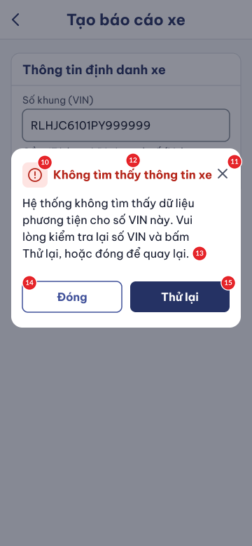
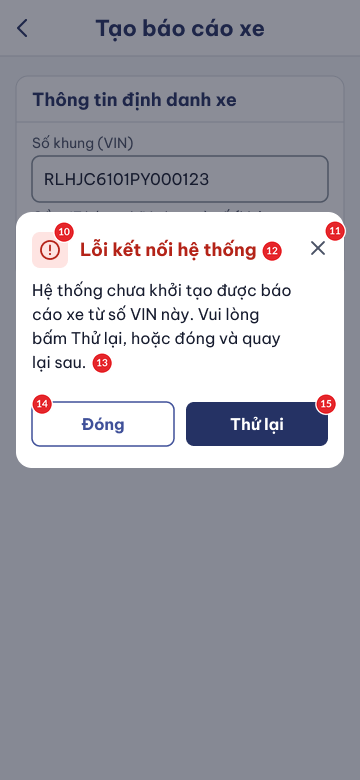
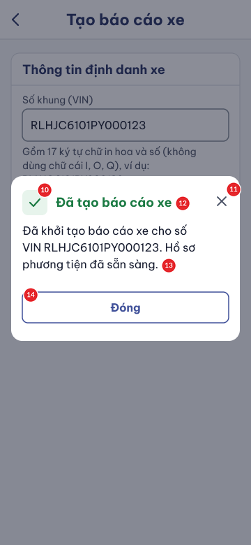

# Screen Spec: S-F01-01 Create Vehicle Report 

| Field | Value |
|---|---|
| Screen ID | `S-F01-01` |
| Screen name | Create Vehicle Report (Vietnamese UI title in Top bar: `"Tạo báo cáo xe"`) |
| Actor | Car Owner |
| Priority | Must |
| Feature | `F-01 Vehicle Identification & Status` |
| Activity diagrams | `AD-UC-1.01` |
| Linked requirements | `FR-01-01` (Must), see section 7 |
| Mockup images | `img/S-F01-01-default.png`, `img/img-numbered/S-F01-01-default-numbered.png`, and state images (section 2) |
| Frame width | `360px` |
| Figma frame | [Vehicle Identification & Status \- S-F01-03 ](https://www.figma.com/design/ahzD4prkBFDCttQimszLWw/Vehicle-Identification---Status?node-id=0-1&p=f&t=jIrF9erJRZuQXgpQ-0), Page 2 |
| Status | Reviewed |

## 1. Purpose

**Shown when:** A signed-in Car Owner taps `"Tạo báo cáo xe"` on the Home screen (`S-F00-01`) to register a vehicle and initialize a new `Verified vehicle report` using its 17-character VIN.

**The user leaves this screen when:** The Car Owner dismisses the `"Đã tạo báo cáo xe"` confirmation popup (via `"Đóng"` or `×`) after successful VIN verification to proceed to the Vehicle Profile screen (`S-F01-02`), or taps the top-bar back arrow (`<`) to return to `S-F00-01`.

## 2. Mockup

**Numbered:** Each number corresponds to the `#` column of the element inventory in Section 3 (`1–8` for the base form and primary CTA, `9` for the top loading banner, and `10–15` for result/error popups).

- Verification progress banner (`9`) appears only in the `Loading` state.
- Popup elements `10–15` appear only in the `Error (VIN Not Found)`, `Error (API)`, and `Success` states (`Retry modal button` `15` appears only in the two error popups). When a popup is open, the dimmed background behind it is blocked and has no numbers.
- The Top bar, the white/grey page background, the card/modal containers, and the dimmed layer behind a popup are layout containers and have no number.

| Default, numbered | Loading, numbered | Error validate FE, numbered |
| :---: | :---: | :---: |
|  |  |  |

| Error validate BE, numbered | Error API, numbered | Success, numbered |
| :---: | :---: | :---: |
|  |  |  |

| State | Image | Numbered image |
| :--- | :--- | :--- |
| Default | `img/S-F01-01-default.png` | `img/img-numbered/S-F01-01-default-numbered.png` |
| Empty (no data) | Described in Section 4 (textbox placeholder shown, primary CTA disabled) | — |
| Loading | `img/S-F01-01-loading.png` | `img/img-numbered/S-F01-01-loading-numbered.png` |
| Error validate BE | `img/S-F01-01-error-validate-BE.png` | `img/img-numbered/S-F01-01-error-validate-BE-numbered.png` |
| Error validate FE | `img/S-F01-01-error-validate-FE.png` | `img/img-numbered/S-F01-01-error-validate-FE-numbered.png` |
| Error API | `img/S-F01-01-error-API.png` | `img/img-numbered/S-F01-01-error-API-numbered.png` |
| Success | `img/S-F01-01-success.png` | `img/img-numbered/S-F01-01-success-numbered.png` |

All colours, fonts, spacing, and corner radii come from the design tokens in `ui-conventions-car-owner.md`.

## 3. Element inventory

The only input element is the `VIN text input field` (`5`). Elements that sit at the same position and share the same number (`6`, `8`, `10`, `12`, `13`, `14`) change their content or style depending on the state; the column `"Content / data source"` specifies which content applies in each state.

| # | Element | Category | Type | Content / data source | Required | Validation |
|---|---|---|---|---|---|---|
| 1 | Back navigation button | Selection | Top bar, back arrow (button) | Static left chevron icon (`44 × 44px` tap target) | Yes | none |
| 2 | Screen title header | Display | Read-only text (Top bar title) | Static: `"Tạo báo cáo xe"` | Yes | none |
| 3 | Section card title | Display | Read-only text (Section card header) | Static: `"Thông tin định danh xe"` | Yes | none |
| 4 | VIN input field label | Display | Read-only text (Field label) | Static: `"Số khung (VIN)"` | Yes | none |
| 5 | VIN text input field | Input | Textbox | 17-character alphanumeric string (`vehicle.vin`, e.g., `"RLHJC6101PY000123"`) written to `Verified vehicle report` and verified against `VETC vehicle data` (`FR-01-01-FE`, `FR-01-01-BE`). Red border (`#B42318`) in `Error (Format)` state; read-only in `Loading` state. | Yes | `BR-VFVR-01`: Required; exact length = 17 characters; uppercase alphanumeric (`A–Z`, `0–9`) excluding letters `I`, `O`, and `Q`; backend checksum and existence check (`FR-01-01-BE`) |
| 6 | VIN helper / inline error text | Display / Feedback | Read-only text / Inline validation error | **Default / Loading:** Static hint `"Gồm 17 ký tự chữ in hoa và số (không dùng chữ cái I, O, Q), ví dụ: RLHJC6101PY000123."` **Error (Format):** Warning icon + red text (`#B42318`) `"VIN cần đủ 17 ký tự gồm chữ và số (không dùng I, O, Q). Vui lòng kiểm tra lại."` | Yes | none |
| 7 | VIN location guidance banner | Display | Banner (info, icon + read-only text, no button) | Info icon + static text: `"Số VIN được in trên giấy đăng ký xe hoặc góc dưới kính chắn gió."` | Yes | none |
| 8 | Submit VIN primary button | Selection | Primary button | **Default / Empty / Error (Format):** Static `"Tạo báo cáo xe"` **Loading:** Disabled button with static `"Đang tạo báo cáo..."` | Yes | Disabled (`#E4E6EB` fill, `#6B7280` text) when `#5` is empty (`0` chars), after format error until edited, or during `Loading` |
| 9 | Verification progress banner | Feedback | Banner (info, icon + read-only text, no button) | Info icon + static text: `"Đang kiểm tra số VIN và khởi tạo hồ sơ xe. Vui lòng chờ..."` (`Loading` state only, placed above the section card) | No | none |
| 10 | Popup status icon | Dialogue | Icon in the Modal (popup) | **Error (VIN Not Found) / Error (API):** Red warning icon (`!`) in `#FEE4E2` rounded box. **Success:** Green check icon (`✓`) in `#E7F4EC` rounded box. | No | none |
| 11 | Close popup icon button | Selection | Icon button (`×`) in the Modal | Static close icon (`44 × 44px` tap target). Shown in every popup state (`10–15`). | No | none |
| 12 | Popup title | Dialogue | Read-only text in the Modal | **Error (VIN Not Found):** `"Không tìm thấy thông tin xe"` (`#B42318`) **Error (API):** `"Lỗi kết nối hệ thống"` (`#B42318`) **Success:** `"Đã tạo báo cáo xe"` (`#1B7A43`) | No | none |
| 13 | Popup body message | Dialogue | Read-only text in the Modal | **Error (VIN Not Found):** `"Hệ thống không tìm thấy dữ liệu phương tiện cho số VIN này. Vui lòng kiểm tra lại số VIN và bấm Thử lại, hoặc đóng để quay lại."` **Error (API):** `"Hệ thống chưa khởi tạo được báo cáo xe từ số VIN này. Vui lòng bấm Thử lại, hoặc đóng và quay lại sau."` **Success:** `"Đã khởi tạo báo cáo xe cho số VIN <vehicle.vin>. Hồ sơ phương tiện đã sẵn sàng."` (e.g., `"RLHJC6101PY000123"`) | No | none |
| 14 | Close popup button | Selection | Secondary (outlined) button in the Modal | Static: `"Đóng"`. Left button on the left of `Retry modal button` (`15`) in error popups; full-width button in `Success` popup. | No | none |
| 15 | Retry modal button | Selection | Primary button in the Modal | Static: `"Thử lại"`. Right button in `Error (VIN Not Found)` and `Error (API)` popups only. | No | none |

## 4. States

| State | What the user sees | Trigger |
|---|---|---|
| Default | Top bar (`1`, `2`), section card `"Thông tin định danh xe"` (`3`) with label (`4`) and a 17-character VIN entered in `5`, helper text with example (`6`), info banner (`7`), and enabled primary button `"Tạo báo cáo xe"` (`8`, `#253264`). | Car Owner has entered a non-empty VIN string ready for submission. |
| Empty (no data) | Same layout as `Default`, except `5` is empty (showing placeholder `"Nhập số khung 17 ký tự"`) and button `8` is disabled (`#E4E6EB` fill, `#6B7280` text). | Car Owner opens `S-F01-01` from `S-F00-01` or deletes all characters in `5`. |
| Loading | Top info banner `"Đang kiểm tra số VIN và khởi tạo hồ sơ xe. Vui lòng chờ..."` (`9`) appears above the section card; input `5` is read-only; primary button `8` is disabled and changes label to `"Đang tạo báo cáo..."`. | Car Owner taps `"Tạo báo cáo xe"`, passes client-side format check (`d1 [Yes]`), and awaits `FR-01-01-BE` verification. |
| Error | **1. Format validation error (`d1 [No]` / BE format reject):** Input `5` border turns `#B42318`, inline error `6` displays `"VIN cần đủ 17 ký tự gồm chữ và số (không dùng I, O, Q). Vui lòng kiểm tra lại."`, and button `8` is disabled until edited. **2. VIN not found (`d2 [No]`):** Popup (`10–15`) over 50% `#161B2E` dimmed layer shows warning icon (`10`), `"Không tìm thấy thông tin xe"` (`12`), guidance message (`13`), `"Đóng"` (`14`), `"Thử lại"` (`15`), and `×` (`11`). **3. System / API error:** Popup (`10–15`) over dimmed layer shows warning icon (`10`), `"Lỗi kết nối hệ thống"` (`12`), retry message (`13`), `"Đóng"` (`14`), `"Thử lại"` (`15`), and `×` (`11`). | 1. Submitted VIN fails `BR-VFVR-01` (length ≠ 17 or contains `I`, `O`, `Q`). 2. Backend (`FR-01-01-BE`) finds no matching vehicle record for the VIN. 3. Backend API or database connection fails/times out. |
| Success / confirmation | Confirmation popup (`10–14`) over 50% `#161B2E` dimmed layer displays green check icon (`10`), title `"Đã tạo báo cáo xe"` (`12`), message `"Đã khởi tạo báo cáo xe cho số VIN <vehicle.vin>. Hồ sơ phương tiện đã sẵn sàng."` (`13`), full-width button `"Đóng"` (`14`), and `×` (`11`). | Backend (`FR-01-01-BE`) confirms VIN existence (`d2 [Yes]`) and initializes the `Verified vehicle report`. |

## 5. Interactions and navigation

| # | Element | User action | System response | Goes to screen |
|---|---|---|---|---|
| 1 | Back navigation button (`1`) | tap | Discards unsaved VIN input and returns to the Home screen. | `S-F00-01` |
| 2 | VIN text input field (`5`) | type | Auto-converts lowercase characters to uppercase, trims spaces, clears any inline validation error (`6`), and enables `"Tạo báo cáo xe"` (`8`) once length ≥ 1. | `stays` |
| 3 | Submit VIN primary button (`8`) | tap | Runs client-side format check (`d1`). If `[No]`, blocks API call and displays inline error (`6`). If `[Yes]`, enters `Loading` state (`9`) and calls `FR-01-01-BE` (`d2`). Opens `Error (VIN Not Found)` popup, `Error (API)` popup, or `Success` popup depending on API outcome. | `stays` |
| 4 | Retry modal button (`15` in Error popups) | tap | Closes the error popup, enters `Loading` state (`9`), and re-sends the VIN verification request to `FR-01-01-BE`. | `stays` |
| 5 | Close popup button (`14` / `11` in Error popups) | tap | Dismisses the error popup and returns focus to the VIN form so the Car Owner can edit the VIN. | `stays` |
| 6 | Close popup button (`14` / `11` in Success popup) | tap | Dismisses the confirmation popup and navigates to the newly initialized Vehicle Profile screen. | `S-F01-02` |

## 6. Screen-level rules

| Rule ID | Rule | Source |
|---|---|---|
| SR-001 | **VIN Format Validation (`BR-VFVR-01`):** A valid VIN must be exactly 17 uppercase alphanumeric characters (`A–Z`, `0–9`) and strictly exclude `I`, `O`, and `Q`. | `AD-UC-1.01` (`BR-VFVR-01`) |
| SR-002 | **Client-Side Gatekeeping:** Client-side validation (`FR-01-01-FE`) runs immediately on tapping `"Tạo báo cáo xe"` (`d1`) and blocks `FR-01-01-BE` calls when `BR-VFVR-01` is violated. | `AD-UC-1.01` (`d1`) |
| SR-003 | **Single Vehicle Onboarding Entry Point:** A vehicle record enters the system exclusively through successful VIN verification on `S-F01-01`. | `screen-list.md` (`S-F01-01`) |
| SR-004 | **Modal Blocking & Dual-Action Order:** While any popup (`Error - VIN Not Found`, `Error - API`, `Success`) is open, background form controls cannot be interacted with. Dual-button error popups place `"Đóng"` (secondary outlined) on the left and `"Thử lại"` (primary filled) on the right. | `ui-conventions-car-owner.md` (§3, §4) |
| SR-005 | **Disabled CTA Styling:** Whenever `"Tạo báo cáo xe"` is disabled (`Empty`, unresolved `Error - Format`, or `Loading`), it renders with `#E4E6EB` background and `#6B7280` text without border. | `ui-conventions-car-owner.md` (§6.1D) |

## 7. Linked requirements

| FR ID (L2) | What this screen does for it | L3 work items |
|---|---|---|
| `FR-01-01` Create vehicle report (Enter VIN) | Captures the 17-character VIN, enforces client-side format rules, triggers backend vehicle lookup/initialization, and displays error or confirmation feedback before opening `S-F01-02`. | `FR-01-01-FE` (form, validation, state feedback), `FR-01-01-BE` (VIN checksum/existence check & report initialization) |

## 8. Responsive and accessibility notes

- Smallest supported width: `360px`, single-column vertical layout with `16px` horizontal outer padding and zero horizontal scroll.
- On narrow screens (`360px`), helper text (`6`), inline error messages, and banner descriptions (`7`, `9`) wrap cleanly inside card/banner containers without clipping or overlapping adjacent elements.
- Information is never carried by colour alone: inline errors combine `#B42318` border/text with a warning icon (`!`) and explicit instructional copy; info banners and popups pair semantic icons (`i`, `!`, `✓`) with descriptive Vietnamese titles and body text.
- Text contrast meets WCAG AA (`≥ 4.5:1`); body/helper text is `≥ 13–14px`; interactive tap targets (`1` back arrow, `8` primary CTA, `11` popup `×`, `14` `"Đóng"`, `15` `"Thử lại"`) are `≥ 44 × 44px`.

## 9. Open questions

| # | Question | Blocking? | Status |
|---|---|---|---|
| 1 | [NEEDS CLARIFICATION: `screen-list.md` lists `UC-2.10` alongside `UC-1.01` for `S-F01-01`, whereas `AD-UC-1.01` and the `Function List` only specify `UC-1.01` (`FR-01-01`). Confirm whether `UC-2.10` requires any extra fields or permissions on `S-F01-01`.] | No | Open. Default: No extra UI fields required |
| 2 | [NEEDS CLARIFICATION: Confirm the authoritative external source queried by `FR-01-01-BE` (`VETC vehicle data` vs. national registry) when checking VIN existence, and define the popup message if the Car Owner submits a VIN that already has an active `Verified vehicle report`.] | Yes | Open. Default: Redirect to `S-F01-02` or show duplicate-VIN popup |
| 3 | [NEEDS CLARIFICATION: In `S-F01-01-error-validate-BE-numbered.png`, the file name says `validate-BE` while the inline error checks the 17-character / `I, O, Q` rule (`d1` client-side check). Confirm that client-side validation triggers this exact inline error before calling the backend, and that backend checksum failure reuses the same inline error style.] | No | Open. Default: Yes, reuse inline error style |

---

## Completion checklist

- [x] The mockup is a separate cropped image file, named with the Screen ID (`img/S-F01-01-default.png`).
- [x] Every visible element in the mockup appears in the element inventory (`1` through `15`).
- [x] Every input element has a validation rule or an explicit `"none"`.
- [x] All five states are filled in with concrete UI behavior and triggers.
- [x] Every navigation target is a Screen ID that exists in the Screen List (`S-F00-01`, `S-F01-02`).
- [x] Every element that displays data names the field it displays (`vehicle.vin`).
- [x] Every linked FR exists in the Function List (`FR-01-01`), and every action in `AD-UC-1.01` is covered by an interaction row.
