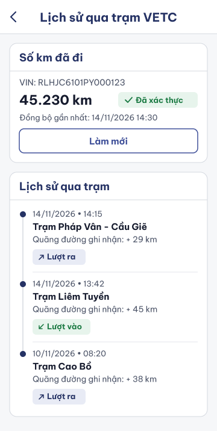
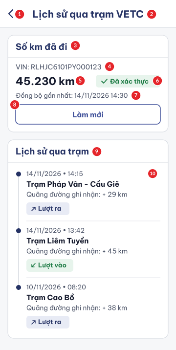
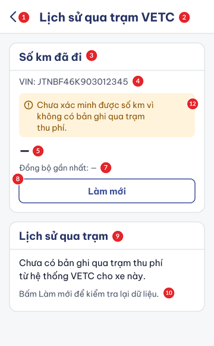
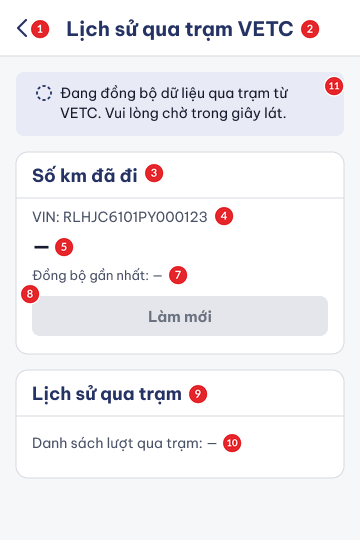
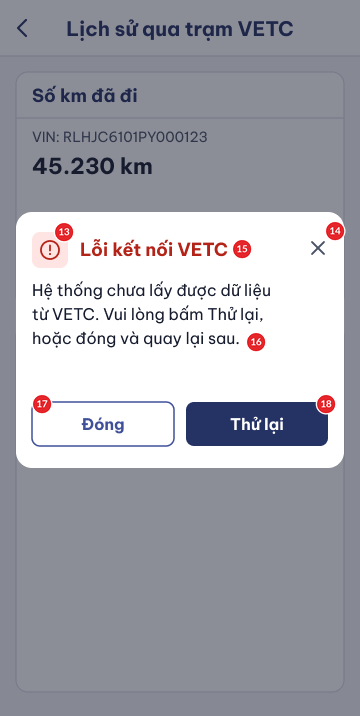
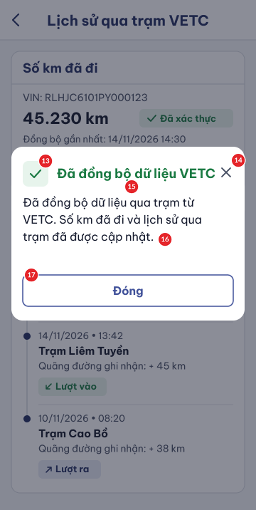

# Screen Spec: S-F01-03 Verified Minimum Mileage

| Field | Value |
|---|---|
| Screen ID | `S-F01-03` |
| Screen name | Verified Minimum Mileage (Vietnamese UI title in Top bar: `"Lịch sử qua trạm VETC"`) |
| Actor | Car Owner |
| Priority | Must |
| Feature | `F-01 Vehicle Identification & Status` |
| Activity diagrams | `AD-UC-1.03` |
| Linked requirements | `FR-01-03` (see section 7) |
| Mockup images | `img/S-F01-03-default.png`, `img/img-numbered/S-F01-03-default-numbered.png`, and state images (section 2) |
| Frame width | `360px` |
| Figma frame | [Vehicle Identification & Status \- S-F01-03 ](https://www.figma.com/design/ahzD4prkBFDCttQimszLWw/Vehicle-Identification---Status?node-id=0-1&p=f&t=jIrF9erJRZuQXgpQ-0) |
| Status | Reviewed |

## 1. Purpose

**Shown when:** A signed-in Car Owner taps `"Xem chi tiết"` in the `"Số km đã đi"` section of the Vehicle Profile screen (`S-F01-02`) to inspect VETC toll station passage records and verified minimum odometer calculation.

**The user leaves this screen when:** The Car Owner taps the top-bar back button (`<`) to return to the Vehicle Profile screen (`S-F01-02`).

## 2. Mockup

**Numbered:** Each number corresponds to the `#` column of the element inventory in Section 3 (`1–10` for the base summary card, toll timeline card, and refresh CTA; `11–12` for state-specific banners; and `13–18` for result/error popups).

- VETC sync loading banner (`11`) appears only in the `Loading` state.
- Empty mileage warning banner (`12`) appears only in the `Empty` state.
- Popup elements `13–18` appear only in the `Error` and `Success` states (`Retry popup button` `18` appears only in the `Error` popup). When a popup is open, the dimmed background behind it is blocked and has no numbers.
- The Top bar, the grey page background, card containers, and the dimmed layer behind a popup are layout containers and have no number.

| Default, numbered | Empty, numbered | Loading, numbered |
| :---: | :---: | :---: |
|  |  |  |

| Error API, numbered | Success, numbered |
| :---: | :---: |
|  |  |

| State | Image | Numbered image |
| :--- | :--- | :--- |
| Default | `img/S-F01-03-default.png` | `img/img-numbered/S-F01-03-default-numbered.png` |
| Empty (no data) | `img/S-F01-03-empty.png` | `img/img-numbered/S-F01-03-empty-numbered.png` |
| Loading | `img/S-F01-03-loading.png` | `img/img-numbered/S-F01-03-loading-numbered.png` |
| Error API | `img/S-F01-03-error-API.png` | `img/img-numbered/S-F01-03-error-API-numbered.png` |
| Success | `img/S-F01-03-success.png` | `img/img-numbered/S-F01-03-success-numbered.png` |

All colours, fonts, spacing, and corner radii come from the design tokens in `ui-conventions-car-owner.md`.

## 3. Element inventory

There are no text input fields on this screen (`S-F01-03` is a read-only inspection screen with a manual `"Làm mới"` re-sync trigger). Elements that share the same number across states (`4`, `5`, `7`, `10`, `13`, `15`, `16`, `17`) adapt their text or placeholder depending on the state.

| # | Element | Category | Type | Content / data source | Required | Validation |
|---|---|---|---|---|---|---|
| 1 | Back navigation button | Selection | Top bar, back arrow (button) | Left chevron icon (`44 × 44px` tap target) in top bar | Yes | none |
| 2 | Screen title header | Display | Read-only text (Top bar title) | Static text: `"Lịch sử qua trạm VETC"` | Yes | none |
| 3 | Mileage card header | Display | Read-only text (Section card header) | Static text: `"Số km đã đi"` | Yes | none |
| 4 | Vehicle VIN identifier | Display | Read-only text | Prefix `"VIN: "` + 17-character VIN (`"VIN: RLHJC6101PY000123"`, or `"VIN: JTNBF46K903012345"` in `Empty` sample) from `Verified vehicle report` / `VETC vehicle data` (`FR-01-03-INT`) | Yes | none |
| 5 | Minimum mileage reading | Display | Read-only text | Formatted accumulated distance (`"45.230 km"` in `Default`, or `"—"` in `Empty` / `Loading`) computed via `BR-DIST-01` from `VETC vehicle data` and stored in `Verified vehicle report` (`FR-01-03-INT`, `FR-01-03-FE`) | Yes | Computed via `BR-DIST-01`: chronological sort $S_1 \to S_2 \to \dots \to S_n$; $D_{\text{total}} = \sum_{i=1}^{n-1} d(S_i, S_{i+1})$; duplicate consecutive station scans ($S_i = S_{i+1}$) add `0` |
| 6 | Mileage verification status badge | Display | Badge (icon + text) | Checkmark icon + status label `"Đã xác thực"` (`#E7F4EC` fill, `#1B7A43` text) from `Verified vehicle report` / `VETC vehicle data` (`FR-01-03-FE`). Shown in `Default` state only (replaced by warning banner `12` in `Empty`). | No | none |
| 7 | Last sync timestamp | Display | Read-only text | Prefix `"Đồng bộ gần nhất: "` + timestamp (`"14/11/2026 14:30"` in `Default`, or `"—"` in `Empty` / `Loading`) from `VETC vehicle data` (`FR-01-03-INT`) | Yes | Formatted as `dd/MM/yyyy HH:mm` |
| 8 | Refresh VETC data secondary button | Selection | Secondary (outlined) button | Static text: `"Làm mới"` (`FR-01-03-FE`, `FR-01-03-INT`) | Yes | Disabled (`#E4E6EB` fill, `#6B7280` text) during `Loading` state to prevent duplicate VETC requests |
| 9 | Toll station history card header | Display | Read-only text (Section card header) | Static text: `"Lịch sử qua trạm"` | Yes | none |
| 10 | Toll passage timeline list / state placeholder | Display | Timeline list / Read-only text | **Default:** Reverse-chronological toll station entries (`"14/11/2026 • 14:15 Trạm Pháp Vân - Cầu Giẽ • Quãng đường ghi nhận: + 29 km"` with `"↗ Lượt ra"`, `"14/11/2026 • 13:42 Trạm Liêm Tuyền • Quãng đường ghi nhận: + 45 km"` with `"↙ Lượt vào"`, `"10/11/2026 • 08:20 Trạm Cao Bồ • Quãng đường ghi nhận: + 38 km"` with `"↗ Lượt ra"`) from `VETC vehicle data` (`FR-01-03-INT`, `FR-01-03-FE`). **Empty:** Static guidance `"Chưa có bản ghi qua trạm thu phí từ hệ thống VETC cho xe này. Bấm Làm mới để kiểm tra lại dữ liệu."` **Loading:** Collapsed placeholder `"Danh sách lượt qua trạm: —"` | Yes | Ordered newest-first with `dd/MM/yyyy • HH:mm` timestamp at the start of each row; turnarounds count both segments (`BR-DIST-01`) |
| 11 | VETC sync loading top banner | Feedback | Banner (info, spinner icon + text, no button) | Spinner icon + static text: `"Đang đồng bộ dữ liệu qua trạm từ VETC. Vui lòng chờ trong giây lát."` (`Loading` state only, placed above the `"Số km đã đi"` card) | No | none |
| 12 | Empty mileage warning banner | Feedback | Banner (warning, icon + text, no button) | Warning icon + static text: `"Chưa xác minh được số km vì không có bản ghi qua trạm thu phí."` (`Empty` state only, placed inside `"Số km đã đi"` card) | No | none |
| 13 | Popup status icon | Dialogue | Icon in the Modal (popup) | **Error:** Red warning icon (`!`) in `#FEE4E2` rounded box. **Success:** Green check icon (`✓`) in `#E7F4EC` rounded box. | No | none |
| 14 | Close popup icon button | Selection | Icon button (`×`) in the Modal | Static close icon (`44 × 44px` tap target). Shown in every popup state (`13–18`). | No | none |
| 15 | Popup title | Dialogue | Read-only text in the Modal | **Error:** `"Lỗi kết nối VETC"` (`#B42318`) **Success:** `"Đã đồng bộ dữ liệu VETC"` (`#1B7A43`) | No | none |
| 16 | Popup body message | Dialogue | Read-only text in the Modal | **Error:** `"Hệ thống chưa lấy được dữ liệu từ VETC. Vui lòng bấm Thử lại, hoặc đóng và quay lại sau."` **Success:** `"Đã đồng bộ dữ liệu qua trạm từ VETC. Số km đã đi và lịch sử qua trạm đã được cập nhật."` | No | none |
| 17 | Close popup button | Selection | Secondary (outlined) button in the Modal | Static: `"Đóng"`. Left button on the left of `Retry popup button` (`18`) in `Error` popup; full-width button in `Success` popup. | No | none |
| 18 | Retry popup button | Selection | Primary button in the Modal | Static: `"Thử lại"`. Right button in `Error` popup only. | No | none |

## 4. States

| State | What the user sees | Trigger |
|---|---|---|
| Default | Top bar (`1`, `2`), `"Số km đã đi"` card (`3`) displaying `VIN` (`4`), verified mileage `"45.230 km"` (`5`), green checkmark badge `"✓ Đã xác thực"` (`6`), sync timestamp `"Đồng bộ gần nhất: 14/11/2026 14:30"` (`7`), enabled `"Làm mới"` button (`8`), and `"Lịch sử qua trạm"` card (`9`) displaying the reverse-chronological toll timeline with direction badges `"↗ Lượt ra"` / `"↙ Lượt vào"` (`10`). | `S-F01-03` opens from `S-F01-02` (or completes a refresh) and VETC returns valid toll station passage logs (`AD-UC-1.03` `d1 [success]`). |
| Empty (no data) | `"Số km đã đi"` card (`3`) displays `VIN` (`4`), yellow warning banner (`12`, `#FFF3DC`) stating *"Chưa xác minh được số km vì không có bản ghi qua trạm thu phí."*, `"—"` for mileage (`5`), `"Đồng bộ gần nhất: —"` (`7`), and enabled `"Làm mới"` button (`8`); `"Lịch sử qua trạm"` card (`9`) displays empty-state guidance (`10`: *"Chưa có bản ghi qua trạm thu phí từ hệ thống VETC cho xe này. Bấm Làm mới để kiểm tra lại dữ liệu."*). | VETC API responds successfully (`d1 [success]`), but returns zero toll station passage records for the vehicle's `VIN`/license plate. |
| Loading | Top information banner (`11`, `#E8EBF5`) stating *"Đang đồng bộ dữ liệu qua trạm từ VETC. Vui lòng chờ trong giây lát."*, `"—"` placeholders for mileage (`5`), sync timestamp (`7`), and timeline list (`10`: `"Danh sách lượt qua trạm: —"`), and disabled `"Làm mới"` button (`8`, `#E4E6EB` fill, `#6B7280` text, no border). | Car Owner opens `S-F01-03` from `S-F01-02` (`a1`) or taps `"Làm mới"` (`8`) while the backend queries VETC (`FR-01-03-INT`) and runs automatic retries (`BR-RET-01`). |
| Error | Backend system error popup (`13–18`, `#FFFFFF` modal over `#161B2E` 50% dimmed layer) displaying red warning icon (`13`), title `"Lỗi kết nối VETC"` (`15`), message *"Hệ thống chưa lấy được dữ liệu từ VETC. Vui lòng bấm Thử lại, hoặc đóng và quay lại sau."* (`16`), secondary button `"Đóng"` (`17`), primary button `"Thử lại"` (`18`), and `×` close button (`14`) (`AD-UC-1.03` `error_view`). | VETC API connection times out (`5s` per attempt) or fails across the initial request plus 3 automatic retries (`4` attempts total, `BR-RET-01` / `AD-UC-1.03` `d1 [max retries exceeded]`). |
| Success / confirmation | Confirmation popup (`13–17`, `#FFFFFF` modal over `#161B2E` 50% dimmed layer) displaying green check icon (`13`), title `"Đã đồng bộ dữ liệu VETC"` (`15`), message *"Đã đồng bộ dữ liệu qua trạm từ VETC. Số km đã đi và lịch sử qua trạm đã được cập nhật."* (`16`), full-width button `"Đóng"` (`17`), and `×` close icon (`14`); dismissing the popup refreshes the `Default` view with updated records. | Car Owner manually taps `"Làm mới"` (`8`) on `S-F01-03` and VETC synchronization + distance recalculation succeeds. |

## 5. Interactions and navigation

| # | Element | User action | System response | Goes to screen |
|---|---|---|---|---|
| 1 | Back navigation button (`1`) | tap | Returns the Car Owner to the Vehicle Profile screen with the latest verified mileage status. | `S-F01-02` |
| 2 | Refresh VETC data secondary button (`"Làm mới"`, `8`) | tap | Enters `Loading` state (`11`, disabling `"Làm mới"`), queries VETC toll station logs (`FR-01-03-INT`) with up to 3 automatic retries (`BR-RET-01`), parses chronological timestamps, recalculates minimum distance (`BR-DIST-01`), and displays the `Success` popup (`13–17`) or `Error` popup (`13–18`) if all 4 attempts fail. | `stays` |
| 3 | Retry popup button (`"Thử lại"`, `18` in Error popup) | tap | Dismisses the error popup, enters `Loading` state (`11`), and re-initiates the VETC toll data retrieval workflow (`AD-UC-1.03` node `m4`). | `stays` |
| 4 | Close popup button (`"Đóng"` `17` / `×` `14`) | tap | Dismisses the active `Error` or `Success` popup and returns focus to `S-F01-03`. | `stays` |

## 6. Screen-level rules

| Rule ID | Rule | Source |
|---|---|---|
| SR-001 | **VETC Integration Retry Rule (`BR-RET-01`):** When querying the external VETC system (`FR-01-03-INT`), if a connection timeout (`5-second` limit per attempt) or API error occurs, the backend must automatically retry up to 3 times after the initial request (maximum 4 attempts total) before displaying the error popup (`AD-UC-1.03` `d1`). | `AD-UC-1.03` (`BR-RET-01`, `d1`) |
| SR-002 | **Minimum Travel Distance Accumulation (`BR-DIST-01`):** Station logs are sorted chronologically ($S_1 \to S_2 \to \dots \to S_n$) and accumulated via $D_{\text{total}} = \sum_{i=1}^{n-1} d(S_i, S_{i+1})$. Turnarounds ($A \to B \to A$) count both segments, while consecutive duplicate records at the same station ($S_i = S_{i+1}$) add `0`. | `AD-UC-1.03` (`BR-DIST-01`, `s4`) |
| SR-003 | **Empty Passage Record Handling:** When VETC returns zero passage records for the vehicle, the system must not display an error popup; instead, it displays `"—"` (`5`) for mileage, a `#FFF3DC` warning banner (`12`) explaining no toll records exist, and empty timeline guidance (`10`). | `screen-list.md` (`S-F01-03`), `ui-conventions-car-owner.md` (§4) |
| SR-004 | **Timeline Display Order & Date Format:** The UI timeline (`10`) displays toll passage entries in reverse-chronological order (newest entry at the top) with `dd/MM/yyyy • HH:mm` timestamps at the start of each row. | `ui-conventions-car-owner.md` (§2, §6.2) |

## 7. Linked requirements

| FR ID | What this screen does for it |
|---|---|
| `FR-01-03-FE` | Renders the `"Lịch sử qua trạm VETC"` screen, displays the verified minimum ODO value (`5`) and `"✓ Đã xác thực"` status badge (`6`), renders the toll station passage timeline (`10`), and handles loading/empty/error UI states (`AD-UC-1.03`). |
| `FR-01-03-INT` | Queries toll station passing logs from the external VETC system with retry handling (`BR-RET-01`) and computes the accumulated minimum travel distance (`BR-DIST-01`) for display (`AD-UC-1.03`). |

## 8. Responsive and accessibility notes

- Smallest supported width: `360px`
- What collapses or stacks on a narrow screen: Top bar (`1`, `2`), `"Số km đã đi"` summary card (`3–8`, `12`), and `"Lịch sử qua trạm"` timeline card (`9`, `10`) stack vertically in a single column (`16px` outer horizontal margins, `16px` vertical card gap) without horizontal scrolling; within the summary card, `"45.230 km"` (`5`) and the `"✓ Đã xác thực"` badge (`6`) sit on opposite ends of a single row.
- Information never carried by colour alone: Verification status (`"✓ Đã xác thực"` in `#1B7A43`/`#E7F4EC`), empty warning banner (`12` in `#8A5300`/`#FFF3DC`), loading banner (`11` in `#253264`/`#E8EBF5`), and toll gate direction tags (`"↗ Lượt ra"` in `#253264`/`#E8EBF5`, `"↙ Lượt vào"` in `#1B7A43`/`#E7F4EC`) always combine colour tokens with directional/status vector icons and explicit Vietnamese text.
- Text contrast and minimum size: All visible labels, timestamps, badges, and buttons use `Be Vietnam Pro` at `14px` minimum font size; `#161B2E` on `#FFFFFF` provides >15:1 contrast, `#4A5266` on `#FFFFFF` provides 7.7:1 contrast, and all interactive buttons (`Back` `1`, `"Làm mới"` `8`, popup `×` `14`, `"Đóng"` `17`, `"Thử lại"` `18`) meet the `44 × 44px` minimum tap target.

## 9. Open questions

| # | Question | Blocking? | Status |
|---|---|---|---|
| 1 | [NEEDS CLARIFICATION: `AD-UC-1.03` traces `s1`, `s3`, `s4`, and `s2` to `FR-01-03-BE`, whereas the `Function List` extract for `S-F01-03` lists only `FR-01-03-FE` and `FR-01-03-INT` (assigning both VETC API retrieval and minimum ODO computation to `FR-01-03-INT`). Should `FR-01-03-BE` be added to `screen-list.md` / `Function List`, or should `AD-UC-1.03` node traces be aligned to `FR-01-03-INT`?] | No | Open |
| 2 | [NEEDS CLARIFICATION: Is pagination (`"Tải thêm lịch sử"`) required when a vehicle has more than 3–10 VETC toll station passage entries, or does `FR-01-03-INT` load the full history list in a single vertical scroll?] | No | Open |

---

## Completion checklist

- [x] The mockup is a separate cropped image file, named with the Screen ID.
- [x] Every visible element in the mockup appears in the element inventory (`1` through `18`).
- [x] Every input element has a validation rule or an explicit "none".
- [x] All five states are filled in, with corresponding clean and numbered mockup images.
- [x] Every navigation target is a Screen ID that exists in the Screen List (`S-F01-02`).
- [x] Every element that displays data names the field it displays.
- [x] Every linked FR exists in the Function List, and every action of this screen in an activity diagram is covered by an interaction row.
