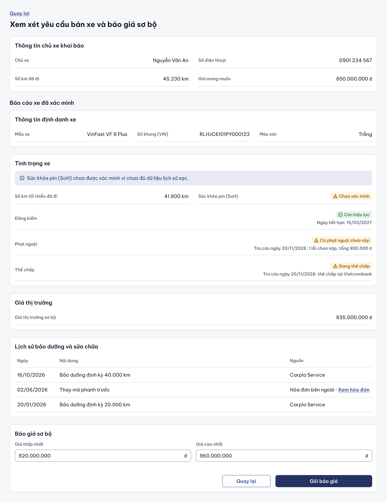
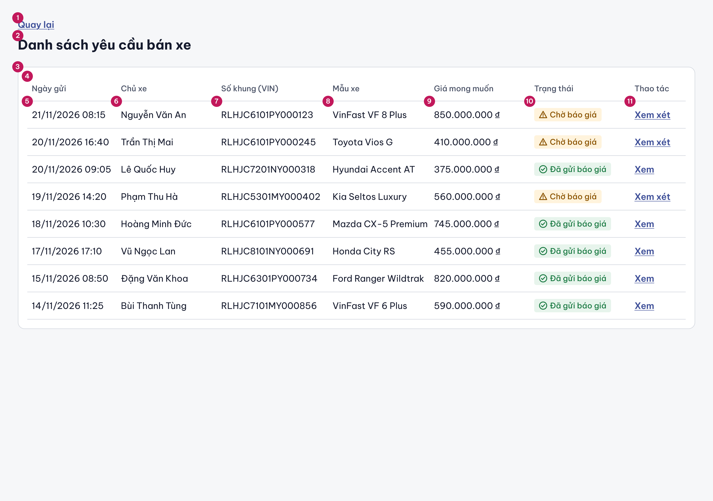
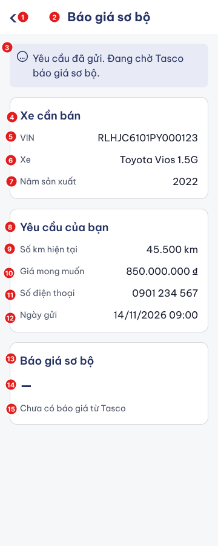
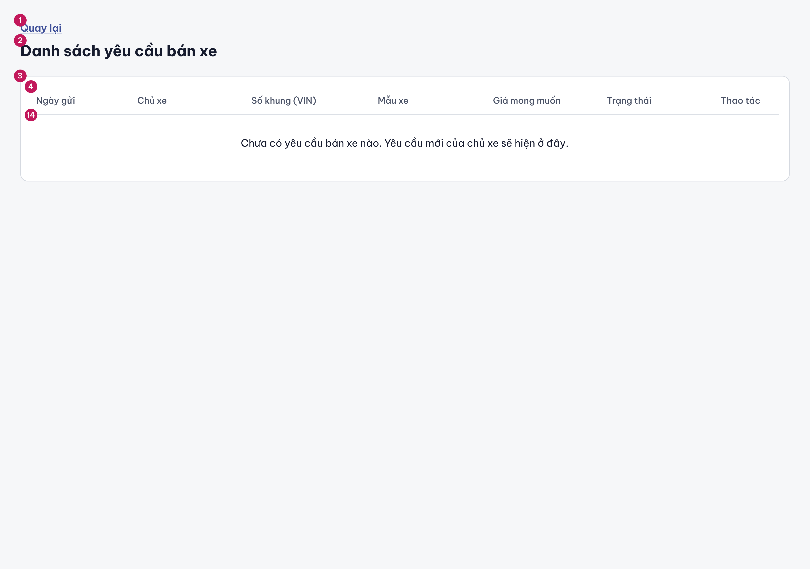
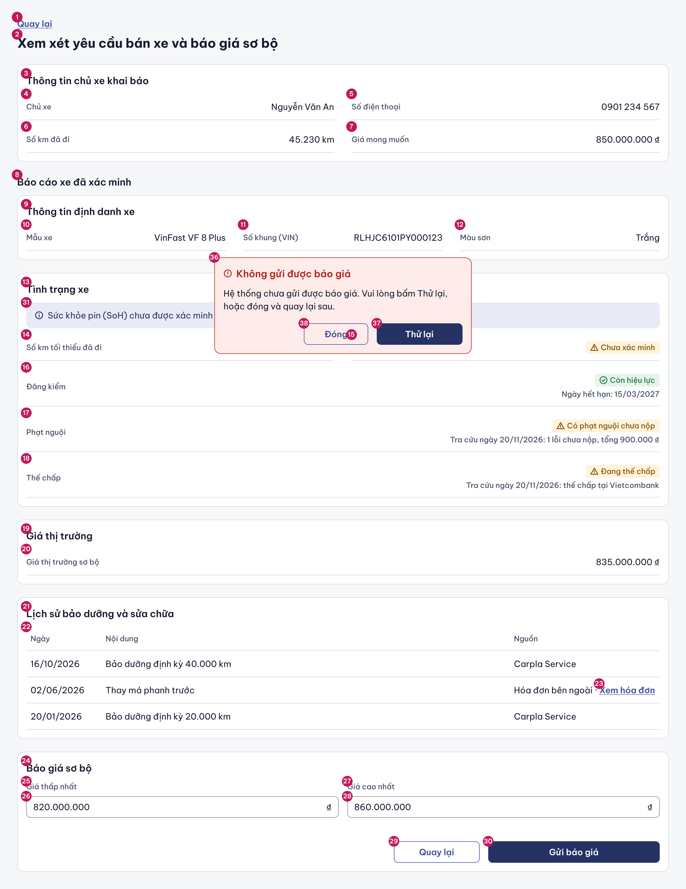

# **Screen Spec: S-F03-02 Sale Request List**

# **1\. Purpose**

| Field | Value |
| ----- | ----- |
| Screen ID | S-F03-03 |
| Screen name | Sale Request List (Vietnamese UI title in Page header: "Danh sách yêu cầu bán xe") |
| Actor | Carpla Staff |
| Priority | Must |
| Feature | F-03 Sale Request |
| Activity diagrams | AD-UC-3.07 (staff open a sale request) \[to check: not among the files provided; confirm the action "open the list" is covered\]. AD-UC-3.06 (package and forward to Carpla CRM) is the system step that makes a request appear in this list |
| Linked requirements | FR-03-04 Review verified report (Must), see section 7 |
| Mockup images | img/S-F03-02-default.png, img/img-numbered/S-F03-02-default-numbered.png, and four state images (section 2) |
| Frame width | 1280px |
| Figma frame | [Verified Vehicle Report \- S-F03-02](https://www.figma.com/design/7ofe8uJ9ikmhr58L7Pzpqw/Verified-Vehicle-Report---S-F03-02?node-id=30-3)|
| Status | Reviewed |

**Shown when:** Carpla staff open the sale request list in the Carpla CRM menu. The screen shows every sale request sent by car owners, newest on top, with its status, so that the staff can pick one to review and quote.

**The user leaves this screen when:** the staff click the link "Xem xét" or "Xem" of a row, which opens that request in S-F03-03, or click "Quay lại" (1), which returns to the previous page of Carpla CRM.

## **2\. Mockup**

| Default, numbered | Loading, numbered |
| ----- | ----- |
|  |  | 

| Empty, numbered | Error API, numbered |
 ----- | ----- |
|  |  |

| State | Image |
| ----- | ----- |
| Default | `img/S-F03-03-Default.png` |
| Loading | `img/S-F03-03-Loading.png` |
| Empty | `img/S-F03-03-Empty.png` |
| Error API | `img/S-F03-03-Error.png` |

Each number is the \# of the element inventory in section 3. In the default state the numbers 5 to 11 are placed on the first data row and stand for the whole column. Elements 12 and 13 appear only in the loading state, element 14 only in the empty state, elements 15 to 17 only in the error API state. All colours, fonts, spacing and corners come from the design tokens in [ui-conventions-carpla-staff.md](https://github.com/giangnhk63db/DBIZ-2_GROUP-A/blob/b91522a0ff39535015962b6ecd409a884e8f22a9/Docs/External%20Design/ui-conventions-carpla-staff.md).
.

## **3\. Element inventory**

The screen is read-only: it has no Input, Upload, Date time or Security element, and no success notification. The only controls are the Back link (1), the row link (11) and the two buttons of the error popup (16, 17).

| \# | Element | Category | Type | Content / data source | Required | Validation |
| ----- | ----- | ----- | ----- | ----- | ----- | ----- |
| 1 | Back | Selection | Page header link (underlined text) | static: "Quay lại" | Yes | none |
| 2 | Title | Display | Page header title (read-only text) | static: "Danh sách yêu cầu bán xe" | Yes | none |
| 3 | Sale request table | Display | Data table (container, white fill) | one row per sale request sent by car owners (FR-03-04-BE); newest on top; contains the header row (4) and the rows (5 to 11). In the loading state the rows are replaced by element 13, in the empty state by element 14, in the error API state the table shows only the header row (4) | Yes | none |
| 4 | Column headings | Display | Header row, 7 read-only labels | static: "Ngày gửi", "Chchủ xe" is NOT used; the labels are "Ngày gửi", "Chủ xe", "Số khung (VIN)", "Mẫu xe", "Giá mong muốn", "Trạng thái", "Thao tác". Shown in every state | Yes | none |
| 5 | Submitted date | Display | Read-only text (table cell) | sale\_request.created\_at; format dd/MM/yyyy HH:mm, for example "21/11/2026 08:15". The list is sorted by this value, newest on top | Yes | none |
| 6 | Car owner | Display | Read-only text (table cell) | sale\_request.owner\_name, from the car owner account (see section 9, question 2); example "Nguyễn Văn An". A long name wraps onto a second line and the row grows. Shows "–" if the name is missing | Yes | none |
| 7 | VIN | Display | Read-only text (table cell) | vehicle.vin (FR-01-01); 17 uppercase letters and digits, no I, O, Q, no spaces, for example "RLHJC6101PY000123" | Yes | none |
| 8 | Vehicle model | Display | Read-only text (table cell) | vehicle.make, vehicle.model, vehicle.variant, for example "VinFast VF 8 Plus". A long name wraps onto a second line. Shows "–" if the model is missing | Yes | none |
| 9 | Desired price | Display | Read-only text (table cell) | sale\_request.desired\_price; format 850.000.000 ₫ | Yes | none |
| 10 | Request status | Display | Status badge (icon + text) | sale\_request.status, derived from the quote (FR-03-05). The mockup displays one of two cases: "Chờ báo giá" with a warning icon (no quote sent yet); "Đã gửi báo giá" with a check icon (a quote has been stored and sent to the car owner) | Yes | none |
| 11 | Row action | Selection | Link (underlined text, table cell) | static, depends on element 10: "Xem xét" when the status is "Chờ báo giá"; "Xem" when the status is "Đã gửi báo giá". Opens the request in S-F03-03 | Yes | none |
| 12 | Loading line | Feedback | Read-only text under the title | static: "Đang tải danh sách yêu cầu bán xe."; visible only in the loading state | No | none |
| 13 | Loading placeholder | Feedback | Loading placeholder (grey bars, no text) | static; takes the place of the rows (6 bars in the mockup); visible only in the loading state and replaced by the data when it arrives | No | none |
| 14 | Empty message | Feedback | Read-only text in the Data table area | static: "Chưa có yêu cầu bán xe nào. Yêu cầu mới của chủ xe sẽ hiện ở đây."; visible only in the empty state, below the header row (4) | No | none |
| 15 | Notification message | Dialogue | Modal (popup), icon + title + read-only text | Error only: title "Không tải được danh sách", text "Hệ thống chưa tải được danh sách yêu cầu bán xe. Vui lòng bấm Thử lại, hoặc đóng và quay lại sau." with an error icon. This screen has no success popup | No | none |
| 16 | Close | Selection | Secondary button in the Modal | static: "Đóng"; it is the close button of the Modal | No | none |
| 17 | Retry | Selection | Primary button in the Modal | static: "Thử lại" | No | none |

**Note**: `vehicle.` and `sale_request.` are the fields sourced from tables in the data source. The field names are proposed and will be finalized with the data dictionary. Element 6 is read from the car owner account, not from `vehicle.` or `sale_request.`.

## **4\. States**

This screen has no input and no action that creates or saves data, so two states do not apply: Error validate FE (nothing to validate) and Success (nothing is sent). Four states are drawn.

| State | What the user sees | Trigger |
| ----- | ----- | ----- |
| Default | Title (2), table (3) with the header row (4) and at least one row (5 to 11). Rows are sorted by the submitted date, newest on top. Each row shows one status (10) and the matching link (11). No loading line, no popup | The staff open the list and the system returns at least one sale request (FR-03-04-BE) |
| Loading | Loading line (12) under the title; table (3) with the header row (4) and the loading placeholder (13) in place of the rows. No popup. The Back link (1) stays usable | The staff open the screen, return from S-F03-03, or tap "Thử lại" (17); the list is being read |
| Empty | Table (3) with the header row (4) and the empty message (14) in place of the rows. This is not an error: no popup | The system answers successfully and there is no sale request yet |
| Error API | Error popup (15, 16, 17) over the screen; behind it the table (3) shows only the header row (4). The controls behind the popup cannot be used | The system could not read the list after the maximum retries (see section 9, question 5) |

**Data cases inside the Default state** (no separate image; every case is covered by the elements above):

| Case | What the screen shows |
| ----- | ----- |
| Request waiting for a quote | Badge "Chờ báo giá" (10, warning icon) and link "Xem xét" (11) |
| Quote already sent | Badge "Đã gửi báo giá" (10, check icon) and link "Xem" (11) |
| Both kinds in the same list | Mixed in one list, always ordered by the submitted date (5), not grouped by status |
| One row only | The table shows one row; same layout, no empty message |
| Many rows | The table grows and the page scrolls vertically; no pagination, no horizontal scroll (section 9, question 6) |
| A text field is missing (owner name or model) | The cell shows "–" (6, 8); the row is still shown and still openable (section 9, question 9) |
| A long owner name or model | The text wraps inside its cell, the row grows; the other columns keep their width |
| Package incomplete (FR-03-04) | Not shown in the list; the missing parts are shown in S-F03-03 after the staff open the request |

## **5\. Interactions and navigation**

| \# | Element | User action | System response | Goes to screen |
| ----- | ----- | ----- | ----- | ----- |
| 1 | Screen | open (from the Carpla CRM menu, or return from S-F03-03) | Shows the loading state, reads the list, then shows Default, Empty or Error API. When the staff come back from S-F03-03, the list is read again so the statuses are up to date | stays |
| 2 | Back (1) | tap or press Enter | Leaves the list | previous page of Carpla CRM |
| 3 | Row action (11), status "Chờ báo giá" ("Xem xét") | tap or press Enter | Opens this request with the packaged verified report and the quote form | S-F03-03 |
| 4 | Row action (11), status "Đã gửi báo giá" ("Xem") | tap or press Enter | Opens this request to view the report and the quote already sent; read-only behaviour is to confirm (section 9, question 4) | S-F03-03 |
| 5 | Retry (17) | tap (error popup) | Closes the popup, shows the loading state and reads the list again | stays (loading, then Default, Empty or Error API) |
| 6 | Close (16) | tap (error popup) | Closes the popup. The screen keeps the header row only; the staff can leave with Back (1) or reopen the screen to try again | stays |

## **6\. Screen-level rules**

| Rule ID | Rule | Source |
| :---- | :---- | :---- |
| SR-001 | The screen is read-only. The staff cannot edit, delete, sort or filter a request here; they can only open it. | FR-03-04 |
| SR-002 | The list shows every sale request sent by car owners, one row per request. A request appears after it is forwarded to Carpla CRM (UC-3.06). | FR-03-03, FR-03-04 |
| SR-003 | Rows are sorted by the submitted date (5), newest on top. The order does not depend on the status. | FR-03-04, ui-conventions section 3 (Data table) |
| SR-004 | The status (10) has two values: "Chờ báo giá" until the quote is stored, "Đã gửi báo giá" after it. The link text (11) follows the status. | FR-03-05 |
| SR-005 | The status is an icon + text. Information is never carried by colour alone. | ui-conventions section 5 |
| SR-006 | Only the link (11) of a row is clickable. Clicking elsewhere in the row does nothing (section 9, question 7). | ui-conventions section 3 |
| SR-007 | A missing owner name or model shows "–" and does not hide the row. | section 9, question 9 |
| SR-008 | Loading is shown by the loading line (12) and the loading placeholder (13), not by a popup. Empty is shown in the Data table area, not by a popup. Neither is an error. | ui-conventions section 4 |
| SR-009 | A system error is a popup only after the maximum retries, with the buttons "Thử lại" and "Đóng". While the popup is open, the controls behind it cannot be used. | ui-conventions sections 3 and 4 |
| SR-010 | This screen has no FE validation message and no success popup, because it has no input and saves nothing. | section 4 |
| SR-011 | Formats: date dd/MM/yyyy HH:mm (for example 21/11/2026 08:15); price 850.000.000 ₫; VIN 17 characters without spaces. | ui-conventions section 2 |
| SR-012 | The screen scrolls vertically only. Smallest supported width is 1280px. | ui-conventions sections 5 and 6.5 |

## **7\. Linked requirements**

| FR ID (L2) | What this screen does for it | L3 work items (IDs as written in the Function List) |
| ----- | ----- | ----- |
| FR-03-04 Review verified report | The list is the entry point: it shows the sale requests so that the staff can open one to review its packaged report (S-F03-03). The list itself has no L3 item, see section 9, question 1 | FR-03-04-FE: display the screen that receives the sale request. FR-03-04-BE: API read of the package (the list read is to add or confirm) |
| FR-03-03 Package and forward report and market price to Carpla staff | Source of the requests shown in the list: a request appears here once it is packaged and forwarded | FR-03-03-BE (not part of this screen) |
| FR-03-05 Send preliminary quote to car owner | Source of the status (10): "Đã gửi báo giá" after the quote is stored | FR-03-05-FE, FR-03-05-BE (not part of this screen) |
| FR-01-01 (VIN) and the vehicle identification fields | Source of the values of elements 7 and 8 | FR-01-01-FE, FR-01-01-BE (not part of this screen) |

## **8\. Responsive and accessibility notes**

* Smallest supported width: 1280px, desktop web browser, vertical scroll only; no horizontal scroll. The column "Mẫu xe" takes the remaining width; the other columns have a fixed width.  
* Information is never carried by colour alone: the status badges have an icon and text; the popup has an icon and text; the links are underlined.  
* Text contrast at least 4.5:1 (WCAG 2.2, 1.4.3); body text 16px, labels and the table header 14px.  
* Clickable targets at least 24 x 24 CSS px: Back (1), the row link (11), "Đóng" (16), "Thử lại" (17).  
* Everything works with the keyboard alone: the Tab order follows the reading order (Back, then the row links from top to bottom). Enter opens the focused link. The focused element has a visible outline, never touching a navy fill.  
* The table uses real header cells linked to their columns for the screen reader. Each link has an accessible name that includes the owner and the VIN, for example "Xem xét yêu cầu của Nguyễn Văn An, RLHJC6101PY000123", because the visible text "Xem xét" is the same in every row.  
* The loading line (12) is announced as a status message. The popup (15) takes the focus when it opens, keeps it inside until it closes, and returns it to the screen afterwards. The error icon and the check and warning icons of the badges have a text alternative.

## **9\. Open questions**

| \# | Question | Blocking? | Status |
| ----- | ----- | ----- | ----- |
| 1 | \[NEEDS CLARIFICATION: FR-03-04 says "WHEN Carpla staff open a sale request ... display the packaged verified report", which describes the detail screen S-F03-03. No FR or L3 item describes reading the LIST of requests. The Screen List assigns this screen to FR-03-04-FE and FR-03-04-BE.\] | No | Open. Default: FR-03-04-FE covers the list display and FR-03-04-BE covers a list read; if the team wants a clean trace, add the L3 item "FR-03-04-BE: API read the list of sale requests with status". |
| 2 | \[NEEDS CLARIFICATION: where does the car owner name (element 6) come from? FR-03-04-BE lists mileage, phone number, desired price, verified report and market data, not the owner name.\] | No | Open. Default: the name is read from the car owner account in the Tasco Mobility system and added to the package. Confirm, or replace the column by the phone number (the team decided not to add a phone column). |
| 3 | \[NEEDS CLARIFICATION: the Figma page and frames of this list are named S-F03-03, and the review screen is named S-F03-02, while the Screen List now gives S-F03-02 to the list and S-F03-03 to the detail.\] | No | Open. Default: this spec follows the Screen List. Rename the Figma pages and frames (and the image files) to match before the spec is reviewed. |
| 4 | \[NEEDS CLARIFICATION: when the staff open a request with status "Đã gửi báo giá", does S-F03-03 show the quote read-only, or can the staff send a new quote?\] | No | Open. Default: S-F03-03 shows the quote already sent, read-only. S-F03-03 needs a matching state. |
| 5 | \[NEEDS CLARIFICATION: how many retries before the error popup, and how long between them, when reading the list? AD-UC-3.06 uses 3 retries and a 5-second wait for forwarding.\] | No | Open. Default: same as AD-UC-3.06 (3 retries, 5 seconds). |
| 6 | \[NEEDS CLARIFICATION: no search, filter or pagination is drawn, because ui-conventions defines no component for them and the screen scrolls vertically only. Is this enough for the expected number of requests?\] | No | Open. Default: not in this release. If needed, add the component to ui-conventions first. |
| 7 | \[NEEDS CLARIFICATION: is the whole row clickable, or only the link in the last column?\] | No | Open. Default: only the link (11). |
| 8 | \[NEEDS CLARIFICATION: are there other request statuses, for example a request whose forwarding failed (UC-3.06), withdrawn by the car owner, or expired?\] | No | Open. Default: only two statuses. A request whose forwarding failed never reaches the list. |
| 9 | \[NEEDS CLARIFICATION: ui-conventions defines no display for a missing plain value (owner name, model). Only "Chưa xác minh" exists for verification values.\] | No | Open. Default: "–". Add this rule to ui-conventions section 3 or 4. |
| 10 | \[NEEDS CLARIFICATION: the Status badge in ui-conventions is defined for verification and legal status only. Here it is used for the request status, with the warning style for "Chờ báo giá" and the success style for "Đã gửi báo giá".\] | No | Open. Default: keep; extend the Status badge row in ui-conventions. |
| 11 | \[NEEDS CLARIFICATION: when a new request arrives while the list is open, does the list refresh by itself? The notification service tells the staff about a new request.\] | No | Open. Default: the list is read when the screen opens; there is no automatic refresh. |

## **Completion checklist**

* \[ \] The mockup is a separate cropped image file, named with the Screen ID, at the frame width. (Export the four frames from Figma, node-ids 30-3, 30-175, 30-203, 30-225.)  
* \[ \] The numbered image exists, and its numbers match the \# column of the element inventory. (Node-ids 34-2, 34-196, 34-236, 34-268.)  
* \[ \] Every visible element in the mockup appears in the element inventory. (Check against Figma.)  
* \[ \] Every colour in the mockup is a design token from ui-conventions-carpla-staff.md. (The grey bars of the loading placeholder use color-disabled-bg; this use must be added to ui-conventions.)  
* \[x\] Every input element has a validation rule or an explicit "none". (The screen has no input element.)  
* \[x\] All states are filled in. (Error validate FE and Success are not applicable: no input, nothing saved.)  
* \[ \] Every navigation target is a Screen ID that exists in the Screen List. (S-F03-03 exists; "previous page of Carpla CRM" is not a screen of this list.)  
* \[x\] Every element that displays data names the field it displays.  
* \[ \] Every linked FR exists in the Function List. (FR-03-03, FR-03-04, FR-03-05, FR-01-01 exist; the list read has no L3 item, section 9, question 1.)  
* \[ \] Every action of this screen in AD-UC-3.07 is covered. (Check the action IDs against the diagram.)
