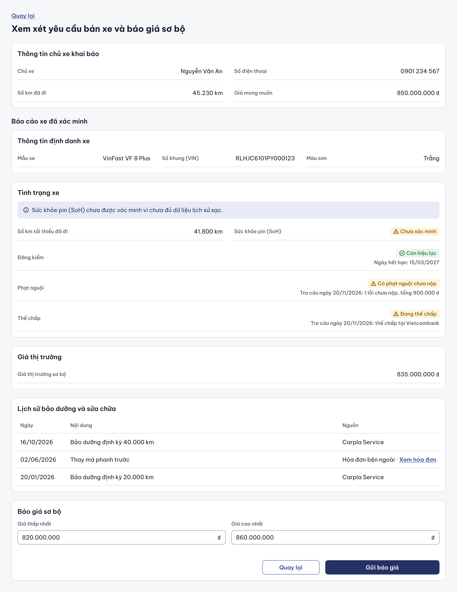
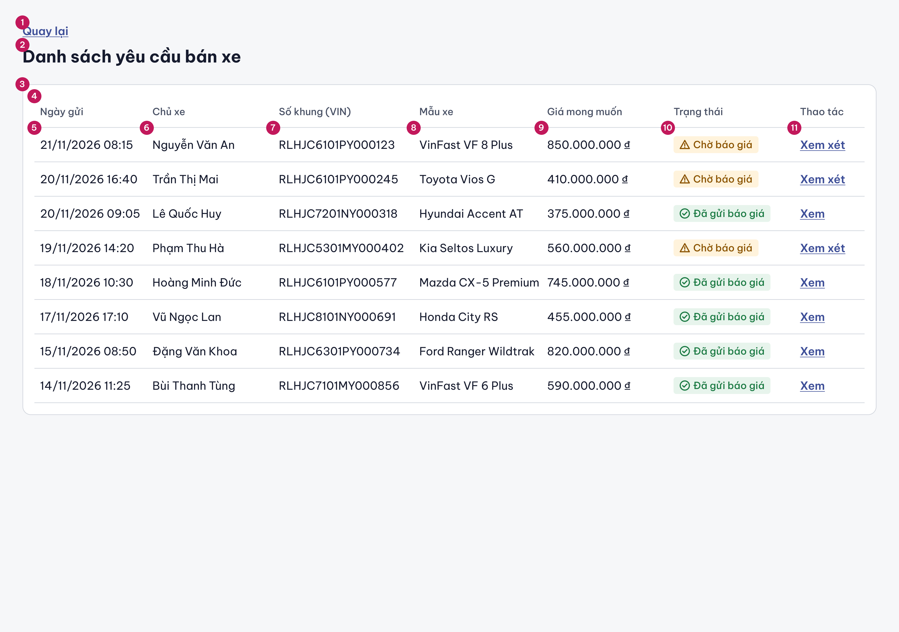
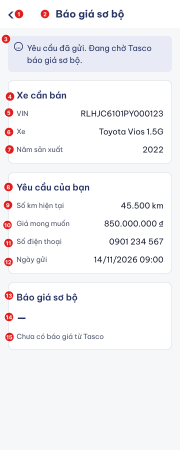
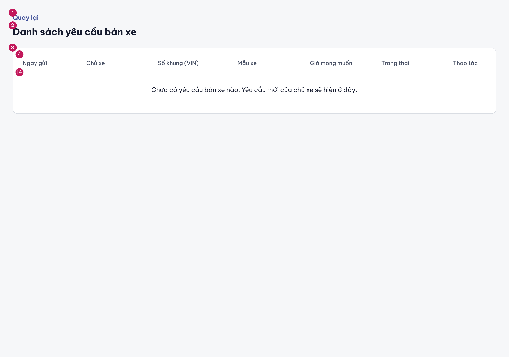
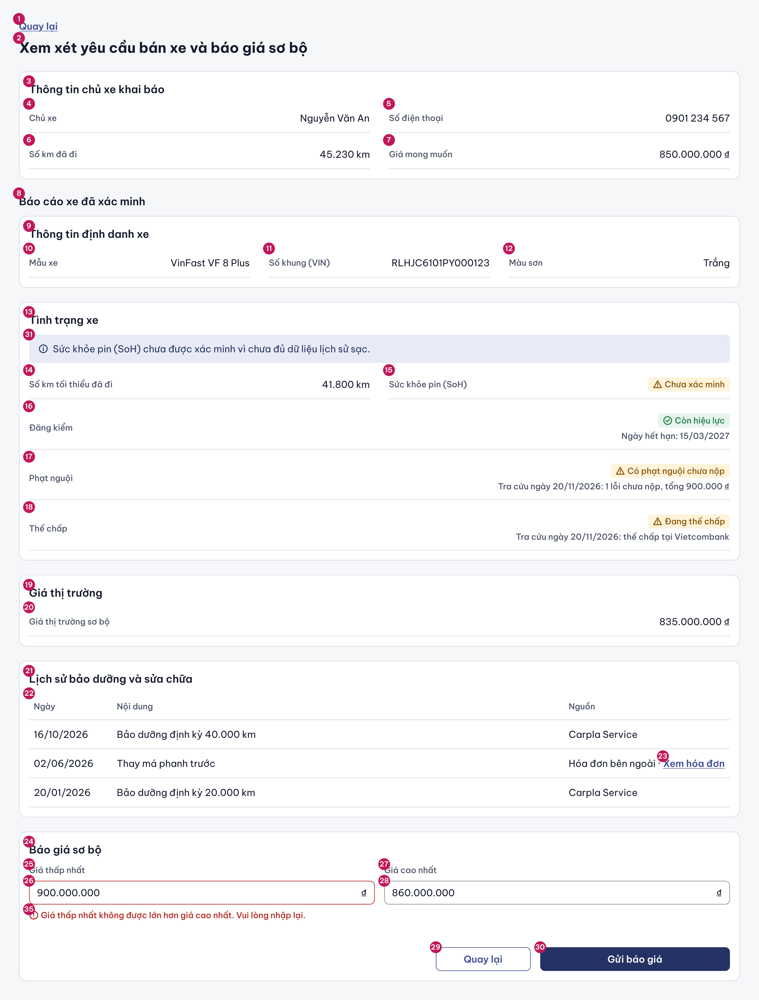
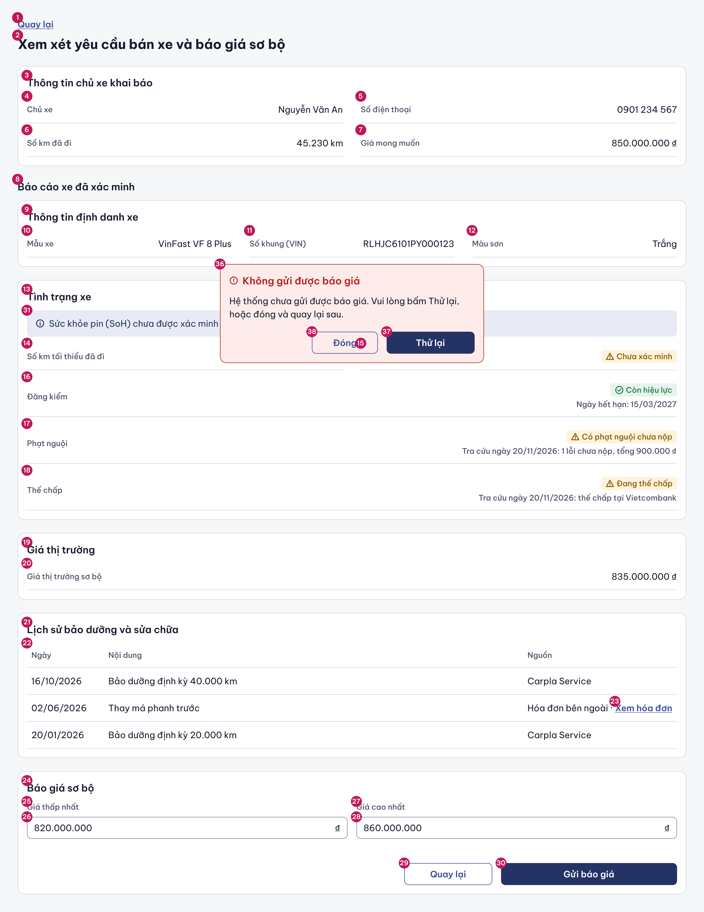
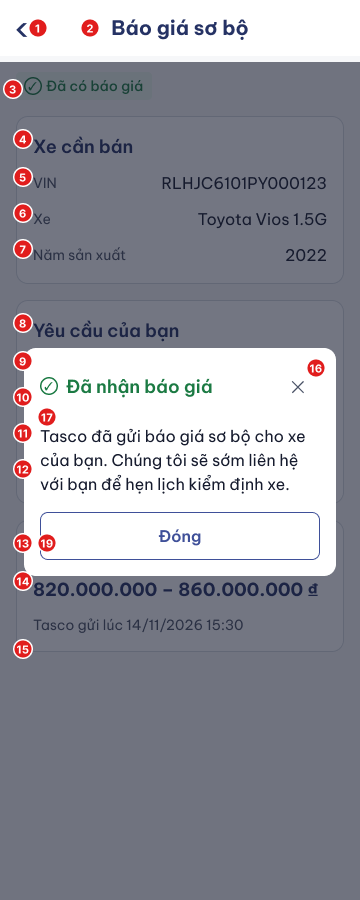

# **Screen Spec: S-F03-03 Sale Request Detail & Preliminary Quote**

# **1\. Purpose**

| Field | Value |
| ----- | ----- |
| Screen ID | S-F03-03 |
| Screen name | Sale Request Detail & Preliminary Quote (Vietnamese UI title in Page header: "Xem xét yêu cầu bán xe và báo giá sơ bộ") |
| Actor | Carpla Staff |
| Priority | Must (screen, as in Screen List). The review part serves FR-03-04 (Must); the quote part serves FR-03-05 (Should in W4) |
| Feature | F-03 Sale Request |
| Activity diagrams | none. UC-3.07 and UC-3.08 have no activity diagram (Activity Index: "Review"; usage-flow-carpla-crm: "not needed"). The behaviour comes from sequence diagram S-10 (S-10.01, S-10.02, S-10.04 to S-10.06) and the EARS criteria of FR-03-04 and FR-03-05. AD-UC-3.06 is the system step that makes the package available to this screen |
| Linked requirements | FR-03-04 Review verified report (Must), FR-03-05 Send preliminary quote to car owner (Should), see section 7 |
| Mockup images | img/S-F03-03-default.png, img/img-numbered/S-F03-03-default-numbered.png, and five state images (section 2). The mockups are drawn, but the files are still named with the old numbering, see section 9, question 1 |
| Frame width | 1280px |
| Figma frame | [Verified Vehicle Report \- S-F03-02]([https://www.figma.com/design/7ofe8uJ9ikmhr58L7Pzpqw/Verified-Vehicle-Report---S-F03-02?node-id=30-3](https://www.figma.com/design/7ofe8uJ9ikmhr58L7Pzpqw/Verified-Vehicle-Report---S-F03-02?node-id=30-2&p=f&t=unESPwF6JkExFeQo-0)) |
| Status | Reviewed |

**Shown when:** Carpla staff select a sale request in the list of sale request in screen S-F03-02. The screen shows the package that the system built for the request: what the car owner declared (name, phone number, current mileage, desired price) and the verified vehicle report (identification, status, legal status, market price, maintenance and repair history). Below the report, the staff enter a preliminary quote range and send it to the car owner.

**The user leaves this screen when:** the staff click "Quay lại" (1 or 36), which returns to S-F03-02, or close the success popup after the quote has been sent, which also returns to S-F03-02 (section 9, question 3).

## **2\. Mockup**

| Default, numbered | Loading, numbered | Empty, numbered | Error validate FE, numbered | Error API, numbered | Success, numbered |
| ----- | ----- | ----- | ----- | ----- | ----- |
|  |  |  |  |  |  |

| State | Image |
| ----- | ----- |
| Default | `img/S-F03-03-default.png` |
| Loading | `img/S-F03-03-loading.png` |
| Empty | `img/S-F03-03-empty.png` |
| Error validate FE | `img/S-F03-03-error-validate-FE.png` |
| Error API | `img/S-F03-03-error-API.png` |
| Success | `img/S-F03-03-success.png` |

Each number is the \# of the element inventory in section 3. The numbers are the same in all states. Element 3 and element 38 appear only in the loading state, element 29 only in the empty state, element 35 only in the error validate FE state, and elements 39 to 41 (popup) only in the error API and success states. Elements 15, 17 and 28 depend on the data (section 4, data cases). All colours, fonts, spacing and corners come from the design tokens in [ui-conventions-carpla-staff.md](ui-conventions-carpla-staff.md).

## **3\. Element inventory**

The report part of the screen (elements 4 to 29) is read-only: it has no Input element. The only inputs are the two Text inputs of the Quote form (32, 34). The screen has no Upload, Date time or Security element. The controls are the two Back controls (1, 36), the invoice link (28), the two Text inputs (32, 34), the button "Gửi báo giá" (37) and the popup buttons (40, 41).

| \# | Element | Category | Type | Content / data source | Required | Validation |
| ----- | ----- | ----- | ----- | ----- | ----- | ----- |
| 1 | Back | Selection | Page header link (underlined text) | static: "Quay lại"; returns to S-F03-02 | Yes | none |
| 2 | Title | Display | Page header title (read-only text) | static: "Xem xét yêu cầu bán xe và báo giá sơ bộ" | Yes | none |
| 3 | Loading line | Feedback | Read-only text under the title | static: "Đang tải thông tin yêu cầu bán xe."; visible only in the loading state | No | none |
| 4 | Declared panel title | Display | Info panel title (read-only text) | static: "Thông tin chủ xe khai báo" | Yes | none |
| 5 | Car owner | Display | Info panel row: label + read-only text | label "Chủ xe"; value sale\_request.owner\_name, from the car owner account (see section 9, question 5); example "Nguyễn Văn An". Shows "–" if the name is missing | Yes | none |
| 6 | Phone number | Display | Info panel row: label + read-only text | label "Số điện thoại"; value sale\_request.phone\_number (FR-03-01); displayed in groups 4-3-3, for example "0901 234 567" | Yes | none |
| 7 | Current mileage | Display | Info panel row: label + read-only text | label "Số km đã đi"; value sale\_request.current\_mileage declared by the car owner (FR-03-01); format 45.230 km | Yes | none |
| 8 | Desired price | Display | Info panel row: label + read-only text | label "Giá mong muốn"; value sale\_request.desired\_price (FR-03-01); format 850.000.000 ₫ | Yes | none |
| 9 | Report heading | Display | Section heading (read-only text) | static: "Báo cáo xe đã xác minh"; groups the panels 10, 14, 21 and 23 | Yes | none |
| 10 | Identification panel title | Display | Info panel title (read-only text) | static: "Thông tin định danh xe" | Yes | none |
| 11 | Vehicle model | Display | Info panel row: label + read-only text | label "Mẫu xe"; value vehicle.make, vehicle.model, vehicle.variant, for example "VinFast VF 8 Plus". Shows "Chưa xác minh" badge if missing | Yes | none |
| 12 | VIN | Display | Info panel row: label + read-only text | label "Số khung (VIN)"; value vehicle.vin (FR-01-01); 17 uppercase letters and digits, no I, O, Q, no spaces, for example "RLHJC6101PY000123" | Yes | none |
| 13 | Paint color | Display | Info panel row: label + read-only text | label "Màu sơn"; value vehicle.paint\_color, for example "Trắng". Shows "Chưa xác minh" badge if missing | Yes | none |
| 14 | Status panel title | Display | Info panel title (read-only text) | static: "Tình trạng xe" | Yes | none |
| 15 | Unverified banner | Feedback | Banner (info, icon + read-only text) | sits at the top of the status panel, above element 16. One sentence for each value of the panel that is not verified. Two sentences are defined: "Sức khỏe pin (SoH) chưa được xác minh vì chưa đủ dữ liệu lịch sử sạc." (FR-01-08) and "Số km chưa được xác minh vì không có bản ghi qua trạm thu phí." (FR-01-03, from ui-conventions section 4). Visible only when at least one value is unverified; no button | No | none |
| 16 | Verified minimum mileage | Display | Info panel row: label + read-only text | label "Số km tối thiểu đã đi"; value vehicle.verified\_min\_mileage (FR-01-03); format 41.800 km. If there is no passage record: Status badge "Chưa xác minh" | Yes | none |
| 17 | Battery health (SoH) | Display | Info panel row: label + read-only text or Status badge | label "Sức khỏe pin (SoH)"; value vehicle.battery\_soh (FR-01-08); format 92%. If the charging data is not sufficient: Status badge "Chưa xác minh" with a warning icon. The row is shown only for an electric vehicle (section 9, question 6) | No | none |
| 18 | Inspection | Display | Info panel row: label + Status badge (icon + text) + detail line | label "Đăng kiểm"; value legal\_status.inspection\_status (FR-01-10). The mockup displays one of: "Còn hiệu lực" with a check icon, detail "Ngày hết hạn: 15/03/2027"; "Hết hạn" with a warning icon; "Chưa xác minh" with a warning icon when the portal gave no data | Yes | none |
| 19 | Unpaid fines | Display | Info panel row: label + Status badge (icon + text) + detail line | label "Phạt nguội"; value legal\_status.fine\_status (FR-01-11). The mockup displays one of: "Có phạt nguội chưa nộp" with a warning icon, detail "Tra cứu ngày 20/11/2026: 1 lỗi chưa nộp, tổng 900.000 ₫"; "Không có phạt nguội" with a check icon; "Chưa xác minh" with a warning icon when the portal gave no data | Yes | none |
| 20 | Mortgage | Display | Info panel row: label + Status badge (icon + text) + detail line | label "Thế chấp"; value legal\_status.mortgage\_status (FR-01-12). The mockup displays one of: "Đang thế chấp" with a warning icon, detail "Tra cứu ngày 20/11/2026: thế chấp tại Vietcombank"; "Không thế chấp" with a check icon; "Chưa xác minh" with a warning icon when the portal gave no data | Yes | none |
| 21 | Market price panel title | Display | Info panel title (read-only text) | static: "Giá thị trường" | Yes | none |
| 22 | Preliminary market price | Display | Info panel row: label + read-only text | label "Giá thị trường sơ bộ"; value market\_price.latest\_weekly\_price (packaged by FR-03-03); format 835.000.000 ₫. If no market price exists for the car, the package marks the price as unavailable and the value shows "Chưa xác minh" (section 9, question 7) | Yes | none |
| 23 | Maintenance panel title | Display | Data table title (read-only text) | static: "Lịch sử bảo dưỡng và sửa chữa" | Yes | none |
| 24 | Column headings | Display | Header row, 3 read-only labels | static: "Ngày", "Nội dung", "Nguồn". Shown in every state | Yes | none |
| 25 | Date | Display | Read-only text (table cell) | maintenance\_record.date; format dd/MM/yyyy, for example "16/10/2026"; newest on top | Yes | none |
| 26 | Content | Display | Read-only text (table cell) | maintenance\_record.description, for example "Bảo dưỡng định kỳ 40.000 km". A long text wraps onto a second line and the row grows | Yes | none |
| 27 | Source | Display | Read-only text (table cell) | maintenance\_record.source: "Carpla Service" (FR-01-04) or "Hóa đơn bên ngoài" (external invoice uploaded by the car owner, FR-01-05, FR-01-07) | Yes | none |
| 28 | Invoice link | Selection | Link (underlined text, table cell) | static: "Xem hóa đơn", placed after "Hóa đơn bên ngoài" and a middle dot; only in rows whose source is "Hóa đơn bên ngoài"; opens the invoice file (invoice\_file) in a new browser tab | No | none |
| 29 | Empty message | Feedback | Read-only text in the Data table area | static: "Chủ xe chưa tải hóa đơn bảo dưỡng bên ngoài."; visible only in the empty state, below the header row (24), in the place of the rows (section 9, question 8) | No | none |
| 30 | Quote form title | Display | Quote form title (read-only text) | static: "Báo giá sơ bộ" | Yes | none |
| 31 | Lowest price label | Display | Text input label (read-only text) | static: "Giá thấp nhất" | Yes | none |
| 32 | Lowest price | Input | Text input (numeric, suffix "₫" inside the field) | quote.price\_min (FR-03-05); digits are formatted with dots while typing, for example 820.000.000 | Yes | Not empty; digits only; greater than 0; not greater than element 34. On failure: inline error (35), nothing is sent (see section 4, Error validate FE) |
| 33 | Highest price label | Display | Text input label (read-only text) | static: "Giá cao nhất" | Yes | none |
| 34 | Highest price | Input | Text input (numeric, suffix "₫" inside the field) | quote.price\_max (FR-03-05); same format as element 32, for example 860.000.000 | Yes | Not empty; digits only; greater than 0; not less than element 32. On failure: inline error (35), nothing is sent |
| 35 | Validation error | Feedback | Inline error text (icon + text, red) | right below the invalid field, replacing nothing else. Texts: "Vui lòng nhập giá thấp nhất." (35a, 32 empty); "Vui lòng nhập giá cao nhất." (35b, 34 empty); "Giá thấp nhất không được lớn hơn giá cao nhất. Vui lòng nhập lại." (35c, shown below 32 when 32 is greater than 34); the text for a value of 0 is proposed in section 9, question 9. The invalid field gets the error border | No | none |
| 36 | Back button | Selection | Secondary button | static: "Quay lại"; same action as element 1; sits at the bottom right of the Quote form, left of element 37 | Yes | none |
| 37 | Send quote | Selection | Primary button | static: "Gửi báo giá"; one per screen; bottom right of the Quote form. Disabled in the loading state | Yes | none |
| 38 | Loading placeholder | Feedback | Loading placeholder (grey bars, no text) | static; takes the place of the values of the panels 4, 10, 14, 21 and the rows of the Data table 23 (2, 2, 4, 1 and 3 bars in the mockup); visible only in the loading state | No | none |
| 39 | Notification message | Dialogue | Modal (popup), icon + title + read-only text | Success: title "Đã gửi báo giá", text "Đã gửi báo giá sơ bộ cho chủ xe." with a check icon. Error: title "Không gửi được báo giá", text "Hệ thống chưa gửi được báo giá. Vui lòng bấm Thử lại, hoặc đóng và quay lại sau." with an error icon | No | none |
| 40 | Close | Selection | Secondary button in the Modal | static: "Đóng"; in the success popup it is the only button | No | none |
| 41 | Retry | Selection | Primary button in the Modal | static: "Thử lại"; error popup only | No | none |

**Note**: `sale_request.`, `vehicle.`, `legal_status.`, `market_price.`, `maintenance_record.` and `quote.` are the fields sourced from tables in the data source. The field names are proposed and will be finalized with the data dictionary. Element 5 is read from the car owner account, not from `sale_request.` (section 9, question 5).

## **4\. States**

Six states are drawn. The report part of the screen is the same in the five states that show data; the states differ in the Maintenance table, the Quote form and the popups.

| State | What the user sees | Trigger |
| ----- | ----- | ----- |
| Default | Title (2); declared panel (4 to 8); report heading (9) with the identification panel (10 to 13), the status panel (14 to 20, with the banner 15 if a value is unverified), the market price panel (21, 22) and the maintenance table (23 to 28) with at least one row; Quote form (30 to 34) with the two inputs and the buttons "Quay lại" (36) and "Gửi báo giá" (37). No loading line, no inline error, no popup | The staff open a request from S-F03-02 and the system returns the package (FR-03-04-BE) |
| Loading | Loading line (3) under the title. The panel titles stay visible; the values are replaced by the loading placeholder (38). The Quote form stays visible with empty inputs; "Gửi báo giá" (37) is disabled; "Quay lại" (1, 36) stays usable. No popup | The staff open the screen, or tap "Thử lại" (41) after a failed load. Nothing failed, so it is not an error (ui-conventions section 4) |
| Empty | Like Default, but the Data table (23) shows the header row (24) and the empty message (29) in place of the rows. This is not an error: no popup. The Quote form works as in Default | The system answers successfully and the vehicle has no maintenance or repair record, neither from Carpla Service nor an external invoice (FR-01-04) |
| Error validate FE | Inline error text (35) right below each invalid input, and the error border on that input. The rest of the screen is unchanged; "Gửi báo giá" (37) stays active so that the staff can correct and tap again. Nothing is sent to the server | The staff tap "Gửi báo giá" (37) and an input does not pass the rule of element 32 or 34. After the first error, the field is checked again when its value changes |
| Error API | Error popup (39, 40, 41) over the screen; behind it the screen is as in Default, and its controls cannot be used | The system could not store or send the quote after the maximum retries (section 9, question 4) |
| Success | Success popup (39, 40) over the screen; the controls behind it cannot be used | The system stored the quote and made it visible to the car owner (FR-03-05) |

**Data cases inside the Default state** (no separate image; every case is covered by the elements above):

| Case | What the screen shows |
| ----- | ----- |
| Request waiting for a quote | Quote form editable, "Gửi báo giá" active. This is the case drawn in the mockups |
| Quote already sent (request status "Đã gửi báo giá" in S-F03-02) | The Quote form shows the stored range read-only and has no "Gửi báo giá" button; only "Quay lại" remains. Not drawn yet (section 9, question 2) |
| A value of the report is not verified | The value shows a Status badge "Chưa xác minh" (icon + text) and the banner (15) explains why, in the status panel. The screen opens normally; no popup (ui-conventions section 4) |
| A legal portal returned no data (FR-03-02) | The row (18, 19 or 20) shows "Chưa xác minh". "No data" is attached to the package only for the staff; the car owner never sees it (S-F03-01, section 9, question 5) |
| Not an electric vehicle | The row "Sức khỏe pin (SoH)" (17) is not shown |
| No market price for the car | Element 22 shows "Chưa xác minh" (section 9, question 7) |
| Package incomplete (FR-03-04) | The screen opens normally; the part that is missing shows "Chưa xác minh" and the banner (15) names the missing part (section 9, question 10) |
| Several rows in the maintenance table | The table grows and the page scrolls vertically; newest on top |
| A long owner name, model or description | The text wraps inside its cell or row, the row grows; the other columns keep their width |
| A row from an external invoice | Source cell shows "Hóa đơn bên ngoài · Xem hóa đơn"; the link (28) opens the file in a new tab. A Carpla Service row has no link |

## **5\. Interactions and navigation**

| \# | Element | User action | System response | Goes to screen |
| ----- | ----- | ----- | ----- | ----- |
| 1 | Screen | open (from the list S-F03-02) | Shows the loading state, reads the package of the request, then shows Default, Empty or (when the read fails) the Error API popup | stays |
| 2 | Back (1) | tap or press Enter | Leaves the screen without sending a quote; entered values are discarded | S-F03-02 |
| 3 | Back button (36) | tap or press Enter | Same as Back (1) | S-F03-02 |
| 4 | Invoice link (28) | tap or press Enter | Opens the invoice file in a new browser tab; the screen stays as it is | stays (new tab) |
| 5 | Lowest price (32) | type digits | Accepts digits only and shows them with dots; clears the inline error of this field when the value becomes valid | stays |
| 6 | Highest price (34) | type digits | Same as element 32 | stays |
| 7 | Send quote (37) | tap, or press Enter in an input | FE pass: sends the quote (FR-03-05-BE), then shows the success popup or the error popup. FE not pass: shows the inline error (35), sends nothing | stays (success or error popup) |
| 8 | Retry (41) | tap (error popup) | Closes the popup and sends the quote again (or reads the package again, if the read failed) | stays (success or error popup) |
| 9 | Close (40), error popup | tap | Closes the popup; the entered values are kept; the staff can correct and send again or leave with Back | stays |
| 10 | Close (40), success popup | tap | Closes the popup and leaves the screen (section 9, question 3) | S-F03-02 |

## **6\. Screen-level rules**

| Rule ID | Rule | Source |
| :---- | :---- | :---- |
| SR-001 | The declared panel, the identification, status and market price panels and the maintenance table are read-only. Only the two inputs of the Quote form (32, 34) can be edited. | FR-03-04 |
| SR-002 | The screen shows the whole package of the request: the owner-declared information, the verified vehicle report and the market price. If the package is incomplete, the screen shows which parts are missing. | FR-03-04 |
| SR-003 | The panels follow this order, from top to bottom: declared information, identification, status (with the legal status), market price, maintenance and repair history, Quote form. | S-10.02, ui-conventions section 3 (Page header, Info panel) |
| SR-004 | A value that is not verified shows "Chưa xác minh" as a Status badge (icon + text). The Banner (15) explains why. Nothing failed and the staff have nothing to retry, so it is never a popup. | ui-conventions section 4 (Unavailable data) |
| SR-005 | Each Status badge is icon + text. Information is never carried by colour alone. The detail line (date of lookup, expiry date, amount, bank) is shown right below the badge. | ui-conventions section 3 (Status badge), section 5 |
| SR-006 | The maintenance table is ordered by date, newest on top. The invoice link (28) appears only in rows from an external invoice and opens the file in a new tab. | ui-conventions section 3 (Data table) |
| SR-007 | The quote is a range with two values. Both are required, digits only, greater than 0, and the lowest must not be greater than the highest. | FR-03-05 |
| SR-008 | The quote inputs are validated on the front end only. If a value is not valid, nothing is sent and the error is an inline text below the field. A failure after the quote is sent is shown as the system error popup. | FR-03-05, ui-conventions section 4 |
| SR-009 | The quote is sent to the car owner only by the button "Gửi báo giá" (37). On success the system stores the quote and makes it visible to the car owner, who is notified (S-10.04 to S-10.06). | FR-03-05, UC-3.08 |
| SR-010 | Loading is shown by the loading line (3) and the loading placeholder (38), not by a popup. While loading, "Gửi báo giá" (37) is disabled. Empty is shown in the Data table area, not by a popup. Neither is an error. | ui-conventions sections 3 and 4 |
| SR-011 | A system error is a popup only after the maximum retries, with the buttons "Thử lại" and "Đóng". A success popup has one button "Đóng". While a popup is open, the controls behind it cannot be used. | ui-conventions sections 3 and 4 |
| SR-012 | The Primary button "Gửi báo giá" is the only Primary button on the screen; "Quay lại" (36) is a Secondary button. | ui-conventions section 3 |
| SR-013 | Formats: date dd/MM/yyyy; price 850.000.000 ₫; mileage 45.230 km; SoH 92%; phone 0901 234 567 (groups 4-3-3); VIN 17 characters without spaces. | ui-conventions section 2 |
| SR-014 | The screen scrolls vertically only. Smallest supported width is 1280px. | ui-conventions sections 5 and 6.5 |

## **7\. Linked requirements**

| FR ID (L2) | What this screen does for it | L3 work items (IDs as written in the Function List) |
| ----- | ----- | ----- |
| FR-03-04 Review verified report | Shows the packaged verified report, the market price and the owner-declared information, and shows which parts are missing when the package is incomplete | FR-03-04-FE: display screen receive sale request and verified report, market price. FR-03-04-BE: API read the package (mileage, phone number, desired price, verified report, market valuation data) |
| FR-03-05 Send preliminary quote to car owner | The Quote form: staff enter the range, the screen validates it, sends it, and shows the success or error popup | FR-03-05-FE: enter and send preliminary quote. FR-03-05-BE: API store quote, notify car owner |
| FR-03-03 Package and forward report and market price to Carpla staff | Source of the package shown on this screen, including the market price marked as unavailable when none exists | FR-03-03-BE (not part of this screen) |
| FR-03-01 Submit sale request | Source of the values of elements 6, 7 and 8 (phone number, current mileage, desired price) | FR-03-01-FE (not part of this screen) |
| FR-03-02 Re-check legal status before forwarding | Source of the legal status shown in elements 18, 19, 20, including "No data" shown as "Chưa xác minh" | FR-03-02-BE (not part of this screen) |
| FR-01-01 and the identification fields | Source of the values of elements 11, 12, 13 | FR-01-01-FE, FR-01-01-BE; FR-01-02-FE, FR-01-02-INT (not part of this screen) |
| FR-01-03 View Verified Minimum Mileage | Source of element 16 | FR-01-03-FE, FR-01-03-INT (not part of this screen) |
| FR-01-08 View Battery State of Health | Source of element 17 | FR-01-08-FE, FR-01-08-INT, FR-01-08-BE (not part of this screen) |
| FR-01-10, FR-01-11, FR-01-12, FR-01-13 (legal checks) | Source of the status values of elements 18, 19, 20 | FR-01-10-INT, FR-01-11-INT, FR-01-12-INT, FR-01-13-BE (not part of this screen) |
| FR-01-04, FR-01-05, FR-01-07 (maintenance history and external invoices) | Source of the rows 25 to 28 | FR-01-04-BE, FR-01-05-BE, FR-01-07-BE (not part of this screen) |

## **8\. Responsive and accessibility notes**

* Smallest supported width: 1280px, desktop web browser, vertical scroll only; no horizontal scroll. The two Text inputs of the Quote form sit side by side. In the panels the label is on the left and the value on the right; the identification panel has three columns.  
* Information is never carried by colour alone: the Status badges have an icon and text, the inline error has an icon and text, the popup has an icon and text, the links are underlined, and the invalid input also gets an error border together with the text (35).  
* Text contrast at least 4.5:1 (WCAG 2.2, 1.4.3); body text 16px, labels and the table header 14px.  
* Clickable targets at least 24 x 24 CSS px: Back (1), the invoice link (28), "Đóng" (40), "Thử lại" (41); buttons (36, 37) and Text inputs (32, 34) at least 40px high.  
* Everything works with the keyboard alone: the Tab order follows the reading order (Back, the invoice links from top to bottom, the lowest price, the highest price, "Quay lại", "Gửi báo giá"). Enter in an input sends the form (same as 37). The focused element has a visible outline, never touching a navy fill.  
* Each Text input has its label (31, 33) linked to it for the screen reader; the inline error (35) is announced when it appears and is linked to its input.  
* The data tables and panels use real header and label cells for the screen reader. Each invoice link has an accessible name that includes the date, for example "Xem hóa đơn ngày 02/06/2026", because the visible text "Xem hóa đơn" is the same in every row.  
* The loading line (3) is announced as a status message. The popup (39) takes the focus when it opens, keeps it inside until it closes, and returns it to the screen afterwards. The check, warning and error icons have a text alternative.

## **9\. Open questions**

| \# | Question | Blocking? | Status |
| ----- | ----- | ----- | ----- |
| 1 | \[NEEDS CLARIFICATION: the six mockup images of this screen are saved as `S-F03-02-default.png`, `-loading.png`, `-empty.png`, `-error-validate-FE.png`, `-error-API.png`, `-success.png`, and the images of the list are saved as `S-F03-03-*.png`. The Screen List gives S-F03-02 to the list and S-F03-03 to this screen. The same naming problem is already in S-F03-02, section 9, question 3.\] | No | Open. Default: this spec follows the Screen List and uses the names `img/S-F03-03-*.png`. Swap the two sets of file names (and the Figma page names) in one commit, then fix the links of both specs. Also export the numbered images. |
| 2 | \[NEEDS CLARIFICATION: when the staff open a request with status "Đã gửi báo giá", can they send a new quote? The same question is S-F03-02, section 9, question 4.\] | No | Open. Default: the Quote form shows the stored range read-only and there is no "Gửi báo giá" button. This state has no image; it must be drawn. |
| 3 | \[NEEDS CLARIFICATION: after the success popup is closed, where do the staff go? Screen Transition draws "Exit: Carpla CRM" from the old S-F03-02 node.\] | No | Open. Default: S-F03-02, which reads the list again so that the request shows "Đã gửi báo giá". Update the Carpla staff diagram of Screen Transition: S-F03-02 to S-F03-03 (opens the request), S-F03-03 to S-F03-02 (back, after sending), and add the screen S-F03-03 to the usage-flow-carpla-crm table (steps 1 and 2). |
| 4 | \[NEEDS CLARIFICATION: how many retries before the error popup, and how long between them, when sending the quote (and when reading the package)? AD-UC-3.06 uses 3 retries and a 5-second wait for forwarding.\] | No | Open. Default: same as AD-UC-3.06 (3 retries, 5 seconds). |
| 5 | \[NEEDS CLARIFICATION: where does the owner name (element 5) come from? FR-03-04-BE lists mileage, phone number, desired price, verified report and market valuation data, not the owner name. The same question is S-F03-02, section 9, question 2.\] | No | Open. Default: read from the car owner account and added to the package. |
| 6 | \[NEEDS CLARIFICATION: for a car that is not electric, is the row "Sức khỏe pin (SoH)" hidden or shown as "Không áp dụng"? FR-01-08 applies only to an electric vehicle.\] | No | Open. Default: hidden. |
| 7 | \[NEEDS CLARIFICATION: what does element 22 show when no market price exists? FR-03-03 only says "marked as unavailable". "Chưa xác minh" is defined in ui-conventions for verification values only.\] | No | Open. Default: Status badge "Chưa xác minh". If the team wants a dedicated text such as "Chưa có giá thị trường", add it to ui-conventions section 3 or 4. |
| 8 | \[NEEDS CLARIFICATION: the empty message (29) in the mockup says "Chủ xe chưa tải hóa đơn bảo dưỡng bên ngoài." but the table also lists the records of Carpla Service. If the vehicle has records from Carpla Service only, the table is not empty; if it has none at all, the message talks only about external invoices. ui-conventions gives the example "Chưa có lịch sử bảo dưỡng và sửa chữa của xe này."\] | No | Open. Default: keep the text of the mockup for the case where the vehicle has no record at all; confirm or replace by the ui-conventions text. |
| 9 | \[NEEDS CLARIFICATION: what is the inline error when a price is 0 or not a number? The mockup draws only the case "lowest price greater than highest price", and ui-conventions gives the two "empty" messages.\] | No | Open. Default (proposed text): "Giá thấp nhất phải lớn hơn 0. Vui lòng nhập lại." and "Giá cao nhất phải lớn hơn 0. Vui lòng nhập lại."; the text boxes accept digits only, so "not a number" cannot be typed. Draw the state if the team accepts. |
| 10 | \[NEEDS CLARIFICATION: FR-03-04 says the system displays which parts of the package are missing, but the mockups show no such display. What is the text, and where?\] | No | Open. Default: the missing part shows "Chưa xác minh" and the Banner (15) names it, for example "Chưa có dữ liệu \<tên phần\> trong gói báo cáo." (proposed text). Draw the state if the team accepts. |
| 11 | \[NEEDS CLARIFICATION: is a quote required to be inside a rule (for example not far from the market price or the desired price)? FR-03-05 only requires "missing or invalid" amounts to be rejected.\] | No | Open. Default: no other rule; the two values only need to pass SR-007. |
| 12 | \[NEEDS CLARIFICATION: while the quote is being sent, is there a visible state? The loading state of the mockup is for opening the screen only.\] | No | Open. Default: "Gửi báo giá" (37) is disabled until the answer arrives; no new image. |
| 13 | \[NEEDS CLARIFICATION: what does the screen show if the package cannot be read after the maximum retries? Only the error of sending the quote is drawn.\] | No | Open. Default: an error popup with the same buttons ("Đóng", "Thử lại"), title "Không tải được yêu cầu bán xe" and text "Hệ thống chưa tải được yêu cầu bán xe. Vui lòng bấm Thử lại, hoặc đóng và quay lại sau." (proposed text); "Thử lại" (41) reads the package again. Draw the state if the team accepts. |
| 14 | \[NEEDS CLARIFICATION: the Status badge in ui-conventions is defined for verification and legal status only. Element 17 and the "Chưa xác minh" values here follow that definition, but the request status badge of S-F03-02 extends it. Is a "Chưa xác minh" badge also right for a missing vehicle model or paint color (elements 11, 13)?\] | No | Open. Default: yes. |

## **Completion checklist**

* \[ \] The mockup is a separate cropped image file, named with the Screen ID, at the frame width. (The six frames are drawn but saved under the names of S-F03-02, see section 9, question 1. Export from Figma and fill in the Figma frame link.)  
* \[ \] The numbered image exists, and its numbers match the \# column of the element inventory. (Not drawn yet; the numbers in this spec are new, 1 to 41.)  
* \[ \] Every visible element in the mockup appears in the element inventory. (Check against Figma.)  
* \[ \] Every colour in the mockup is a design token from ui-conventions-carpla-staff.md.  
* \[x\] Every input element has a validation rule or an explicit "none".  
* \[x\] All states are filled in. (Six states drawn; three proposed states are in section 9, questions 2, 10 and 13.)  
* \[ \] Every navigation target is a Screen ID that exists in the Screen List. (S-F03-02 exists; Screen Transition must be updated, section 9, question 3.)  
* \[x\] Every element that displays data names the field it displays.  
* \[x\] Every linked FR exists in the Function List (FR-03-01 to FR-03-05, FR-01-01 to FR-01-08, FR-01-10 to FR-01-13).  
* \[ \] Every action of this screen in the sequence diagram S-10 is covered. (S-10.01, S-10.02, S-10.04 to S-10.06; no activity diagram exists for UC-3.07 and UC-3.08.)
