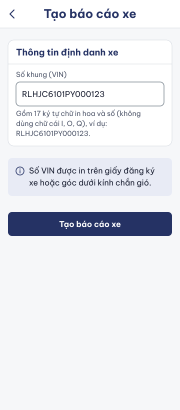
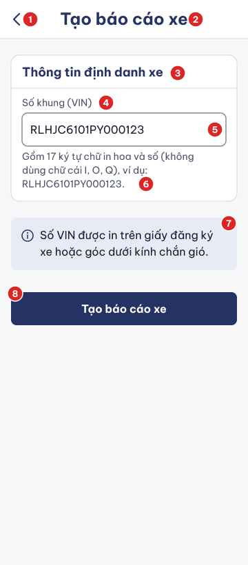
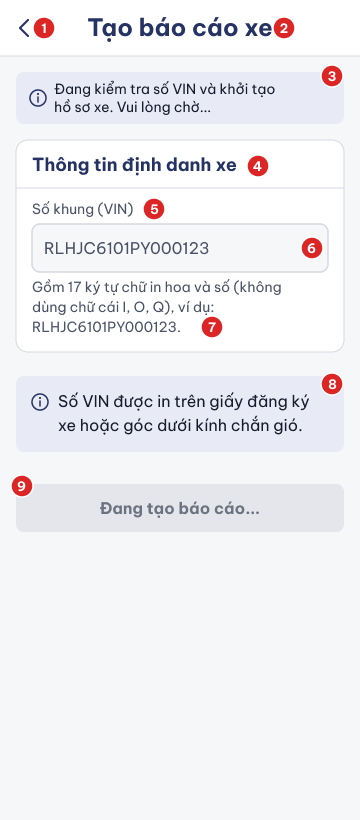
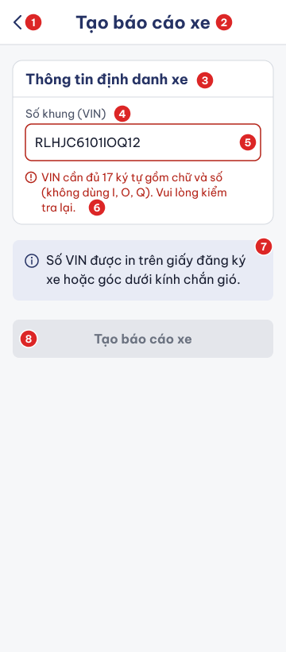
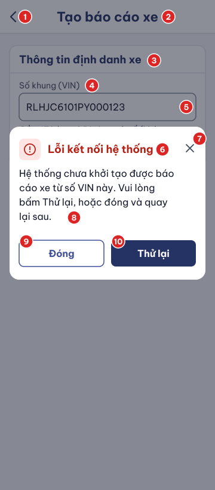
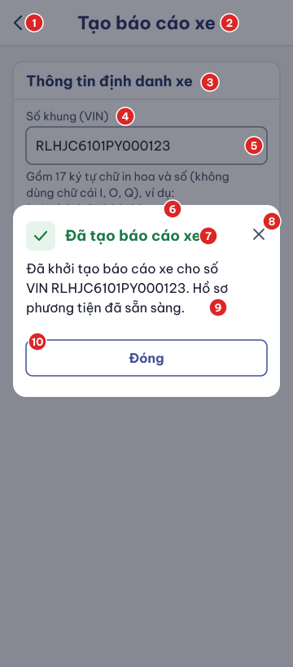

# Screen Spec: S-F01-01 Create Vehicle Report (Enter VIN)

| Field | Value |
|---|---|
| Screen ID | `S-F01-01` |
| Screen name | Create Vehicle Report (Vietnamese UI title in Top bar: `"Tạo báo cáo xe"`) |
| Actor | Car Owner |
| Priority | Must |
| Feature | `F-01 Vehicle Identification & Status` |
| Activity diagrams | `AD-UC-1.01` |
| Linked requirements | `FR-01-01` (Must), see section 7 |
| Mockup images | `img/S-F01-01-default.png`, `img/img-numbered/S-F01-01-default-numbered.png`, and state images (section 2) |
| Frame width | `360px` |
| Status | Reviewed |

## 1. Purpose

**Shown when:** A signed-in Car Owner taps `"Tạo báo cáo xe"` on the Home screen (`S-F00-01`) to register a vehicle and initialize a new `Verified vehicle report` using its 17-character VIN.

**The user leaves this screen when:** The Car Owner dismisses the `"Đã tạo báo cáo xe"` confirmation modal (via `"Đóng"` or `×`) after successful VIN verification to proceed to the Vehicle Profile screen (`S-F01-02`), or taps the top-bar back arrow (`<`) to return to `S-F00-01`.

## 2. Mockup

**Numbered:** Each red callout badge maps to the `#` column in Section 3 for that specific state layout:
- **Default (`1–8`) & Error – Format Validation (`1–8`):** Share the same 8-element structure, with `#6` switching from helper text to inline validation error text.
- **Loading (`1–9`):** Adds `#3` (top verification banner), shifting subsequent background elements by `+1` (`#4–#9`).
- **Error – VIN Not Found (`1–10`), Error – API (`1–10`), & Success (`1–10`):** Display a modal overlay (`#6–#10`) over the dimmed form (`#1–#5`). *(Note: In `Error – VIN Not Found`, `#6` marks the modal container/title and `#7` marks `×`; in `Error – API` and `Success`, `#6` marks the modal container/title and `#7`/`#8` mark the header title and `×` icon respectively.)*

| Default, numbered | Loading, numbered | Error (Format), numbered |
| :---: | :---: | :---: |
|  |  |  |

| Error (VIN Not Found), numbered | Error (API), numbered | Success, numbered |
| :---: | :---: | :---: |
|  |  |  |

| State | Image |
| :--- | :--- |
| Default | `img/S-F01-01-default.png` |
| Empty (no data) | Described in Section 4 (textbox placeholder shown, primary CTA disabled) |
| Loading | `img/img-numbered/S-F01-01-loading-numbered.png` |
| Error (Client/BE Format) | `img/img-numbered/S-F01-01-error-validate-be-numbered.png` |
| Error (VIN Not Found) | `img/img-numbered/S-F01-01-error-vin-not-found-numbered.png` |
| Error (API / System) | `img/img-numbered/S-F01-01-error-api-numbered.png` |
| Success | `img/img-numbered/S-F01-01-success-numbered.png` |

All colours, typography, spacing, and corner radii follow the design tokens in `ui-conventions-car-owner.md`.

## 3. Element inventory

| # | Element | Category | Type | Content / data source | Required | Validation |
|---|---|---|---|---|---|---|
| 1 | Back navigation button | Selection | Top bar, back arrow (button) | Static left chevron icon (`44 × 44px` tap target) | Yes | none |
| 2 | Screen title header | Display | Read-only text (Top bar title) | Static: `"Tạo báo cáo xe"` | Yes | none |
| 3 *(Loading)* | Verification progress banner | Feedback | Banner (info, icon + read-only text, no button) | Info icon + static text: `"Đang kiểm tra số VIN và khởi tạo hồ sơ xe. Vui lòng chờ..."` (visible only in `Loading` state) | No | none |
| 3 *(4 in Loading)* | Section card title | Display | Read-only text (Section card header) | Static: `"Thông tin định danh xe"` | Yes | none |
| 4 *(5 in Loading)* | VIN input field label | Display | Read-only text (Field label) | Static: `"Số khung (VIN)"` | Yes | none |
| 5 *(6 in Loading)* | VIN text input field | Input | Textbox | 17-character alphanumeric string (`vehicle.vin`, e.g., `"RLHJC6101PY000123"`) written to `Verified vehicle report` and verified against `VETC vehicle data` (`FR-01-01-FE`, `FR-01-01-BE`) | Yes | `BR-VFVR-01`: Required; exact length = 17 characters; uppercase alphanumeric (`A–Z`, `0–9`) excluding letters `I`, `O`, and `Q`; backend checksum and existence check (`FR-01-01-BE`) |
| 6 *(7 in Loading)* | VIN helper / inline error text | Display / Feedback | Read-only text / Inline validation error | **Default / Loading:** Static helper text `"Gồm 17 ký tự chữ in hoa và số (không dùng chữ cái I, O, Q), ví dụ: RLHJC6101PY000123."` **Format Error:** Warning icon + red text (`#B42318`) `"VIN cần đủ 17 ký tự gồm chữ và số (không dùng I, O, Q). Vui lòng kiểm tra lại."` | Yes | none |
| 7 *(8 in Loading)* | VIN location guidance banner | Display | Banner (info, icon + read-only text, no button) | Info icon + static text: `"Số VIN được in trên giấy đăng ký xe hoặc góc dưới kính chắn gió."` | Yes | none |
| 8 *(9 in Loading)* | Submit VIN primary button | Selection | Primary button | **Default / Empty / Format Error:** Static `"Tạo báo cáo xe"` **Loading:** Disabled button with static `"Đang tạo báo cáo..."` | Yes | Disabled (`#E4E6EB` fill, `#6B7280` text) when `VIN text input field` has `0` characters (`Empty`), after a format error until edited, or during `Loading` |
| 6–8 *(Modals)* | Modal header & message | Dialogue | Modal (popup), icon + title + read-only text + close `×` | **VIN Not Found (`#6–#8`):** Warning icon, title `"Không tìm thấy thông tin xe"`, text `"Hệ thống không tìm thấy dữ liệu phương tiện cho số VIN này. Vui lòng kiểm tra lại số VIN và bấm Thử lại, hoặc đóng để quay lại."`, close `×`. **API Error (`#6–#8`):** Warning icon, title `"Lỗi kết nối hệ thống"`, text `"Hệ thống chưa khởi tạo được báo cáo xe từ số VIN này. Vui lòng bấm Thử lại, hoặc đóng và quay lại sau."`, close `×`. **Success (`#6–#9`):** Check icon, title `"Đã tạo báo cáo xe"`, text `"Đã khởi tạo báo cáo xe cho số VIN <vehicle.vin>. Hồ sơ phương tiện đã sẵn sàng."`, close `×`. | No | none |
| 9 *(Modals)* | Close modal button | Selection | Secondary (outlined) button in Modal | Static: `"Đóng"` (left button in Error modals; full-width button `#10` in Success modal) | No | none |
| 10 *(Error Modals)* | Retry modal button | Selection | Primary button in Modal | Static: `"Thử lại"` (right button in `VIN Not Found` and `API Error` modals only) | No | none |

## 4. States

| State | What the user sees | Trigger |
|---|---|---|
| Default | Top bar (`#1`, `#2`), card `"Thông tin định danh xe"` (`#3`) with label (`#4`) and a 17-character VIN entered in `#5`, helper text with example (`#6`), info banner (`#7`), and enabled primary button `"Tạo báo cáo xe"` (`#8`, `#253264`). | Car Owner has entered a non-empty VIN string ready for submission. |
| Empty (no data) | Same layout as `Default`, except `#5` is empty (showing placeholder `"Nhập số khung 17 ký tự"`) and button `#8` is disabled (`#E4E6EB` fill, `#6B7280` text). | Car Owner opens `S-F01-01` from `S-F00-01` or deletes all characters in `#5`. |
| Loading | Top info banner `"Đang kiểm tra số VIN và khởi tạo hồ sơ xe. Vui lòng chờ..."` (`#3`) appears above the card; input `#6` is locked/read-only; primary button `#9` is disabled and changes label to `"Đang tạo báo cáo..."`. | Car Owner taps `"Tạo báo cáo xe"`, passes client-side format check (`d1 [Yes]`), and awaits `FR-01-01-BE` verification. |
| Error | **1. Format validation error (`d1 [No]` / BE format reject):** Input `#5` border turns `#B42318`, inline error `#6` displays `"VIN cần đủ 17 ký tự gồm chữ và số (không dùng I, O, Q). Vui lòng kiểm tra lại."`, and button `#8` is disabled until edited. **2. VIN not found (`d2 [No]`):** Modal (`#6–#10`) over 50% `#161B2E` scrim shows `"Không tìm thấy thông tin xe"`, guidance message, `"Đóng"` (`#9`), `"Thử lại"` (`#10`), and `×` (`#7`). **3. System / API error:** Modal (`#6–#10`) over scrim shows `"Lỗi kết nối hệ thống"`, retry message, `"Đóng"` (`#9`), `"Thử lại"` (`#10`), and `×` (`#8`). | 1. Submitted VIN fails `BR-VFVR-01` (length ≠ 17 or contains `I`, `O`, `Q`). 2. Backend (`FR-01-01-BE`) finds no matching vehicle record for the VIN. 3. Backend API or database connection fails/times out. |
| Success / confirmation | Confirmation modal (`#6–#10`) over 50% `#161B2E` scrim displays green check icon, title `"Đã tạo báo cáo xe"`, message `"Đã khởi tạo báo cáo xe cho số VIN <vehicle.vin>. Hồ sơ phương tiện đã sẵn sàng."`, full-width button `"Đóng"` (`#10`), and `×` (`#8`). | Backend (`FR-01-01-BE`) confirms VIN existence (`d2 [Yes]`) and initializes the `Verified vehicle report`. |

## 5. Interactions and navigation

| # | Element | User action | System response | Goes to screen |
|---|---|---|---|---|
| 1 | Back navigation button (`#1`) | tap | Discards unsaved VIN input and returns to the Home screen. | `S-F00-01` |
| 2 | VIN text input field (`#5`) | type | Auto-converts lowercase characters to uppercase, trims spaces, clears any inline validation error (`#6`), and enables `"Tạo báo cáo xe"` (`#8`) once length ≥ 1. | `stays` |
| 3 | Submit VIN primary button (`#8`) | tap | Runs client-side format check (`d1`). If `[No]`, blocks API call and displays inline error (`#6`). If `[Yes]`, enters `Loading` state and calls `FR-01-01-BE` (`d2`). Shows `VIN Not Found` modal, `API Error` modal, or `Success` modal depending on API outcome. | `stays` |
| 4 | Retry button (`#10` in Error modals) | tap | Closes the error modal, enters `Loading` state, and re-sends the VIN verification request to `FR-01-01-BE`. | `stays` |
| 5 | Close button (`#9` / `×` in Error modals) | tap | Dismisses the error modal and returns focus to the VIN form so the Car Owner can edit the VIN. | `stays` |
| 6 | Close button (`#10` / `×` in Success modal) | tap | Dismisses the confirmation modal and navigates to the newly initialized Vehicle Profile screen. | `S-F01-02` |

## 6. Screen-level rules

| Rule ID | Rule | Source |
|---|---|---|
| SR-001 | **VIN Format Validation (`BR-VFVR-01`):** A valid VIN must be exactly 17 uppercase alphanumeric characters (`A–Z`, `0–9`) and strictly exclude `I`, `O`, and `Q`. | `AD-UC-1.01` (`BR-VFVR-01`) |
| SR-002 | **Client-Side Gatekeeping:** Client-side validation (`FR-01-01-FE`) runs immediately on tapping `"Tạo báo cáo xe"` (`d1`) and blocks `FR-01-01-BE` calls when `BR-VFVR-01` is violated. | `AD-UC-1.01` (`d1`) |
| SR-003 | **Single Vehicle Onboarding Entry Point:** A vehicle record enters the system exclusively through successful VIN verification on `S-F01-01`. | `screen-list.md` (`S-F01-01`) |
| SR-004 | **Modal Blocking & Dual-Action Order:** While any modal (`VIN Not Found`, `API Error`, `Success`) is open, background form controls cannot be interacted with. Dual-button error modals place `"Đóng"` (secondary outlined) on the left and `"Thử lại"` (primary filled) on the right. | `ui-conventions-car-owner.md` (§3, §4) |
| SR-005 | **Disabled CTA Styling:** Whenever `"Tạo báo cáo xe"` is disabled (`Empty`, unresolved `Format Error`, or `Loading`), it renders with `#E4E6EB` background and `#6B7280` text without border. | `ui-conventions-car-owner.md` (§6.1D) |

## 7. Linked requirements

| FR ID (L2) | What this screen does for it | L3 work items |
|---|---|---|
| `FR-01-01` Create vehicle report (Enter VIN) | Captures the 17-character VIN, enforces client-side format rules, triggers backend vehicle lookup/initialization, and displays error or confirmation feedback before opening `S-F01-02`. | `FR-01-01-FE` (form, validation, state feedback), `FR-01-01-BE` (VIN checksum/existence check & report initialization) |

## 8. Responsive and accessibility notes

- Smallest supported width: `360px`, single-column vertical layout with `16px` horizontal outer padding and zero horizontal scroll.
- On narrow screens (`360px`), helper text (`#6`), inline error messages, and banner descriptions wrap cleanly inside card/banner containers without clipping or overlapping adjacent elements.
- Information is never carried by colour alone: inline errors combine `#B42318` border/text with a warning icon (`!`) and explicit instructional copy; info banners and modals pair semantic icons (`i`, `!`, `✓`) with descriptive Vietnamese titles and body text.
- Text contrast meets WCAG AA (`≥ 4.5:1`); body/helper text is `≥ 13–14px`; interactive tap targets (`#1` back arrow, `#8` primary CTA, modal `×`, `"Đóng"`, `"Thử lại"`) are `≥ 44 × 44px`.

## 9. Open questions

| # | Question | Blocking? | Status |
|---|---|---|---|
| 1 | [NEEDS CLARIFICATION: `screen-list.md` lists `UC-2.10` alongside `UC-1.01` for `S-F01-01`, whereas `AD-UC-1.01` and the `Function List` only specify `UC-1.01` (`FR-01-01`). Confirm whether `UC-2.10` requires any extra fields or permissions on `S-F01-01`.] | No | Open. Default: No extra UI fields required |
| 2 | [NEEDS CLARIFICATION: Confirm the authoritative external source queried by `FR-01-01-BE` (`VETC vehicle data` vs. national registry) when checking VIN existence, and define the modal message if the Car Owner submits a VIN that already has an active `Verified vehicle report`.] | Yes | Open. Default: Redirect or show duplicate-VIN notice |
| 3 | [NEEDS CLARIFICATION: In `S-F01-01-Error-Validate BE-numbered.png`, the file name says `Validate BE` while the inline error checks the 17-character / `I, O, Q` rule (`d1` client-side check). Confirm that client-side validation triggers this exact inline error before calling the backend, and that backend checksum failure reuses the same inline error style.] | No | Open. Default: Yes, reuse inline error style |

---

## Completion checklist

- [x] The mockup is a separate cropped image file, named with the Screen ID (`img/S-F01-01-default.png`).
- [x] Every visible element in the mockup appears in the element inventory.
- [x] Every input element has a validation rule or an explicit `"none"`.
- [x] All five states are filled in with concrete UI behavior and triggers.
- [x] Every navigation target is a Screen ID that exists in the Screen List (`S-F00-01`, `S-F01-02`).
- [x] Every element that displays data names the field it displays (`vehicle.vin`).
- [x] Every linked FR exists in the Function List (`FR-01-01`), and every action in `AD-UC-1.01` is covered by an interaction row.
