# Screen Spec: S-F01-04 Maintenance & Repair History

## 1. Purpose

| Field | Value |
| --- | --- |
| Screen ID | S-F01-04 |
| Screen name | Maintenance & Repair History (Vietnamese UI title in Top bar: "Bảo dưỡng và sửa chữa"). Includes the Upload invoice sheet (bottom sheet), its result popups and the camera steps |
| Actor | Car Owner |
| Priority | Must |
| Feature | F-01 Vehicle Identification & Status |
| Activity diagrams | AD-UC-1.05 |
| Linked requirements | FR-01-04, FR-01-05, FR-01-06, FR-01-07 (FE, INT, BE), see section 7 |
| Mockup images | `img/S-F01-04-default.png`, `img/img-numbered/S-F01-04-default-numbered.png`, state images of the main screen, the Upload invoice sheet and the camera steps (section 2) |
| Frame width | 360 px |
| Figma frame | [Vehicle Identification & Status \- S-F01-04 ](https://www.figma.com/design/ahzD4prkBFDCttQimszLWw/Vehicle-Identification---Status?node-id=0-1&p=f&t=jIrF9erJRZuQXgpQ-0) |
| Status | Reviewed |

**Shown when:** the car owner taps "Xem tất cả" in the section "Bảo dưỡng và sửa chữa" of S-F01-02 Vehicle Profile.

**The user leaves this screen when:** the user taps the Back arrow (1) in the Top bar and returns to S-F01-02. The Upload invoice sheet (opened by the Upload button (13) is part of this screen and closes back to it.

## 2. Mockup

Default screen, without numbers:

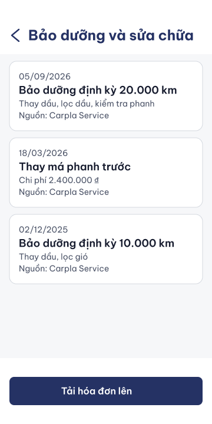

Screens with numbered elements, one per state.

Main screen (numbers of section 3.1):

| Default, numbered | Empty, numbered | Loading, numbered | Error API, numbered | Success, numbered |
| --- | --- | --- | --- | --- |
| 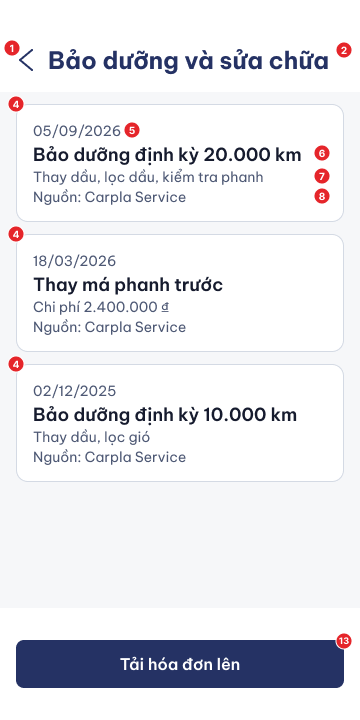 | 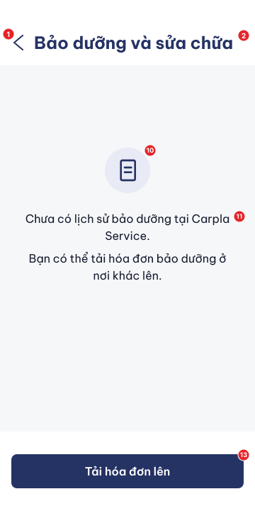 |  | 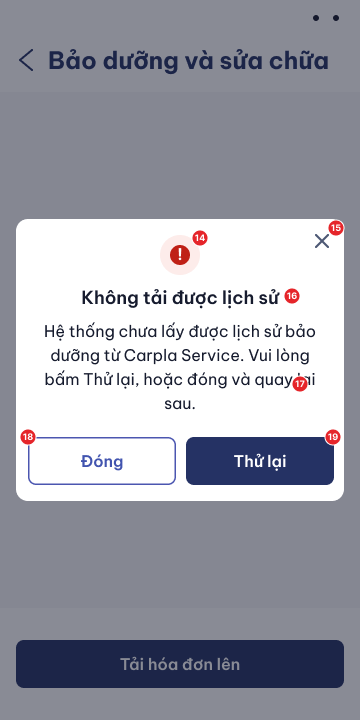 | 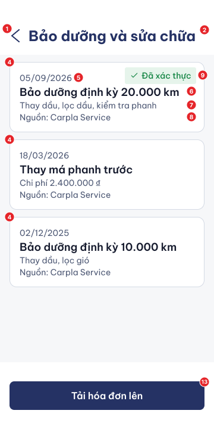 |

Upload invoice sheet (numbers of section 3.2):

| Upload Invoice Sheet Default, numbered | Upload Invoice Sheet Loading, numbered | Upload Invoice Sheet Error validate FE (1), numbered | Upload Invoice Sheet Error validate FE (2), numbered | Review Invoice Sheet, numbered |
| --- | --- | --- | --- | --- |
| 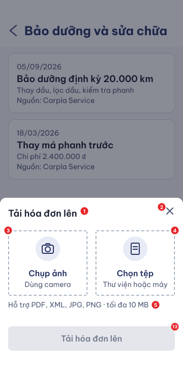 | 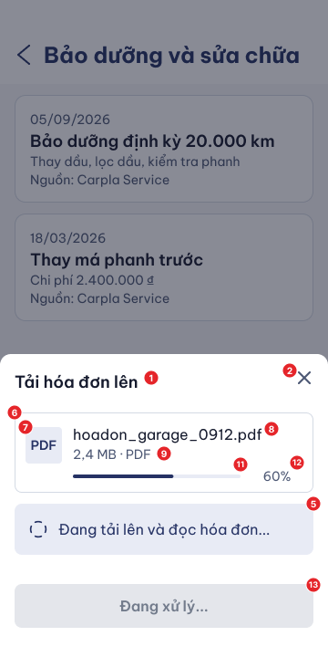 | 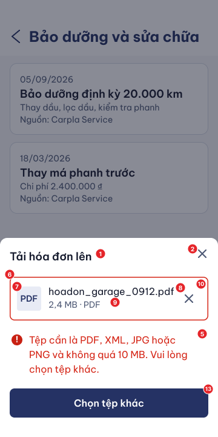 | 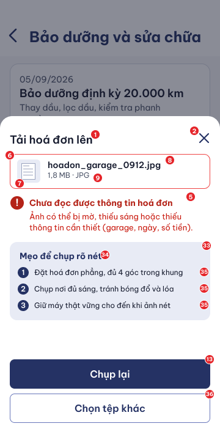 | 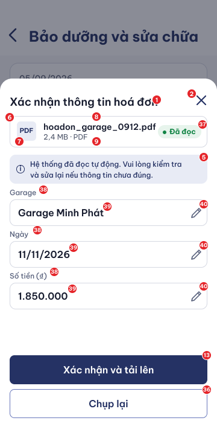 |

Result popups of the sheet and camera steps (numbers of section 3.2):

|Upload Invoice Sheet Error validate BE, numbered | Upload Invoice Sheet Success, numbered | Camera, numbered | Camera preview, numbered |
| --- | --- | --- | --- |
| 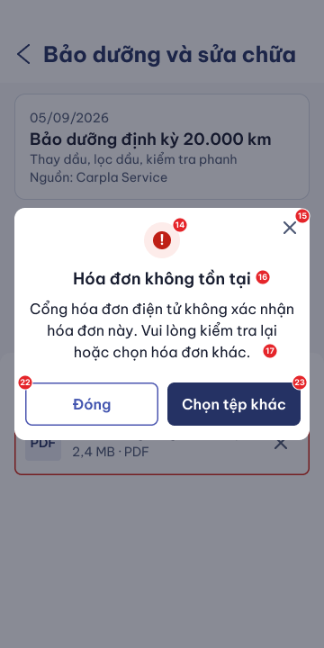 | 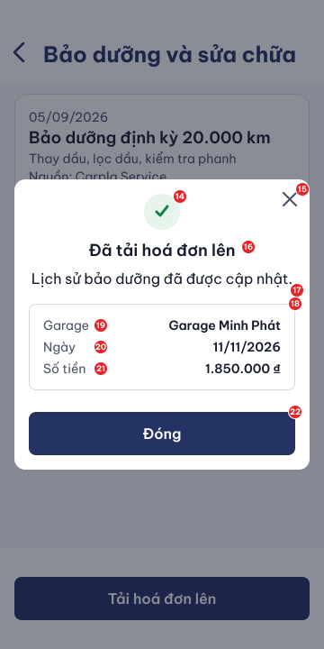 |  |  |

| Group | State | Image | 
| --- | --- | --- |
| Main screen | Default | `img/S-F01-04-default.png` | 
| Main screen | Empty | `img/S-F01-04-empty.png` | 
| Main screen | Loading | `img/S-F01-04-loading.png` | 
| Main screen | Error API | `img/S-F01-04-error-API.png` | 
| Main screen | Success | `img/S-F01-04-success.png` | 
| Upload invoice sheet | Default | `img/S-F01-04-modal-default.png` | 
| Upload invoice sheet | Loading | `img/S-F01-04-modal-loading.png` | 
| Upload invoice sheet | Error validate FE (1) | `img/S-F01-04-modal-error-validate-FE-1.png` | 
| Upload invoice sheet | Error validate FE (2) | `img/S-F01-04-modal-error-validate-FE-2.png` | 
| Upload invoice sheet | Review | `img/S-F01-04-modal-review.png` | 
| Upload invoice sheet | Error validate BE (popup) | `img/S-F01-04-modal-error-validate-BE.png` | 
| Upload invoice sheet | Success (popup) | `img/S-F01-04-modal-success.png` | 
| Camera steps | Camera | `img/S-F01-04-modal-camera.png` | 
| Camera steps | Camera preview | `img/S-F01-04-modal-camerapreview.png` | `

Each number is the # of the element inventory in section 3. The main screen and the Upload invoice sheet are separate mockups, so their numbers are two different sequences: the main screen uses 1 to 19 elements (section 3.1); the Upload invoice sheet, its popups and the camera steps use 1 to 40 elements (section 3.2). Always read a number together with the element name, for example Upload button (13) on the main screen and Primary action button (13) in the sheet.

Main screen: Loading banner (3) and Loading placeholder (12) appear only in the Loading state; Empty icon (10) and Empty message (11) only in the Empty state; elements 14 to 19 (popup) only in the Error API state; Verified badge (9) only in the Success state. Record card (4) is repeated once for every record, and its number is shown on every card.

Upload invoice sheet: Take photo tile (3) and Choose file tile (4) appear only in the Default state; Remove file (10) only in the Error validate FE (1) state; Upload progress bar (11) and Upload percent (12) only in the Loading state; elements 14 to 23 (popups) only in the Error validate BE and Success states; elements 24 to 32 only in the camera steps; elements 33 to 35 (Tips card) only in the Error validate FE (2) state; Secondary action button (36) in the Error validate FE (2) and Review states; elements 37 to 40 only in the Review state. Tip item (35), Field label (38), Field input (39) and Edit icon (40) are repeated (three tips, three fields), and the number is shown on every repeat.

The Top bar, the white background, the sheet container and the dimmed layer behind a popup are layout containers and have no number. All colors, fonts, and corners come from the design tokens in [ui-conventions-car-owner](https://github.com/giangnhk63db/DBIZ-2_GROUP-A/blob/4f88e331210049e04b7fd420b043700c352bec19/External%20Design/ui-conventions-car-owner.md).

## 3. Element inventory

The main screen is read-only; its only action is the Upload button (13). The only input elements are the three Field inputs (39) of the Review state of the sheet; the Selected file card (6) is the Upload element. Elements that sit at the same position and have the same number have different content depending on the state; the column "Content / data source" says which content applies in which state.

### 3.1 Main screen (numbers 1 to 19)

| # | Element | Category | Type | Content / data source | Required | Validation |
| --- | --- | --- | --- | --- | --- | --- |
| 1 | Back | Selection | Top bar, back arrow (button) | static; hit area 44 x 44. Shown in every state | Yes | none |
| 2 | Title | Display | Read-only text (Top bar screen name) | static: "Bảo dưỡng và sửa chữa" | Yes | none |
| 3 | Loading banner | Feedback | Banner (icon + read-only text) | Has no button. Info banner with loading icon, text "Đang tải lịch sử bảo dưỡng. Vui lòng chờ trong giây lát.". **Loading state:** shown, disappears when data is available. Hidden in the other states. | No | none |
| 4 | Record card | Display | Card (timeline item) | One card per maintenance or repair record, newest on top. Holds elements 5 to 9. Not tappable. **Default and Success state:** one card per record. **Empty, Loading and Error API state:** no card. **Data source:** carpla_service_records (FR-01-04-BE) merged with uploaded_maintenance_invoice (FR-01-07-BE) | Yes | none |
| 5 | Record date | Display | Read-only text | Date of the service or of the invoice, format dd/MM/yyyy, example "05/09/2026". **Data source:** maintenance_record.service_date | Yes | none |
| 6 | Record title | Display | Read-only text | Service or repair name, example "Bảo dưỡng định kỳ 20.000 km". **Data source:** maintenance_record.service_title | Yes | none |
| 7 | Record detail | Display | Read-only text | One line, depends on the record: work description (example "Thay dầu, lọc dầu, kiểm tra phanh") or cost (example "Chi phí 2.400.000 ₫"). **Data source:** maintenance_record.details or invoice.total_amount | No | none |
| 8 | Record source | Display | Read-only text | "Nguồn: Carpla Service" or "Nguồn: Hóa đơn ngoài". **Data source:** maintenance_record.source_type | Yes | none |
| 9 | Verified badge | Display | Status badge (icon + text in a pill) | "Đã xác thực" (success style, green pill, check icon), at the top right of the Record card (4). Only on a card of an external invoice; Carpla Service cards have no badge. Other statuses: see open question 4. **Success state:** shown on the new invoice card. **Other states:** hidden. **Data source:** invoice.verification_status | No | none |
| 10 | Empty icon | Display | Icon (document icon in a circle) | static, centred in the list area. **Empty state** only | No | none |
| 11 | Empty message | Display | Read-only text | static: "Chưa có lịch sử bảo dưỡng tại Carpla Service." and "Bạn có thể tải hóa đơn bảo dưỡng ở nơi khác lên.", centred under the Empty icon (10). **Empty state** only | No | none |
| 12 | Loading placeholder | Display | Read-only text | "—" in the centre of the list area. **Loading state** only | No | none |
| 13 | Upload button | Selection | Primary button | static: "Tải hóa đơn lên", fixed at the bottom, full width inside 16 px side margins, height 48 px. Opens the Upload invoice sheet. **Loading state:** disabled. **Error API state:** dimmed behind the popup, cannot be used. **Other states:** enabled. | Yes | none |
| 14 | Popup icon | Dialogue | Icon in the Modal (popup) | red error (warning) icon. **Error API state** only | No | none |
| 15 | Close popup | Selection | Icon button (X) in the Modal | static; hit area 44 x 44 | No | none |
| 16 | Popup title | Dialogue | Read-only text in the Modal | static: "Không tải được lịch sử" | No | none |
| 17 | Popup message | Dialogue | Read-only text in the Modal | static: "Hệ thống chưa lấy được lịch sử bảo dưỡng từ Carpla Service. Vui lòng bấm Thử lại, hoặc đóng và quay lại sau." | No | none |
| 18 | Close | Selection | Secondary (outlined) button in the Modal | static: "Đóng", on the left of Retry (19) | No | none |
| 19 | Retry | Selection | Primary button in the Modal | static: "Thử lại" | No | none |

### 3.2 Upload invoice sheet, its result popups and the camera steps (numbers 1 to 40)

The sheet is a bottom sheet opened by the Upload button (13) of the main screen. It sits over the dimmed main screen. The camera steps (24 to 32) are full-screen steps opened by the Take photo tile (3).

| # | Element | Category | Type | Content / data source | Required | Validation |
| --- | --- | --- | --- | --- | --- | --- |
| 1 | Sheet title | Display | Read-only text (sheet header) | The content depends on the state: **Review state:** "Xác nhận thông tin hóa đơn". **All other sheet states:** "Tải hóa đơn lên". | Yes | none |
| 2 | Close sheet | Selection | Icon button (X) | static; hit area 44 x 44. Closes the sheet and discards the selected file. Shown in every sheet state | Yes | none |
| 3 | Take photo tile | Selection | Button (tile) | Camera icon, "Chụp ảnh", sub-text "Dùng camera". Opens the camera steps (24 to 32). **Default state** only | No | none |
| 4 | Choose file tile | Selection | Button (tile) | File icon, "Chọn tệp", sub-text "Thư viện hoặc máy". Opens the system file picker. **Default state** only | No | none |
| 5 | Status message | Feedback | Read-only text, banner or inline error | The content depends on the state: **Default state:** hint text "Hỗ trợ PDF, XML, JPG, PNG · tối đa 10 MB", under the tiles (3, 4). **Loading state:** info banner with loading icon, "Đang tải lên và đọc hóa đơn…". **Error validate FE (1) state:** inline error with error icon, "Tệp cần là PDF, XML, JPG hoặc PNG và không quá 10 MB. Vui lòng chọn tệp khác.". **Error validate FE (2) state:** inline error with error icon, title "Chưa đọc được thông tin hóa đơn" and the line "Ảnh có thể bị mờ, thiếu sáng hoặc thiếu thông tin cần thiết (garage, ngày, số tiền).". **Review state:** info banner with info icon, "Hệ thống đã đọc tự động. Vui lòng kiểm tra và sửa lại nếu thông tin chưa đúng.". Has no button. | Yes | FE validation in Error validate FE (1): no request is sent |
| 6 | Selected file card | Upload | File upload item (card) | Holds elements 7 to 12 and, in the Review state, the Read badge (37). Shown while a file is selected. Red border in the Error validate FE (1) and (2) states. **Data source:** uploaded_maintenance_invoice.file_object | No | Type is PDF, XML, JPG or PNG; size is at most 10 MB (BR-FILE-01) |
| 7 | File thumbnail | Display | Tag or thumbnail | Type tag "PDF" for a PDF file, or a small preview for a photo. Left of the File name (8) | No | none |
| 8 | File name | Display | Read-only text | Name of the chosen file, example "hoadon_garage_0912.pdf" | No | none |
| 9 | File size and type | Display | Read-only text | Size and type, comma for decimals, example "2,4 MB · PDF" | No | none |
| 10 | Remove file | Selection | Icon button (X) | static; hit area 44 x 44. Clears the selection. **Error validate FE (1) state** only | No | none |
| 11 | Upload progress bar | Feedback | Progress bar | Upload progress inside the Selected file card (6). **Loading state** only | No | none |
| 12 | Upload percent | Feedback | Read-only text | Percent of the upload, example "60%", right of the Upload progress bar (11). **Loading state** only | No | none |
| 13 | Primary action button | Selection | Primary button | Fixed at the bottom of the sheet, full width. The content depends on the state: **Default state:** "Tải hóa đơn lên", disabled. **Loading state:** "Đang xử lý…", disabled. **Error validate FE (1) state:** "Chọn tệp khác", enabled, opens the file picker. **Error validate FE (2) state:** "Chụp lại", enabled, opens the camera. **Review state:** "Xác nhận và tải lên", enabled, sends the confirmed information. | Yes | Disabled until a valid input is provided: 1. For uploaded files: Must be PDF, XML, JPG, or PNG format and at most 10 MB. 2. For captured photos: Must be successfully taken via the camera/preview steps, fit within the scan frame with adequate lighting and clarity (not blurry or excessively shadowed), and pass initial OCR readability. 3. Stays disabled while processing. |
| 14 | Popup icon | Dialogue | Icon in the Modal (popup) | The icon depends on the popup: **Error validate BE state:** red error (warning) icon. **Success state:** green check icon. | No | none |
| 15 | Close popup | Selection | Icon button (X) in the Modal | static; hit area 44 x 44. Same in the rejected popup and the success popup | No | none |
| 16 | Popup title | Dialogue | Read-only text in the Modal | **Error validate BE state:** "Hóa đơn không tồn tại". **Success state:** "Đã tải hóa đơn lên". | No | none |
| 17 | Popup message | Dialogue | Read-only text in the Modal | **Error validate BE state:** "Cổng hóa đơn điện tử không xác nhận hóa đơn này. Vui lòng kiểm tra lại hoặc chọn hóa đơn khác." **Success state:** "Lịch sử bảo dưỡng đã được cập nhật." | No | none |
| 18 | Invoice summary card | Dialogue | Card (read-only rows) in the Modal | Holds Garage row (19), Date row (20) and Amount row (21). **Success state** only. **Data source:** electronic_invoice_portal.extracted_fields (FR-01-06-BE) | No | none |
| 19 | Garage row | Display | Label + read-only text | label "Garage"; value: garage name, example "Garage Minh Phát" | No | none |
| 20 | Date row | Display | Label + read-only text | label "Ngày"; value: invoice date, format dd/MM/yyyy, example "11/11/2026" | No | none |
| 21 | Amount row | Display | Label + read-only text | label "Số tiền"; value: total amount, dot as thousands separator and ₫, example "1.850.000 ₫" | No | none |
| 22 | Close | Selection | Button in the Modal | static: "Đóng". The style depends on the popup: **Error validate BE state:** secondary (outlined) button, on the left of Choose other file (23). **Success state:** primary button, full width. | No | none |
| 23 | Choose other file | Selection | Primary button in the Modal | static: "Chọn tệp khác"; rejected popup only (Error validate BE state) | No | none |
| 24 | Camera back | Selection | Top bar, back arrow (button) | static; hit area 44 x 44. Shown in both camera steps | Yes | none |
| 25 | Camera title | Display | Read-only text (Top bar screen name) | The content depends on the step: **Camera step:** "Chụp hóa đơn". **Camera preview step:** "Xem lại ảnh". | Yes | none |
| 26 | Camera view | Display | Camera view or image | The content depends on the step: **Camera step:** live camera view on a dark background. **Camera preview step:** the photo that was taken. | Yes | none |
| 27 | Scan frame | Display | Frame (four corner marks) | Guides where to place the invoice. **Camera step** only | No | none |
| 28 | Camera hint | Display | Read-only text | static: "Đặt hóa đơn vào khung, đủ sáng và rõ nét", under the Scan frame (27). **Camera step** only | No | none |
| 29 | Library button | Selection | Button (icon + text) | Gallery icon + "Chọn từ thư viện", hit area 64 x 64. Opens the system gallery. **Camera step** only | No | none |
| 30 | Shutter button | Selection | Button (round) | Round capture button, hit area 64 x 64. **Camera step** only | No | none |
| 31 | Retake button | Selection | Secondary (outlined) button | static: "Chụp lại", on the left of Use photo button (32). **Camera preview step** only | No | none |
| 32 | Use photo button | Selection | Primary button | static: "Dùng ảnh này". **Camera preview step** only | No | none |
| 33 | Tips card | Display | Card | Holds Tips title (34) and three Tip items (35). Under the Status message (5). **Error validate FE (2) state** only | No | none |
| 34 | Tips title | Display | Read-only text | static: "Mẹo để chụp rõ nét" | No | none |
| 35 | Tip item | Display | Numbered text row (3 rows) | static, three rows: 1 "Đặt hóa đơn phẳng, đủ 4 góc trong khung"; 2 "Chụp nơi đủ sáng, tránh bóng đổ và lóa"; 3 "Giữ máy thật vững cho đến khi ảnh nét" | No | none |
| 36 | Secondary action button | Selection | Secondary (outlined) button | Under the Primary action button (13), full width. The content depends on the state: **Error validate FE (2) state:** "Chọn tệp khác", opens the file picker. **Review state:** "Chụp lại", opens the camera. | No | none |
| 37 | Read badge | Display | Status badge (dot + text in a pill) | "Đã đọc" (success style, green pill), at the right end of the Selected file card (6). **Review state** only | No | none |
| 38 | Field label | Display | Read-only text (3 labels) | static: "Garage", "Ngày", "Số tiền (₫)", each above its Field input (39). **Review state** only | Yes | none |
| 39 | Field input | Input | Text input (3 fields) | Pre-filled with the information the system read from the invoice, and the user can edit it. Three fields: Garage (example "Garage Minh Phát"), Ngày (example "11/11/2026"), Số tiền (example "1.850.000"). **Review state** only. **Data source:** electronic_invoice_portal.extracted_fields (FR-01-06-BE) | Yes | Garage: not empty. Ngày: a valid date, format dd/MM/yyyy. Số tiền: a whole number greater than 0. See open question 5 |
| 40 | Edit icon | Display | Icon (pencil, 3 icons) | At the right end of each Field input (39); shows that the value can be edited. **Review state** only | No | none |

**Note**: the field names (`maintenance_record.*`, `invoice.*`, `uploaded_maintenance_invoice.*`, `electronic_invoice_portal.*`) come from the Function List and will be finalized with the data dictionary.

## 4. States

This screen has no form on the main screen, so the main screen has no Error validate FE state. The Upload invoice sheet has two Error validate FE states, see the table in section 4.2.

### 4.1 Main screen states

| State | What the user sees | Trigger |
| --- | --- | --- |
| Default | Record cards (4), each with Record date (5), Record title (6), Record detail (7) and Record source (8), newest on top; Upload button (13) at the bottom. No banner, no popup. | Records loaded successfully (FR-01-04). |
| Empty | Empty icon (10) and Empty message (11) "Chưa có lịch sử bảo dưỡng tại Carpla Service. Bạn có thể tải hóa đơn bảo dưỡng ở nơi khác lên." in the list area; Upload button (13) stays enabled. No banner, no popup. | Carpla Service returns no record and the owner has no uploaded invoice (FR-01-04). |
| Loading | Loading banner (3) at the top; Loading placeholder (12) "—" in the list area; Upload button (13) disabled. No card, no popup. | The screen opens and the system fetches the records from Carpla Service (FR-01-04-BE). |
| Error API | List area empty and dimmed behind the error popup (14, 15, 16, 17, 18, 19) with Popup title (16) "Không tải được lịch sử", buttons Close (18) "Đóng" and Retry (19) "Thử lại" (and Close popup (15) X). Upload button (13) dimmed behind the popup. | The fetch from Carpla Service fails after the maximum retries (SR-006). |
| Success | The new external invoice at the top of the Record cards (4) with Verified badge (9) "Đã xác thực", and its Record date (5), Record title (6), Record detail (7) and Record source (8). It appears after the success popup of the sheet is closed. | The Electronic Invoice Portal confirms the invoice and the system merges it into the history (FR-01-07-BE). |

### 4.2 Upload invoice sheet states

| State | What the user sees | Trigger |
| --- | --- | --- |
| Default | Sheet title (1) "Tải hóa đơn lên", Close sheet (2), Take photo tile (3), Choose file tile (4), Status message (5) as the hint, Primary action button (13) "Tải hóa đơn lên" disabled. No Selected file card. | The owner taps the Upload button (13) of the main screen. |
| Loading | Sheet title (1), Close sheet (2), Selected file card (6) with File thumbnail (7), File name (8), File size and type (9), Upload progress bar (11) and Upload percent (12); Status message (5) as info banner "Đang tải lên và đọc hóa đơn…"; Primary action button (13) "Đang xử lý…" disabled. | A valid file is chosen, or a photo is accepted with Use photo button (32) (see open question 3). |
| Error validate FE (1) | Selected file card (6) with a red border (7, 8, 9) and Remove file (10); Status message (5) as inline error "Tệp cần là PDF, XML, JPG hoặc PNG và không quá 10 MB. Vui lòng chọn tệp khác."; Primary action button (13) "Chọn tệp khác". No request is sent. | The chosen file is not a PDF, XML, JPG or PNG, or is larger than 10 MB (BR-FILE-01). |
| Error validate FE (2) | Selected file card (6) with a red border (7, 8, 9); Status message (5) as error "Chưa đọc được thông tin hóa đơn"; Tips card (33, 34, 35); Primary action button (13) "Chụp lại"; Secondary action button (36) "Chọn tệp khác". | The system stored the file but could not read the mandatory information from it (BR-OCR-01, FR-01-06-BE). See open question 7. |
| Review | Sheet title (1) "Xác nhận thông tin hóa đơn"; Close sheet (2); Selected file card (6) with 7, 8, 9 and Read badge (37); Status message (5) as info banner; three fields with Field label (38), Field input (39) and Edit icon (40); Primary action button (13) "Xác nhận và tải lên"; Secondary action button (36) "Chụp lại". | The system read the invoice information (FR-01-06-BE). |
| Error validate BE | Rejected popup (14, 15, 16, 17, 22, 23) with Popup title (16) "Hóa đơn không tồn tại", buttons Close (22) "Đóng" and Choose other file (23) "Chọn tệp khác" (and Close popup (15) X), over the dimmed sheet. The content behind it cannot be used. | The Electronic Invoice Portal does not confirm the invoice (BR-INV-01, FR-01-07-INT). |
| Success | Success popup (14 with check icon, 15, 16, 17, 18, 19, 20, 21, 22) with Popup title (16) "Đã tải hóa đơn lên", the Invoice summary card (18) and Close (22) "Đóng" (and Close popup (15) X), over the dimmed screen. After "Đóng" the sheet closes and the main screen shows the Success state. | The Portal confirms the invoice and the history is updated (FR-01-07-BE). |
| Camera | Full-screen capture view: Camera back (24), Camera title (25) "Chụp hóa đơn", Camera view (26), Scan frame (27), Camera hint (28), Library button (29), Shutter button (30). | The owner taps the Take photo tile (3). |
| Camera preview | Full-screen review of the photo taken: Camera back (24), Camera title (25) "Xem lại ảnh", Camera view (26) showing the photo, Retake button (31), Use photo button (32). | The owner taps the Shutter button (30). |

## 5. Interactions and navigation

### 5.1 Main screen

| # | Element | User action | System response | Goes to screen |
| --- | --- | --- | --- | --- |
| 1 | Back (1) | tap | Return to the vehicle profile | S-F01-02 |
| 2 | Record card (4) | scroll | Scroll the list of cards; the Top bar and the Upload button (13) stay in place. The cards are not tappable | stays |
| 3 | Upload button (13) | tap | Open the Upload invoice sheet in the Default state | stays (sheet) |
| 4 | Close popup (15) | tap (error popup) | Closes the popup. The list area stays empty and the Upload button (13) can be used | stays |
| 5 | Close (18) | tap (error popup) | Same as Close popup (15) | same as Close popup (15) |
| 6 | Retry (19) | tap (error popup) | Closes the popup, shows the Loading state and repeats the request with a fresh retry count | stays (loading, then default, empty or error) |

### 5.2 Upload invoice sheet and camera steps

| # | Element | User action | System response | Goes to screen |
| --- | --- | --- | --- | --- |
| 1 | Close sheet (2) | tap | Closes the sheet and discards the selected file. Nothing is saved | stays |
| 2 | Take photo tile (3) | tap | Asks for the camera permission if needed and opens the Camera step | stays (camera step) |
| 3 | Choose file tile (4) | tap | Opens the system file picker. After a file is chosen the system checks type and size: valid shows the Loading state; invalid shows the Error validate FE (1) state | stays (sheet) |
| 4 | Remove file (10) | tap | Clears the selection and returns to the Default state | stays (sheet) |
| 5 | Primary action button (13) | tap | **Error validate FE (1):** opens the file picker; the previous file is replaced. **Error validate FE (2):** opens the Camera step. **Review:** sends the confirmed information for the Portal check (FR-01-07-INT), then shows the Success popup or the Error validate BE popup. Disabled in the Default and Loading states | stays (sheet or camera step) |
| 6 | Close popup (15) | tap (rejected or success popup) | **Error validate BE:** closes the popup; the sheet stays open with the rejected file marked. **Success:** closes the popup and the sheet and refreshes the history (new card with the Verified badge (9) of the main screen) | stays |
| 7 | Close (22) | tap (rejected or success popup) | Same as Close popup (15) | same as Close popup (15) |
| 8 | Choose other file (23) | tap (rejected popup) | Closes the popup and opens the file picker; the rejected file is replaced | stays (sheet) |
| 9 | Camera back (24) | tap | Camera step: returns to the sheet, nothing is selected. Camera preview step: returns to the Camera step | stays (sheet or camera step) |
| 10 | Library button (29) | tap | Opens the system gallery | stays (camera step) |
| 11 | Shutter button (30) | tap | Takes the photo and opens the Camera preview step | stays (camera step) |
| 12 | Retake button (31) | tap | Discards the photo and returns to the Camera step | stays (camera step) |
| 13 | Use photo button (32) | tap | Uses the photo as the selected file, returns to the sheet and checks it like a chosen file (see open question 3) | stays (sheet) |
| 14 | Secondary action button (36) | tap | **Error validate FE (2):** opens the file picker; the previous file is replaced. **Review:** discards the read result and opens the Camera step | stays (sheet or camera step) |
| 15 | Field input (39) | edit | The owner corrects Garage, Ngày or Số tiền; the value is checked as in the column "Validation" | stays (sheet) |

## 6. Screen-level rules

| Rule ID | Rule | Source |
| --- | --- | --- |
| SR-001 | The Record cards (4) are sorted by date, newest on top; each card starts with the Record date (5) in dd/MM/yyyy. | ui-conventions-car-owner §2, §3 (Timeline item) |
| SR-002 | Carpla Service records and external invoice records share one list. Every card shows its Record source (8). Only external invoice cards carry the Verified badge (9). | FR-01-04, FR-01-07-BE |
| SR-003 | The Empty state is shown only when there is no Carpla Service record and no external invoice. The Upload button (13) stays enabled in the Empty state. | FR-01-04; ui-conventions §4 (Empty state) |
| SR-004 | The main screen has one Primary button, the Upload button (13), fixed at the bottom. It is disabled while Loading. While loading, show the info Loading banner (3) and "—" (12) in the list area; the banner disappears when data is available. | ui-conventions §3 (Primary button), §4 (Waiting / loading) |
| SR-005 | A banner sits at the top of the content, never covers it and has no button. This holds for the Loading banner (3) and for the Status message (5) in the banner form. | ui-conventions §3 (Banner), §4 |
| SR-006 | A failed fetch from Carpla Service is retried automatically; after the maximum retries the system shows the error popup (14 to 19) with Retry (19) "Thử lại" and Close (18) "Đóng". Assumed maximum: 3 retries after the first attempt (4 attempts in total), 2 seconds apart. | ui-conventions §4 (System error); assumption, see open question 1 |
| SR-007 | Accepted file types are PDF, XML, JPG and PNG; the maximum size is 10 MB. A wrong file is rejected on the client with the inline error in the Status message (5) and no request to the server. | BR-FILE-01; FR-01-05-FE; AD-UC-1.05 open question 1 |
| SR-008 | The Primary action button (13) of the sheet is disabled in the Default state and while processing. Closing the sheet with Close sheet (2) discards an unsent file. | FR-01-05-FE |
| SR-009 | If the mandatory information (seller tax code, invoice number, total amount) cannot be read, the sheet shows the Error validate FE (2) state with the Tips card (33) and the owner can take a new photo or choose another file. When it can be read, the owner checks it in the Review state and may correct it in the Field inputs (39); a manual correction never bypasses the Portal check. | BR-OCR-01; FR-01-06-BE |
| SR-010 | An invoice is valid only if the Portal confirms it (tax code exists, details match, not cancelled or replaced). If not valid, the invoice is rejected, not added to the list, and the owner sees the rejected popup (14 to 17, 22, 23). | BR-INV-01; FR-01-07-BE |
| SR-011 | Only one popup is shown at a time, and every popup has a Close popup X (15). While a popup is open, the controls behind it cannot be used. The popup buttons trigger an action (Retry (19), Choose other file (23)) or only close the popup (Close (18), Close (22)). A popup is never used for navigation. | ui-conventions §3 (Modal) |
| SR-012 | Dates are dd/MM/yyyy; currency is written 1.850.000 ₫; file size uses a comma for decimals (2,4 MB). | ui-conventions §2 |
| SR-013 | All visible text is Vietnamese, addresses the user as "bạn", no emoji, no exclamation marks. Proper names stay: Carpla Service, PDF, XML, JPG, PNG. | ui-conventions §1 |

## 7. Linked requirements

| FR ID | What this screen does for it |
| --- | --- |
| FR-01-04-FE | Displays the Record cards (4 to 8), the Verified badge (9), the Empty icon and Empty message (10, 11), the Loading banner and Loading placeholder (3, 12) and the Upload button (13). |
| FR-01-04-BE | Provides the records fetched from Carpla Service (source of elements 4 to 8). Its failure after the retries triggers the Error API state (14 to 19). |
| FR-01-05-FE | Upload invoice sheet: source choice (Take photo tile (3), Choose file tile (4)), Selected file card (6 to 12), inline rejection of a wrong file (Status message (5)), camera steps (24 to 32). |
| FR-01-05-BE | Stores the uploaded file; the sheet shows the progress (Upload progress bar (11), Upload percent (12)) and the result. |
| FR-01-06-BE | Reads the invoice information; a failure leads to the Error validate FE (2) state; the read information appears in the Review state (Field inputs (39)) and in the Invoice summary card (18). |
| FR-01-07-INT | Portal check; an invalid result leads to the rejected popup (14 to 17, 22, 23). |
| FR-01-07-BE | Merges the valid invoice into the list (Verified badge (9)), or returns the rejection shown to the owner. |

## 8. Responsive and accessibility notes

* Smallest supported width: 360px. Mockup frame 360 x 720, portrait, single column, vertical scroll only.

* What collapses or stacks on a narrow screen: the text of a Record card (4) wraps and the card grows in height; the Top bar Title (2) stays on one line and is truncated with "..." if too long; the Upload button (13) stays fixed and the list scrolls above it; the Take photo tile (3) and the Choose file tile (4) share the row width equally; the two popup buttons Close (18) and Retry (19), and Close (22) and Choose other file (23), share one row; a long File name (8) is truncated with "..." and the Remove file (10) stays at the right.

* Information is never carried by colour alone: the Verified badge (9) and the Read badge (37) carry text; the Loading banner (3), the Status message (5) and the Popup icon (14) carry an icon and text; the invalid Selected file card (6) is shown by a red border plus the error icon and Status message (5); the upload progress (11) also shows the percent (12).

* Text contrast and minimum size: body text 16 px, supporting text and badges 14 px, never smaller; colours only from ui-conventions-car-owner §6.1, which passes the 4.5:1 check in §6.6. The layout must hold when the user enlarges the system font.

* Tap targets at least 44 x 44 px: Back (1), Close popup (15), Close sheet (2), Remove file (10), Camera back (24); Library button (29) and Shutter button (30) are 64 x 64; the Upload button (13) is 48 px high; popup buttons Close (18), Retry (19), Close (22) and Choose other file (23) are at least 44 px high.

* The Loading banner (3), the Status message (5) and the popups must be readable by a screen reader (loading icon, warning icon, error icon, info icon and check icon have a text alternative). The Field inputs (39) have a visible Field label (38).

## 9. Open questions

| # | Question | Blocking? | Status |
| --- | --- | --- | --- |
| 1 | [NEEDS CLARIFICATION: No retry rule exists for the Carpla Service fetch (BR-RET-01 is VETC, BR-RET-02 is charging stations). | No | Open. Default: Same as BR-RET-02, 3 retries after the first attempt, 4 attempts, 2 seconds apart. |
| 2 | [NEEDS CLARIFICATION: The Camera step and the Camera preview step are not in the Screen List or the Modals table. | No | Open. Default: They are steps of the Upload invoice sheet inside S-F01-04. The behaviour when the camera permission is denied is not drawn. |
| 3 | [NEEDS CLARIFICATION: There is no mockup for "a valid file is chosen but not yet sent". | No | Open. Default: the upload starts right after a valid file is chosen or a photo is accepted with Use photo button (32), so the Primary action button (13) "Tải hóa đơn lên" stays disabled in the Default state. |
| 5 | [NEEDS CLARIFICATION: Validation of the three Field inputs (39) in the Review state is not defined in the Function List. | No | Open. Default: Garage not empty; Ngày a valid date in dd/MM/yyyy; Số tiền a whole number greater than 0.  |

## Completion checklist

* [x] The mockup is a separate cropped image file, named with the Screen ID, at the frame width. The images of the sheet, popups and camera steps are ready (`img/S-F01-04-modal-*.png`); the five main screen images (default, empty, loading, error-API, success) are still to be exported. The images are not yet inserted in this document; the paths in section 2 are ready.

* [x] The numbered images exist, and their numbers match the # column of the element inventory (1 to 19 for the main screen, 1 to 40 for the sheet, the popups and the camera steps). The sheet, popup and camera numbered images are done; the five numbered main screen images are still to be made.

* [x] Every visible element in the mockup appears in the element inventory (main screen, sheet, popups, camera steps).

* [x] Every input element has a validation rule or an explicit "none" (the validation of Field input (39) is proposed, open question 5).

* [x] All five main screen states and the nine sheet states are filled in.

* [x] Every navigation target is a Screen ID that exists in the Screen List (S-F01-02).

* [x] Every element that displays data names the field it displays.

* [x] Every linked FR exists in the Function List, and every action of this screen in an activity diagram is covered by an interaction row 
