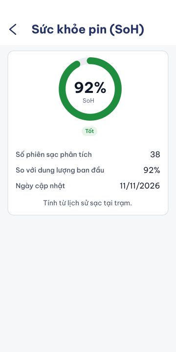
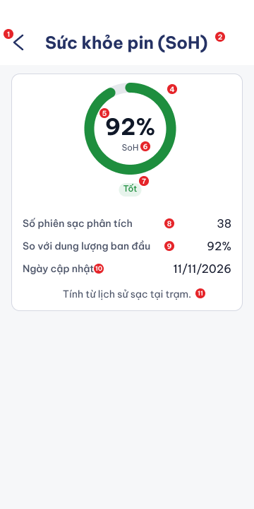
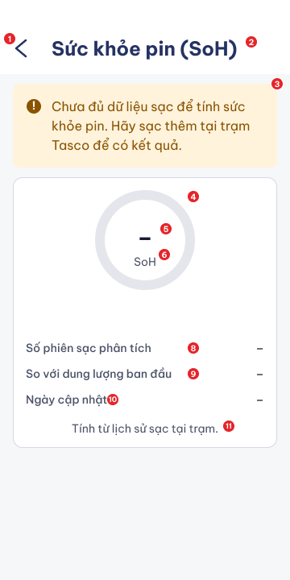
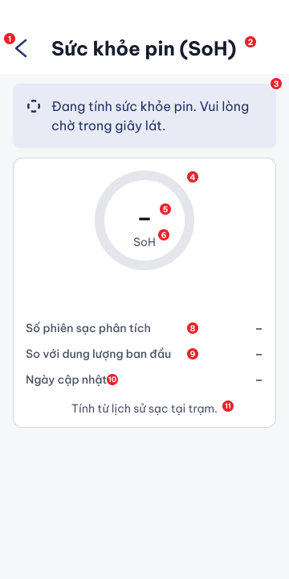
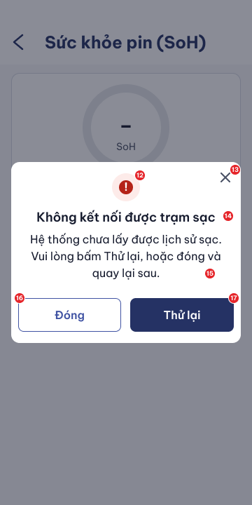
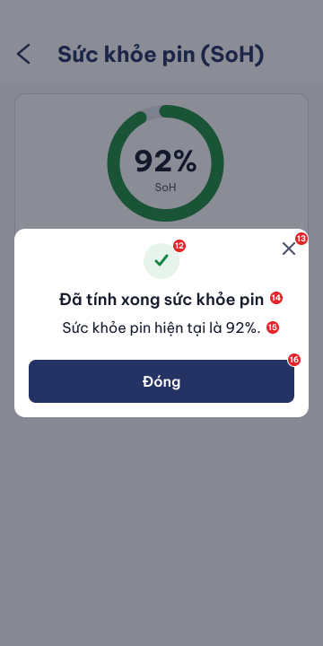

# Screen Spec: S-F01-06 Battery Health (SoH)

## 1. Purpose

| Field | Value |
| --- | --- |
| Screen ID | S-F01-06 |
| Screen name | Battery Health (SoH) (Vietnamese UI title in Top bar: "Sức khỏe pin (SoH)") |
| Actor | Car Owner (owner of an electric vehicle) |
| Priority | Could |
| Feature | F-01 Vehicle Passport |
| Activity diagrams | AD-UC-1.06 (Assess Battery Health Condition (SoH Calculation)) |
| Linked requirements | FR-01-08 (FE, INT, BE), see section 7 |
| Mockup images | `img/S-F01-06-default.png`, `img/S-F01-06-default-numbered.png`, five state images (section 2) |
| Frame width | 360 px |
| Figma frame | [Figma link: to be added] |
| Status | Reviewed |

**Shown when:** the car owner of an electric vehicle taps "Xem chi tiết" in the section "Sức khỏe pin" of S-F01-02 Vehicle Profile.

**The user leaves this screen when:** the user taps the Back arrow (1) in the Top bar and returns to S-F01-02. The screen is read-only and has no other exit.

## 2. Mockup

Default screen, without numbers:

Screens with numbered elements, one per state:

| Default, numbered | Empty, numbered | Loading, numbered | Error API, numbered | Success, numbered |
| --- | --- | --- | --- | --- |
|  |  |  |  |  |

| State | Image |
| --- | --- |
| Default | `img/S-F01-06-default.png` |
| Empty | `img/S-F01-06-empty.png` |
| Loading | `img/S-F01-06-loading.png` |
| Error API | `img/S-F01-06-error-API.png` |
| Success | `img/S-F01-06-success.png` |

Each number is the # of the element inventory in section 3. Element 3 (banner) appears only in the Empty and Loading states; elements 12 to 17 (popup) appear only in the Error API and Success states. The white card that holds elements 4 to 11 is a layout container and has no number. All colors, fonts, and corners come from the design tokens in [ui-conventions-car-owner](https://github.com/giangnhk63db/DBIZ-2_GROUP-A/blob/4f88e331210049e04b7fd420b043700c352bec19/External%20Design/ui-conventions-car-owner.md).

## 3. Element inventory

The whole screen is read-only. The screen has no input, Upload or Security element. Elements that sit at the same position and have the same number have different content depending on the state; the column "Content / data source" says which content applies in which state.

| # | Element | Category | Type | Content / data source | Required | Validation |
| --- | --- | --- | --- | --- | --- | --- |
| 1 | Back | Selection | Top bar, back arrow (button) | static; hit area 44 x 44. Shown in every state | Yes | none |
| 2 | Title | Display | Read-only text (Top bar screen name) | static: "Sức khỏe pin (SoH)" | Yes | none |
| 3 | Notification banner | Feedback | Banner (icon + read-only text) | Has no button. The content depends on the state: **Loading state:** info banner with loading icon, text "Đang tính sức khỏe pin. Vui lòng chờ trong giây lát.". It disappears when data is available. **Empty state:** warning banner with warning icon, text "Chưa đủ dữ liệu sạc để tính sức khỏe pin. Hãy sạc thêm tại trạm Tasco để có kết quả.". It stays until the data exists. Hidden in the Default, Error API and Success states. | No | none |
| 4 | SoH ring chart | Display | Ring chart | Ring that fills clockwise from the top in proportion to SoH. The content depends on the state: **Default and Success state:** green ring filled to the SoH value (example 92%). **Empty, Loading and Error API state:** grey track only, no fill (no value). **Data source:** soh.percent (proposed name), battery SoH percent, calculated as charging time from V1 to V2 (current battery) divided by charging time from V1 to V2 (new battery), times 100 (FR-01-08-BE) | Yes | none |
| 5 | SoH value | Display | Read-only text | SoH percent in the centre of the ring, whole number, no space. The content depends on the state: **Default and Success state:** value, example "92%" (soh.percent). **Empty, Loading and Error API state:** "—" (no value). | Yes | none |
| 6 | SoH label | Display | Read-only text | static: "SoH", under the SoH value (5). Shown in every state | Yes | none |
| 7 | SoH status badge | Display | Status badge (text in a pill) | Grade derived from the SoH percent, example "Tốt" (success style, green pill), no icon, centred under the ring (4). Which grades exist: see open question 1. **Default state:** shown. **Empty, Loading and Error API state:** hidden (no value). **Data source:** soh.grade (proposed name) | No | none |
| 8 | Charging sessions | Display | Label + read-only text | label "Số phiên sạc phân tích"; value: number of charging sessions used for the calculation (soh.session_count, proposed name; FR-01-08-INT), example "38". **Default and Success state:** the number. **Empty, Loading and Error API state:** "—". | Yes | none |
| 9 | Capacity ratio | Display | Label + read-only text | label "So với dung lượng ban đầu"; value: percent of original capacity (soh.capacity_ratio, proposed name; result of FR-01-08-BE), example "92%". **Default and Success state:** the percent. **Empty, Loading and Error API state:** "—". | Yes | none |
| 10 | Updated date | Display | Label + read-only text | label "Ngày cập nhật"; value: date of the calculation (soh.updated_at, proposed name), format dd/MM/yyyy, example "11/11/2026". **Default and Success state:** the date. **Empty, Loading and Error API state:** "—". | Yes | none |
| 11 | Source note | Display | Read-only text | static: "Tính từ lịch sử sạc tại trạm.", centred at the bottom of the card. Shown in every state | Yes | none |
| 12 | Popup icon | Dialogue | Icon in the Modal (popup) | The icon depends on the popup: **Error API state:** red error (warning) icon. **Success state:** green check icon. | No | none |
| 13 | Close popup | Selection | Icon button (X) in the Modal | static; hit area 44 x 44. Same in the error popup and the success popup | No | none |
| 14 | Popup title | Dialogue | Read-only text in the Modal | **Error API state:** "Không kết nối được trạm sạc". **Success state:** "Đã tính xong sức khỏe pin". | No | none |
| 15 | Popup message | Dialogue | Read-only text in the Modal | **Error API state:** "Hệ thống chưa lấy được lịch sử sạc. Vui lòng bấm Thử lại, hoặc đóng và quay lại sau." **Success state:** "Sức khỏe pin hiện tại là {SoH}.", example "Sức khỏe pin hiện tại là 92%." ({SoH} = soh.percent) | No | none |
| 16 | Close | Selection | Button in the Modal | static: "Đóng". The style depends on the popup: **Error API state:** secondary (outlined) button, on the left of Retry (17). **Success state:** primary button, full width. | No | none |
| 17 | Retry | Selection | Primary button in the Modal | static: "Thử lại"; error popup only (Error API state) | No | none |

**Note**: `soh.` fields are sourced from the charging data and the SoH calculation (FR-01-08). The field names are proposed and will be finalized with the data dictionary.

## 4. States

This screen is read-only and has no form, so there is no Error validate FE state.

| State | What the user sees | Trigger |
| --- | --- | --- |
| Default | SoH ring chart (4) filled to the SoH value, SoH value (5) "92%" and SoH label (6) in the centre, SoH status badge (7) "Tốt", the three rows (8, 9, 10) with values and the source note (11). No banner, no popup. | Charging data retrieved and SoH calculated (FR-01-08). |
| Empty | Banner (3, warning) at the top; SoH ring chart (4) with an empty grey ring, SoH value (5) "—" and "—" in the three rows (8, 9, 10), no badge (7), source note (11) kept. No popup. | The charging stations answer, but the data is not enough to calculate SoH (FR-01-08 EARS: estimation pending notice). |
| Loading | Banner (3, info) at the top; SoH ring chart (4) with an empty grey ring and "—" in the SoH value (5) and the three rows (8, 9, 10). No badge (7), no popup. | The car owner opens the details from the section "Sức khỏe pin" and the Loading state is shown on screen S-F01-02 (FR-01-08-INT). |
| Error API | Card with "—" everywhere (5, 8, 9, 10) and a grey ring (4), dimmed behind the error popup (12, 13, 14, 15, 16, 17) with title "Không kết nối được trạm sạc", buttons "Đóng" and "Thử lại" (and X). | The request to the charging stations fails after the maximum retries (BR-RET-02). |
| Success | Success popup (12 with check icon, 13, 14, 15, 16) with title "Đã tính xong sức khỏe pin", the message and button "Đóng" (and X), over the filled card (4, 5, 6). The content behind it cannot be used. After "Đóng" the screen is Default. | SoH was calculated successfully (see open question 3 for when it appears). |

## 5. Interactions and navigation

| # | Element | User action | System response | Goes to screen |
| --- | --- | --- | --- | --- |
| 1 | Back (1) | tap | Return to the vehicle profile | S-F01-02 |
| 2 | Retry (17) | tap (error popup) | Closes the popup, shows the Loading state and repeats the request with a fresh retry count | stays (loading, then success or error) |
| 3 | Close (16) | tap (error or success popup) | Closes the popup. After an error the screen keeps the Error API content behind it ("—" everywhere). After a success the screen is Default | stays |
| 4 | Close popup (13) | tap (error or success popup) | Same as Close (16) | same as Close (16) |

## 6. Screen-level rules

| Rule ID | Rule | Source |
| --- | --- | --- |
| SR-001 | The screen is reachable only for an electric vehicle; S-F01-02 shows the section "Sức khỏe pin" only for electric cars. | FR-01-08 (WHERE the vehicle is an electric vehicle); Screen List S-F01-02 |
| SR-002 | SoH is the charging time from V1 to V2 of the current battery divided by the charging time from V1 to V2 of a new battery, times 100, shown as a whole-number percent with no space (92%) in the SoH value (5) and the capacity ratio (9). | AD-UC-1.06 node s3; ui-conventions-car-owner §2 |
| SR-003 | If the charging data cannot be retrieved, the system retries automatically up to 3 times after the first attempt (4 attempts in total), 2 seconds apart. Only after the last failure does the error popup (12 to 17) appear. | BR-RET-02; AD-UC-1.06 open question 1 |
| SR-004 | Insufficient charging data is not an error: show the warning Banner (3), "—" in place of every value (5, 8, 9, 10), no badge (7), no popup and no button. The banner stays until the data exists. | ui-conventions §4 (Unavailable data); FR-01-08 |
| SR-005 | While loading, show the info Banner (3) in the screen content and "—" in the result area (5, 8, 9, 10); the banner disappears when data is available. | ui-conventions §4 (Waiting / loading) |
| SR-006 | The SoH status badge (7) is derived from the SoH percent and always shows its grade as text, so the information is never carried by colour alone. It is hidden when there is no SoH value. The grade thresholds (Tốt, Trung bình, Thấp) are defined in BR-SOH-01 (open question 1). | ui-conventions §3 (Status badge), §5; BR-SOH-01 |
| SR-007 | The screen is read-only: no Primary button on the screen, no input. The only actions are Back (1) and the popup buttons (13, 16, 17). | AD-UC-1.06 |
| SR-008 | Only one popup is shown at a time, and every popup has a Close popup X (13). While a popup is open, the controls behind it cannot be used. The popup buttons trigger an action (Retry (17) sends the request again) or only close the popup (Close (16)). | ui-conventions §3 (Modal) |
| SR-009 | Dates are dd/MM/yyyy; all visible text is Vietnamese, addresses the user as "bạn", no emoji, no exclamation marks. Proper names stay: SoH, Tasco. | ui-conventions §1, §2 |

## 7. Linked requirements

| FR ID | What this screen does for it |
| --- | --- |
| FR-01-08-FE | Displays the SoH ring chart (4), SoH value (5), status badge (7), charging sessions (8), capacity ratio (9), updated date (10), the Loading and Empty banner (3) and the popups (12 to 17). |
| FR-01-08-INT | Source of the charging session data: Tasco charging stations. Its failure after retries triggers the Error API state. |
| FR-01-08-BE | Calculates SoH (source of elements 4, 5, 7, 9). |

## 8. Responsive and accessibility notes

* Smallest supported width: 360px. Mockup frame 360 x 720, portrait, single column, vertical scroll only.

* What collapses or stacks on a narrow screen: the card keeps one column; each label stays on the left and its value on the right (8, 9, 10), and if a label does not fit it wraps to a second line while the value stays aligned to the right; the Top bar title (2) stays on one line and is truncated with "..." if too long; the ring chart (4) keeps its size and is centred.

* Information is never carried by colour alone: the green ring (4) is always accompanied by the number "92%" (5) and the badge text "Tốt" (7); the Banner (3) and the popups (12) carry an icon and text; the empty ring shows "—" (5).

* Text contrast and minimum size: SoH value (5) 24 px bold, body 16 px, labels and badge 14 px, never smaller; colours only from ui-conventions-car-owner §6.1, which passes the 4.5:1 check in §6.6 (green #1B7A43 on white is 5.37:1). The grey ring track is decorative because the value is also written as text. The layout must hold when the user enlarges the system font.

* Tap targets at least 44 x 44 px: Back arrow (1), Close popup X (13); popup buttons "Đóng" (16) and "Thử lại" (17) are at least 44 px high.

* The Banner (3) and the popups must be readable by a screen reader (loading icon, warning icon, error icon and check icon have a text alternative).

## 9. Open questions

| # | Question | Blocking? | Status |
| --- | --- | --- | --- |
| 1 | [NEEDS CLARIFICATION: The mockup shows the badge (7) "Tốt" for 92%. What other grades exist and from which SoH ranges (example: Tốt, Trung bình, Thấp)? Which icon and colour does each use?] | No for layout; Yes for build | Open. Default: Added business rule defining SoH grade classification thresholds (Good/Average/Low) via BR-SOH-01 and detailing UI state changes for Average/Low levels. |
| 2 | [NEEDS CLARIFICATION: What is the minimum charging data needed to calculate SoH (number of sessions, voltage window V1 to V2)? The W1 rows FR-01-08-FE, INT and BE are marked "EARS precise: No".] | Yes, for FR-01-08-BE | Open. Default: Added business rule BR-SOH-02 specifying the minimum valid charging sessions required for SoH calculation. |
| 3 | [NEEDS CLARIFICATION: Does the success popup (12 to 16) appear on every visit, or only when SoH is newly calculated (not read from a stored result)? Default applied: only when it was newly calculated in this visit. AD-UC-1.06 does not include this popup.] | No | Open. Default: Added business rule BR-SOH-05 specifying that the success popup triggers only when SoH is newly recalculated based on new valid charging sessions. |
| 4 | [NEEDS CLARIFICATION: Rounding of SoH to a whole number (nearest, round half up) is not defined in the Function List.] | No | Open. Default: Added business rule BR-SOH-03 defining the decimal rounding standard for SoH percentage. |
| 5 | [NEEDS CLARIFICATION: "Ngày cập nhật" (10) shows 11/11/2026. Is it the date of the last calculation or the date of the last charging session used?] | No | Open. Default: Added business rule BR-SOH-04 specifying SoH calculation frequency and update triggers upon new session sync or re-evaluation intervals. |

## Completion checklist

* [x] The mockup is a separate cropped image file, named with the Screen ID, at the frame width.

* [x] The numbered images exist, and their numbers match the # column of the element inventory (1 to 17).

* [x] Every visible element in the mockup appears in the element inventory.

* [x] Every input element has a validation rule or an explicit "none" (the screen has no input element).

* [x] All five states are filled in.

* [x] Every navigation target is a Screen ID that exists in the Screen List.

* [x] Every element that displays data names the field it displays.

* [x] Every linked FR exists in the Function List, and every action of this screen in an activity diagram is covered by an interaction row (AD-UC-1.06 actions a1, a2 and error_view are covered by rows 1, 1 and 2 to 4).
