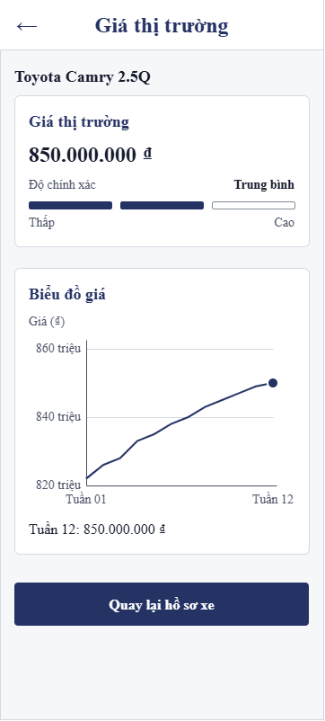
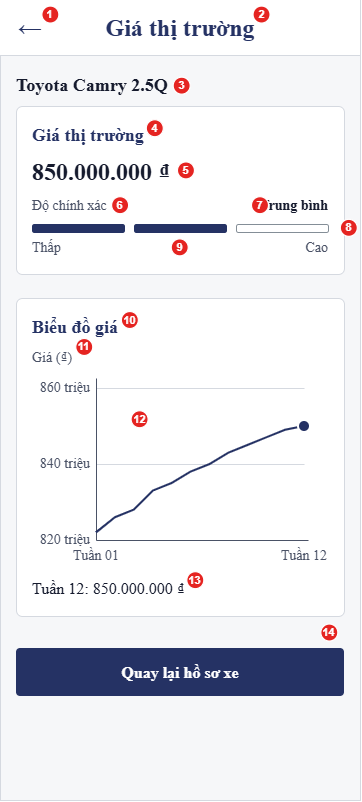
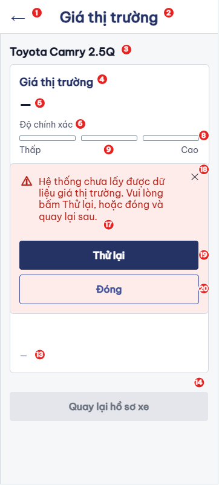

# Screen Spec: S-F02-01 Market price \& 12-week trend

|Field|Value|
|-|-|
|Screen ID|S-F02-01|
|Screen name|Market Price \& 12-Week Trend (Vietnamese UI title in Top bar: "Giá thị trường")|
|Actor|Car Owner|
|Priority|Must|
|Feature|F-02 Market Price|
|Activity diagrams|AD-UC-2.10: action "View market price and 12-week trend chart", system actions "Display Calculating Price" and "Display market price and 12-week trend chart". UC-2.01 and UC-2.02 have no activity diagram (simple use cases; their behaviour is the EARS criterion of FR-02-10 and FR-02-11)|
|Linked requirements|FR-02-10 View market price (Must), FR-02-11 View 12-week price trend chart (Should), see section 7|
|Mockup images|`img/S-F02-01-default.png`, `img/S-F02-01-default-numbered.png`, `img/S-F02-01-error-numbered.png`, four state images (section 2)|
|Frame width|360px |
|Figma frame|not used |
|Status|Draft|

## 1\. Purpose

**Shown when:** the car owner clicks "Xem xu hướng" in the section "Market data" of S-F01-02 (Vehicle Profile) to see the latest weekly market price, its confidence level and the 12-week trend chart.

**The user leaves this screen when:** the car owner goes back to S-F01-02, with the Back arrow of the Top bar or the button "Quay lại hồ sơ xe".

## 2\. Mockup

**Numbered:** each number is the # of the element inventory in section 3. Elements 15 and 16 appear only in the loading and empty states, so they are described in section 3 but not numbered on the two images below. Elements 17 to 20 (popup) appear only in the error and success states, so they are numbered on the error image.

|Default, numbered|Error, numbered|
|-|-|
|||

|State|Image|
|-|-|
|Default|`img/S-F02-01-default.png`|
|Empty|`img/S-F02-01-empty.png`|
|Loading|`img/S-F02-01-loading.png`|
|Error|`img/S-F02-01-error.png` (system error popup, FR-02-10 / FR-02-11)|
|Success|`img/S-F02-01-success.png`|

All colours, fonts and corners come from the design tokens in
[ui-conventions-car-owner.md](../ui-conventions-car-owner.md#6-design-tokens).

## 3\. Element inventory

This screen is read-only: it has no Input, Date time, Upload or Security element, so no textbox or textarea.

|#|Element|Category|Type|Content / data source|Required|Validation|
|-|-|-|-|-|-|-|
|1|Back|Selection|Top bar, back arrow (button)|static|Yes|none|
|2|Title|Display|Read-only text (Top bar screen name)|static: "Giá thị trường"|Yes|none|
|3|Vehicle name|Display|Read-only text|`vehicle.make`, `vehicle.model`, `vehicle.variant` (for example "Toyota Camry 2.5Q")|Yes|none|
|4|Price card title|Display|Read-only text (Section card title)|static: "Giá thị trường"|Yes|none|
|5|Latest market price|Display|Read-only text|`market\_price.latest\_price` (FR-02-10); format `850.000.000 ₫`; shows "—" when there is no price|Yes|none|
|6|Confidence label|Display|Read-only text|static: "Độ chính xác"|Yes|none|
|7|Confidence level|Display|Read-only text|`market\_price.confidence\_level`: "Thấp", "Trung bình" or "Cao" (FR-02-10, level assigned by FR-02-05); empty when there is no price|Yes|none|
|8|Confidence bar|Display|Bar of 3 segments (read-only)|`market\_price.confidence\_level`: 1, 2 or 3 segments filled; all empty when there is no price|Yes|none|
|9|Confidence scale|Display|Read-only text|static: "Thấp" (left end), "Cao" (right end)|Yes|none|
|10|Chart card title|Display|Read-only text (Section card title)|static: "Biểu đồ giá"|Yes|none|
|11|Price axis title|Display|Read-only text|static: "Giá (₫)"|Yes|none|
|12|Price trend chart|Display|Line chart (read-only)|`market\_price\_history.week\_label` (x-axis, "Tuần 01" to "Tuần 12") and `market\_price\_history.price` (y-axis, in millions of dong, for example "840 triệu"); the latest week is marked with a dot (FR-02-11)|Yes|exactly 12 weekly points (the 12 most recent weeks); fewer than 12 weekly prices: the chart is not drawn and element 16 is shown instead (FR-02-11)|
|13|Latest week value|Display|Read-only text|"Tuần 12: " + `market\_price.latest\_price`; shows "—" when there is no price (conventions: the latest value is also written as text)|Yes|none|
|14|Back to profile|Selection|Primary button|static: "Quay lại hồ sơ xe"|Yes|none|
|15|Calculating banner|Feedback|Banner (info, icon + read-only text, no button)|static: "Đang tính giá thị trường cho xe của bạn. Vui lòng quay lại sau." (FR-02-10: "Calculating" message) Sits inside the price card, under element 4; visible only in the loading state|No|none|
|16|Empty message|Feedback|Empty-state message (icon + read-only text)|static: "Chưa có dữ liệu giá thị trường cho xe này. Bạn có thể quay lại hồ sơ xe và xem lại sau." Sits in the chart card in place of the chart (11, 12); visible only in the empty state|No|none|
|17|Notification message|Dialogue|Modal (popup), read-only text message|Success: "Đã cập nhật giá thị trường. Giá và biểu đồ 12 tuần đã sẵn sàng." with check icon. Error: "Hệ thống chưa lấy được dữ liệu giá thị trường. Vui lòng bấm Thử lại, hoặc đóng và quay lại sau." with warning icon|No|none|
|18|Close popup|Selection|Icon button (X) in the Modal|static|No|none|
|19|Retry|Selection|Primary button in the Modal|static: "Thử lại"; error popup only|No|none|
|20|Close|Selection|Button in the Modal|static: "Đóng"; primary style in the success popup, secondary style in the error popup|No|none|

## 4\. States

|State|What the user sees|Trigger|
|-|-|-|
|Default|Price card with the latest price (5), confidence level (7) and bar (8); chart card with the 12-week line chart (12) and the latest week value (13); button "Quay lại hồ sơ xe" (14). The mockup shows confidence "Trung bình" (2 of 3 segments) and price 850.000.000 ₫.|Screen opened and the price and the 12-week history are loaded|
|Empty (no data)|Price (5) and latest week value (13) show "—"; the confidence bar is empty and has no level text; the chart card shows the message (16) in place of the chart. The button "Quay lại hồ sơ xe" stays active. No popup and no banner.|The weekly calculation has finished but recorded INSUFFICIENT\_DATA for this car (mileage below 2,000 km per year, FR-02-01; or mileage missing/implausible or fewer than 30 comparable listings, FR-02-05, FR-02-06, AD-UC-2.10 d2 and d3), so there is no price. The case "fewer than 12 weekly prices" (FR-02-11) is described in SR-009|
|Loading|Banner (15) with a loading icon inside the price card; price (5) and latest week value (13) show "—"; the confidence bar is empty; the chart area is blank with "—". The banner disappears when the data is available. The button stays active.|No weekly price exists for the car yet (FR-02-10: message "Calculating"), for example right after a new vehicle whose model is not yet in the listing store is added (AD-UC-2.10, s1), or the data is being fetched|
|Error|Error popup (17 to 20) with warning icon, message, button "Thử lại" and button "Đóng" (and X). Behind it the screen shows "—" in place of data, and the button "Quay lại hồ sơ xe" is shown inactive while the popup is open.|The system could not get the market price data from the server after the maximum retries (L3 work items FR-02-09-BE and FR-02-10-BE, see section 7)|
|Success / confirmation|Success popup (17, 18, 20) with check icon, the message and button "Đóng" (and X). Behind it the price and the chart are filled; the button "Quay lại hồ sơ xe" is shown inactive while the popup is open.|The price and the 12-week history have been calculated and loaded while the car owner is on this screen|

## 5\. Interactions and navigation

|#|Element|User action|System response|Goes to screen|
|-|-|-|-|-|
|1|Back (1)|tap|Returns without any change|S-F01-02|
|2|Back to profile (14)|tap|Returns without any change|S-F01-02|
|3|Retry (19)|tap (error popup)|Closes the popup, shows the loading state and sends the request again|stays (loading, then default, empty or error)|
|4|Close (20)|tap (error or success popup)|Closes the popup. After an error the screen keeps "—" in place of data; after a success the price and the chart stay visible|stays|
|5|Close popup (18)|tap (error or success popup)|Same as Close (20)|stays|
|6|Price trend chart (12)|none|The chart is not interactive|stays|
|7|Screen (on open)|tap "Xem xu hướng" on S-F01-02 (AD-UC-2.10, a2)|Reads the latest weekly price, confidence level and the 12 weekly prices, then shows the Default, Empty, Loading or Error state (AD-UC-2.10, s1 and s9)|S-F02-01|

## 6\. Screen-level rules

|Rule ID|Rule|Source|
|-|-|-|
|SR-001|The screen is read-only and shows the latest weekly market price and the 12 weekly prices of this vehicle.|FR-02-10, FR-02-11|
|SR-002|The confidence level has 3 values. 1, 2 or 3 bar segments are filled for "Thấp", "Trung bình" and "Cao", and the level text is always written next to the bar (never by fill alone).|FR-02-10, FR-02-05|
|SR-003|While the data is not available, each missing value shows "—" and the chart area stays blank.|ui-conventions §4|
|SR-004|Loading and "Calculating Price" are shown as a Banner, not a popup. The banner has no button and disappears when the data is available.|FR-02-10, ui-conventions §4|
|SR-005|Empty is shown on the screen in place of the chart, with the reason and the next action. It is not a popup.|ui-conventions §4|
|SR-006|A system error is shown as a popup only after the maximum retries, with the buttons "Thử lại" and "Đóng". A success popup has one button "Đóng". A popup is never used for navigation.|ui-conventions §3, §4|
|SR-007|While a popup is open, the controls behind it cannot be used.|ui-conventions §3 (Modal)|
|SR-008|Formats: price `850.000.000 ₫`; chart y-axis in millions ("840 triệu"); x-axis "Tuần 01" to "Tuần 12"; the latest week value is also written as text under the chart. The price shown is the median of the weekly price record (rounded to the nearest million VND); the P25-P75 range is not shown on this screen.|FR-02-06, ui-conventions §2|
|SR-009|When fewer than 12 weekly prices exist, the chart is not drawn and the chart card shows the empty message (16) instead (the price card still shows the latest price if one exists).|FR-02-11|

## 7\. Linked requirements

|FR ID (L2)|What this screen does for it|L3 work items (IDs as written in the Function List)|
|-|-|-|
|FR-02-10 View market price|Displays the latest weekly market price and its confidence level; shows the "Calculating" banner when no weekly price exists yet|FR-02-09-FE (display), FR-02-09-BE (read latest price and confidence)|
|FR-02-11 View 12-week price trend chart|Displays the 12-week line chart; shows the empty message when fewer than 12 weekly prices exist|FR-02-10-FE (chart), FR-02-10-BE (read the latest 12 weeks)|
|FR-02-05, FR-02-06 (background, no UI)|Produce the confidence level and the price that this screen reads|not part of this screen|

## 8\. Responsive and accessibility notes

* Smallest supported width: 360px, single column, vertical scroll only; no horizontal scroll.
* On a narrow screen the confidence bar and the chart shrink to the card width; the three bar segments stay on one row.
* Information is never carried by colour alone: confidence has the level text next to the bar; the popups have an icon and text; the chart has axis labels and the latest value written as text (13).
* Text contrast at least 4.5:1; body text at least 14 px; layout must not break when the system font is enlarged.
* Tap targets at least 44 x 44 px: Back arrow (1), "Quay lại hồ sơ xe" (14), popup X (18), "Thử lại" (19), "Đóng" (20).
* The loading banner and the error popup must be readable by a screen reader (loading icon and warning icon have a text alternative).

## 9\. Open questions

|#|Question|Blocking?|Status|
|-|-|-|-|
|1|\[NEEDS CLARIFICATION: FR-02-11 says "No historical data available" when fewer than 12 weekly prices exist, but the Empty mockup shows no price and a different text ("Chưa có dữ liệu giá thị trường cho xe này..."). Need a mockup or text for the case: latest price exists, chart replaced by a message (SR-009).]|No|Open. Default: reuse element 16 in the chart card.|
|2|\[NEEDS CLARIFICATION: the source trace of FR-02-10 lists only UC-2.01 and FR-02-11 only UC-2.02, but AD-UC-2.10 (s1) shows "Calculating Price" through FR-02-09-FE (L2 FR-02-10), and the Screen List also serves UC-2.10. Add UC-2.10 to FR-02-10 in the Function List.]|No|Open|
|3|\[NEEDS CLARIFICATION: AD-UC-2.10 open question 5 is still open: when some weeks are INSUFFICIENT\_DATA, does the chart show gaps or is the chart replaced by the message of FR-02-11 ("fewer than 12 weekly prices")? This spec follows FR-02-11 (SR-009).]|No|Open. Default: as FR-02-11.|
|4|\[NEEDS CLARIFICATION: field names in section 3 (`market\_price.\*`, `market\_price\_history.\*`, `vehicle.\*`) are proposed. Confirm them with the data dictionary.]|No|Open|
|5|\[NEEDS CLARIFICATION: after "Thử lại" succeeds, does the screen show the success popup or go straight to the default state?]|No|Open. Default: straight to default.|

\---

## Completion checklist

* \[x] The mockup is a separate cropped image file, named with the Screen ID, at the frame width.
* \[x] The numbered image exists, and its numbers match the # column of the element inventory.
* \[x] Every visible element in the mockup appears in the element inventory.
* \[x] Every colour in the mockup is a design token from ui-conventions-car-owner.md.
* \[x] Every input element has a validation rule or an explicit "none". (This screen has no input; the column says "none".)
* \[x] All five states are filled in.
* \[x] Every navigation target is a Screen ID that exists in the Screen List.
* \[x] Every element that displays data names the field it displays.
* \[x] Every linked FR exists in the Function List (FR-02-10, FR-02-11).
* \[x] Every action of this screen in AD-UC-2.10 (a2, s1, s9) is covered: a2 by interaction row 7, s1 by the Loading state, s9 by the Default state. UC-2.01 and UC-2.02 have no activity diagram.

