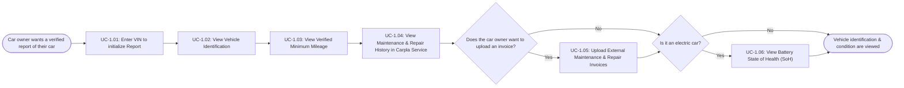
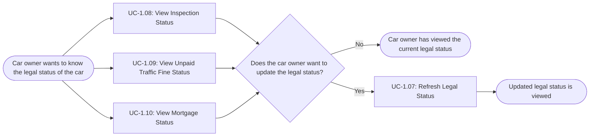
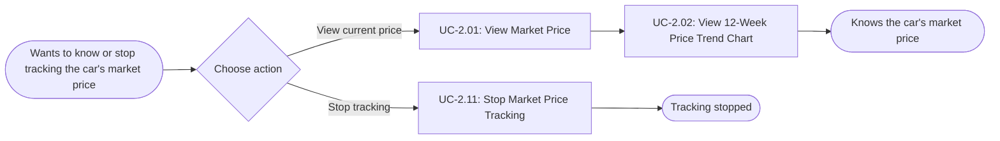
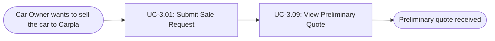
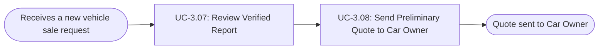

# Usage Flow: TASCO Verified Vehicle Report System

## 1.  Car Owner: Create the verified vehicle report and view vehicle identification & condition 

| Field | Value |
| ----- | ----- |
| Product | TASCO Verified Vehicle Report System |
| Version | v0.1 |
| Date | 2026-11-05 |
| Sources | W0 Table 1 (use case inventory); Use Case Diagram; Activity Diagram Index |

| Step | Use case | Activity diagram | Screens (fill in after Block 2\) |
| :---: | ----- | ----- | :---: |
| 1 | UC-1.01: Enter VIN to initialize Report | AD-UC-1.01.md | S-F01-01  |
| 2 | UC-1.02: View Vehicle Identification | not needed | S-F01-02  |
| 3 | UC-1.03: View Verified Minimum Mileage | AD-UC-1.03.md  | S-F01-03  |
| 4 | UC-1.04: View Maintenance & Repair History in Carpla Service | not needed | S-F01-02, S-F01-05  |
| 5 | UC-1.05: Upload External Maintenance & Repair Invoices | AD-UC-1.05.md | S-F01-05  |
| 6 | UC-1.06: View Battery State of Health (SoH) | AD-UC-1.06.md | S-F01-02, S-F01-06  |

## 2. Car Owner:  View and refresh the legal status 

| Step | Use case | Activity diagram | Screens (fill in after Block 2\) |
| ----- | ----- | ----- | ----- |
| 1 | UC-1.07: Refresh Legal Status | AD-UC-1.07.md | S-F01-02  |
| 2 | UC-1.08: View Inspection Status | not needed | S-F01-02  |
| 3 | UC-1.09: View Unpaid Traffic Fine Status | not needed | S-F01-02  |
| 4 | UC-1.10: View Mortgage Status | not needed | S-F01-02  |

## 3. Car owner: Track market price and trends

| Field | Value |
| ----- | ----- |
| Product | TASCO Verified Vehicle Report System |
| Version | v0.1 |
| Date | 2026-11-05 |
| Sources | W0 Table 1 (use case inventory); Use Case Diagram; Activity Diagram Index |

| Step | Use case | Activity diagram | Screens (fill in after Block 2\) |
| ----- | ----- | ----- | ----- |
| 1 | UC-2.01: View Market Price | not needed | S-F01-02, S-F02-01  |
| 2 | UC-2.02: View 12-Week Price Trend Chart | not needed | S-F02-01  |
| 3 | UC-2.11: Stop Market Price Tracking | not needed | No screen  |

## 4. Car Owner: Sell  the car to Carpla and request preliminary quote 

| Field | Value |
| ----- | ----- |
| Product | TASCO Verified Vehicle Report System |
| Version | v0.1 |
| Date | 2026-11-05 |
| Sources | W0 Table 1 (use case inventory); Use Case Diagram; Activity Diagram Index |

| Step | Use case | Activity diagram | Screens (fill in after Block 2\) |
| ----- | ----- | ----- | ----- |
| 1 | UC-3.01: Submit Sale Request | AD-UC-3.01.md | S-F03-01  |
| 2 | UC-3.09: View Preliminary Quote | not needed | S-F03-03   |

5. Carpla Staff: Process sale request and send quote

| Step | Use case | Activity diagram | Screens (fill in after Block 2\) |
| ----- | ----- | ----- | ----- |
| 1 | UC-3.07: Review Verified Report | not needed | S-F03-02  |
| 2 | UC-3.08: Send Preliminary Quote to Car Owner | not needed | S-F03-02  |

Use cases without a flow

| Use case | Started by | Described in |
| ----- | ----- | ----- |
| UC-2.03: Check Verified Mileage Plausibility | VETC (External System) | not needed |
| UC-2.04: Calculate Weekly Market Price | Weekly timer | AD-UC-2.04.md |
| UC-2.05: Sync Listings from Partner Marketplaces | Nextgen VN, Chợ Tốt (External Systems) | AD-UC-2.05.md |
| UC-2.06: Sync 180-Day Listing History (for the 1st time signed up car) | Nextgen VN (External System) | not needed |
| UC-2.07: Normalize and Clean Listings | Weekly timer / System (Included by UC-2.04) | AD-UC-2.07.md |
| UC-2.08: Select Comparable Vehicles | Weekly timer / System (Included by UC-2.04) | AD-UC-2.08.md |
| UC-2.09: Calculate Market Price and Confidence | Weekly timer / System (Included by UC-2.04) | AD-UC-2.09.md |
| UC-2.10: Backfill 12-Week Price History | System (when the owner adds a vehicle for the first time)  | AD-UC-2.10.md |
| UC-3.02: Re-check Legal Status | System | not needed |
| UC-3.06: Package & Forward Verified Report and Market Price to Carpla Staff | System | AD-UC-3.06.md |
| UC-3.03: Check Inspection Status | System | AD-UC-3.03.md |
| UC-3.04: Check Unpaid Traffic Fine Status | System | AD-UC-3.04.md |
| UC-3.05: Check Mortgage Status | System | AD-UC-3.05.md |

