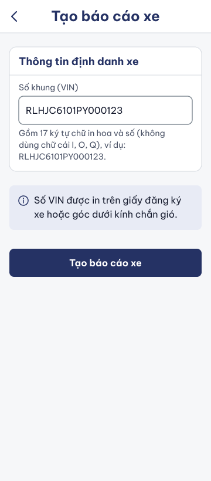
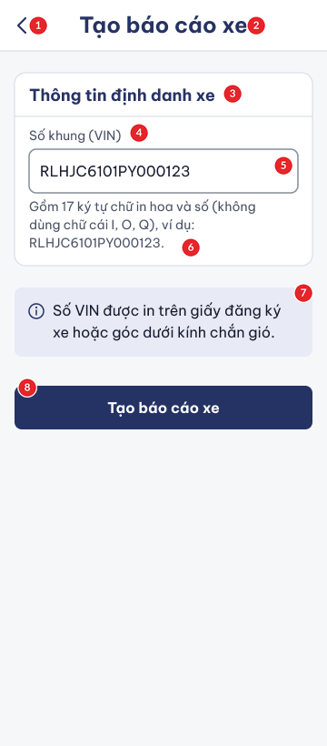
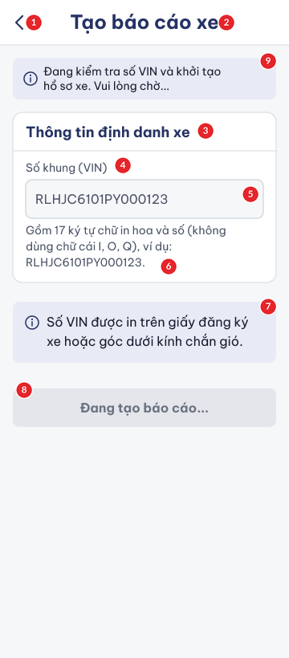
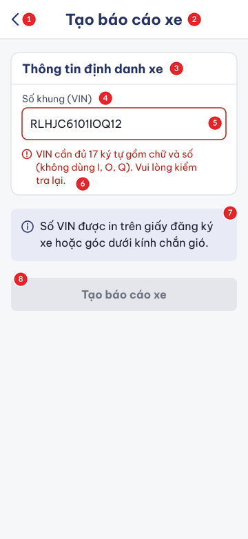
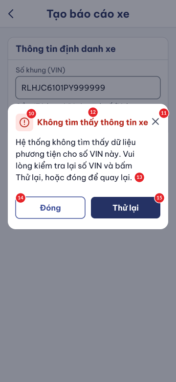
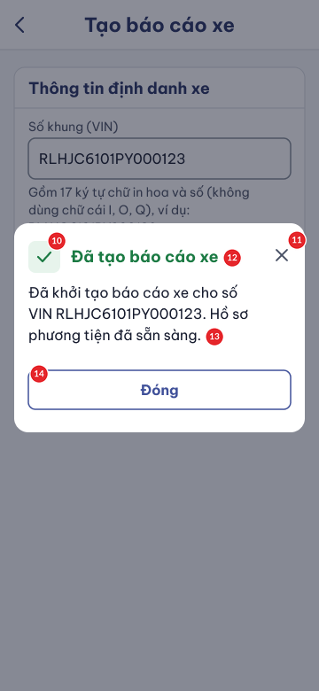

# Screen Spec: S-F01-01 Create Vehicle Report

| Field | Value |
|---|---|
| Screen ID | `S-F01-01` |
| Screen name | Create Vehicle Report (Vietnamese UI title: `"Tạo báo cáo xe"`) |
| Actor | Car Owner |
| Priority | Must |
| Feature | `F-01 Vehicle Passport` |
| Activity diagrams | `AD-UC-1.01` |
| Mockup image | `img/S-F01-01-default.png` |
| Status | Reviewed |

## 1. Purpose

**Shown when:** A signed-in Car Owner taps `"Tạo báo cáo xe"` on the Home screen (`S-F00-01`) to register a vehicle and initialize a new `Verified vehicle report` using its 17-character VIN.

**The user leaves this screen when:** The Car Owner dismisses the `"Đã tạo báo cáo xe"` confirmation popup (via `"Đóng"` or `×`) after successful VIN verification to proceed to the Vehicle Profile screen (`S-F01-02`), or taps the top-bar back arrow (`<`) to return to `S-F00-01`.

## 2. Mockup

**Numbered:** Each number corresponds to the `#` column of the element inventory in Section 3 (`1–8` for the base form and primary CTA, `9` for the top loading banner, and `10–15` for result/error popups).

- Verification progress banner (`9`) appears only in the `Loading` state.
- Popup elements `10–15` appear only in the `Error validate BE`, `Error API`, and `Success` states (`Retry popup button` `15` appears only in `Error validate BE` and `Error API`). When a popup is open, the dimmed background behind it is blocked and has no numbers.
- The Top bar, the grey page background, card/modal containers, and the dimmed layer behind a popup are layout containers and have no number.

| Default, numbered | Loading, numbered | Error validate FE, numbered |
| :---: | :---: | :---: |
|  |  |  |

| Error validate BE, numbered | Error API, numbered | Success, numbered |
| :---: | :---: | :---: |
|  |  |  |

| State | Image | Numbered image |
| :--- | :--- | :--- |
| Default | `img/S-F01-01-default.png` | `img/img-numbered/S-F01-01-default-numbered.png` |
| Empty | Described in Section 4 (textbox placeholder shown, primary CTA disabled) | — |
| Loading | `img/S-F01-01-loading.png` | `img/img-numbered/S-F01-01-loading-numbered.png` |
| Error validate FE | `img/S-F01-01-error-validate-FE.png` | `img/img-numbered/S-F01-01-error-validate-FE-numbered.png` |
| Error validate BE | `img/S-F01-01-error-validate-BE.png` | `img/img-numbered/S-F01-01-error-validate-BE-numbered.png` |
| Error API | `img/S-F01-01-error-API.png` | `img/img-numbered/S-F01-01-error-API-numbered.png` |
| Success | `img/S-F01-01-success.png` | `img/img-numbered/S-F01-01-success-numbered.png` |

All colours, fonts, spacing, and corner radii come from the design tokens in `ui-conventions-car-owner.md`.

## 3. Element inventory

The only input element is the `VIN text input field` (`5`). Elements that sit at the same position and share the same number (`6`, `8`, `10`, `12`, `13`, `14`) change their content or style depending on the state; the column `"Content / data source"` specifies which content applies in each state.

| # | Element | Type | Content / data source | Required | Validation |
|---|---|---|---|---|---|
| 1 | Back navigation button | Button (top bar back arrow) | Static left chevron icon (`44 × 44px` tap target) | Yes | none |
| 2 | Screen title header | Header (top bar title) | Static: `"Tạo báo cáo xe"` | Yes | none |
| 3 | Section card title | Header (section card header) | Static: `"Thông tin định danh xe"` | Yes | none |
| 4 | VIN input field label | Text (field label) | Static: `"Số khung (VIN)"` | Yes | none |
| 5 | VIN text input field | Input (textbox) | 17-character alphanumeric string (`vehicle.vin`, e.g., `"RLHJC6101PY000123"`) written to `Verified vehicle report` and verified against `VETC vehicle data` (`FR-01-01-FE`, `FR-01-01-BE`). Red border (`#B42318`) in `Error validate FE`; read-only grey fill in `Loading`. | Yes | `BR-VFVR-01`: Required; exact length = 17 characters; uppercase alphanumeric (`A–Z`, `0–9`) excluding letters `I`, `O`, and `Q`; backend existence check (`FR-01-01-BE`) |
| 6 | VIN helper / inline error text | Text (helper / inline error) | **Default / Empty / Loading:** Static hint `"Gồm 17 ký tự chữ in hoa và số (không dùng chữ cái I, O, Q), ví dụ: RLHJC6101PY000123."` **Error validate FE:** Warning icon (`!`) + red text (`#B42318`) `"VIN cần đủ 17 ký tự gồm chữ và số (không dùng I, O, Q). Vui lòng kiểm tra lại."` | Yes | none |
| 7 | VIN location guidance banner | Text (info banner) | Info icon (`i`) + static text: `"Số VIN được in trên giấy đăng ký xe hoặc góc dưới kính chắn gió."` | Yes | none |
| 8 | Submit VIN primary button | Button (primary CTA) | **Default / Empty / Error validate FE:** Static `"Tạo báo cáo xe"` **Loading:** Disabled button with static `"Đang tạo báo cáo..."` | Yes | Disabled (`#E4E6EB` fill, `#6B7280` text) in `Empty`, in `Error validate FE` until `#5` is edited, or during `Loading` |
| 9 | Verification progress banner | Text (loading banner) | Info icon (`i`) + static text: `"Đang kiểm tra số VIN và khởi tạo hồ sơ xe. Vui lòng chờ..."` (`Loading` state only, placed above the section card) | No | none |
| 10 | Popup status icon | Image (modal status icon) | **Error validate BE / Error API:** Red warning icon (`!`) in `#FEE4E2` rounded box. **Success:** Green check icon (`✓`) in `#E7F4EC` rounded box. | No | none |
| 11 | Close popup icon button | Button (modal close icon) | Static close icon (`×`, `44 × 44px` tap target). Shown in `Error validate BE`, `Error API`, and `Success` popups (`10–15`). | No | none |
| 12 | Popup title | Header (modal title) | **Error validate BE:** `"Không tìm thấy thông tin xe"` (`#B42318`) **Error API:** `"Lỗi kết nối hệ thống"` (`#B42318`) **Success:** `"Đã tạo báo cáo xe"` (`#1B7A43`) | No | none |
| 13 | Popup body message | Text (modal body) | **Error validate BE:** `"Hệ thống không tìm thấy dữ liệu phương tiện cho số VIN này. Vui lòng kiểm tra lại số VIN và bấm Thử lại, hoặc đóng để quay lại."` **Error API:** `"Hệ thống chưa khởi tạo được báo cáo xe từ số VIN này. Vui lòng bấm Thử lại, hoặc đóng và quay lại sau."` **Success:** `"Đã khởi tạo báo cáo xe cho số VIN <vehicle.vin>. Hồ sơ phương tiện đã sẵn sàng."` (e.g., `"RLHJC6101PY000123"`) | No | none |
| 14 | Close popup button | Button (modal secondary button) | Static: `"Đóng"`. Left outlined button next to `Retry popup button` (`15`) in `Error validate BE` and `Error API`; full-width outlined button in `Success`. | No | none |
| 15 | Retry popup button | Button (modal primary button) | Static: `"Thử lại"`. Right primary button in `Error validate BE` and `Error API` popups only. | No | none |

## 4. States

| State | What the user sees | Trigger |
|---|---|---|
| Default | Top bar (`1`, `2`), section card `"Thông tin định danh xe"` (`3`) with label (`4`) and a 17-character VIN entered in `5`, helper text with example (`6`), info banner (`7`), and enabled primary button `"Tạo báo cáo xe"` (`8`, `#253264`). | Car Owner has entered a non-empty VIN string ready for submission. |
| Empty | Same layout as `Default`, except `5` is empty (showing placeholder `"Nhập số khung 17 ký tự"`) and button `8` is disabled (`#E4E6EB` fill, `#6B7280` text). | Car Owner opens `S-F01-01` from `S-F00-01` or deletes all characters in `5`. |
| Loading | Top info banner `"Đang kiểm tra số VIN và khởi tạo hồ sơ xe. Vui lòng chờ..."` (`9`) appears above the section card; input `5` is read-only with grey fill; primary button `8` is disabled and changes label to `"Đang tạo báo cáo..."`. | Car Owner taps `"Tạo báo cáo xe"`, passes client-side format check (`d1 [Yes]`), and awaits `FR-01-01-BE` verification. |
| Error validate FE | Input `5` border turns `#B42318`, inline error `6` displays `"VIN cần đủ 17 ký tự gồm chữ và số (không dùng I, O, Q). Vui lòng kiểm tra lại."`, and button `8` is disabled until `5` is edited. | Submitted VIN fails `BR-VFVR-01` on client-side check (`d1 [No]`: length ≠ 17 or contains `I`, `O`, `Q`). |
| Error validate BE | Popup (`10–15`) over 50% `#161B2E` dimmed layer displays red warning icon (`10`), title `"Không tìm thấy thông tin xe"` (`12`), message `"Hệ thống không tìm thấy dữ liệu phương tiện cho số VIN này. Vui lòng kiểm tra lại số VIN và bấm Thử lại, hoặc đóng để quay lại."` (`13`), `"Đóng"` (`14`), `"Thử lại"` (`15`), and `×` (`11`). | Backend (`FR-01-01-BE`) completes the lookup (`d2 [No]`) but finds no matching vehicle record for the submitted VIN. |
| Error API | Popup (`10–15`) over 50% `#161B2E` dimmed layer displays red warning icon (`10`), title `"Lỗi kết nối hệ thống"` (`12`), message `"Hệ thống chưa khởi tạo được báo cáo xe từ số VIN này. Vui lòng bấm Thử lại, hoặc đóng và quay lại sau."` (`13`), `"Đóng"` (`14`), `"Thử lại"` (`15`), and `×` (`11`). | External lookup service or backend API connection fails or times out during VIN verification. |
| Success | Confirmation popup (`10–14`) over 50% `#161B2E` dimmed layer displays green check icon (`10`), title `"Đã tạo báo cáo xe"` (`12`), message `"Đã khởi tạo báo cáo xe cho số VIN <vehicle.vin>. Hồ sơ phương tiện đã sẵn sàng."` (`13`), full-width button `"Đóng"` (`14`), and `×` (`11`). | Backend (`FR-01-01-BE`) confirms VIN existence (`d2 [Yes]`) and initializes the `Verified vehicle report`. |

## 5. Interactions and navigation

| # | Element | User action | System response | Goes to screen |
|---|---|---|---|---|
| 1 | Back navigation button (`1`) | tap | Discards unsaved VIN input and returns to the Home screen. | `S-F00-01` |
| 2 | VIN text input field (`5`) | type | Auto-converts lowercase characters to uppercase, trims spaces, clears any `Error validate FE` inline error (`6`), and enables `"Tạo báo cáo xe"` (`8`) once length ≥ 1. | "stays" |
| 3 | Submit VIN primary button (`8`) | tap | Runs client-side format check (`d1`). If `[No]`, blocks API call and enters `Error validate FE` (`6`). If `[Yes]`, enters `Loading` (`9`) and calls `FR-01-01-BE` (`d2`), opening `Error validate BE`, `Error API`, or `Success` popup based on the response. | "stays" |
| 4 | Retry popup button (`15` in `Error validate BE` / `Error API`) | tap | Closes the error popup, enters `Loading` (`9`), and re-sends the VIN verification request to `FR-01-01-BE`. | "stays" |
| 5 | Close popup button (`14` / `11` in `Error validate BE` / `Error API`) | tap | Dismisses the error popup and returns focus to the VIN form so the Car Owner can edit the VIN. | "stays" |
| 6 | Close popup button (`14` / `11` in `Success`) | tap | Dismisses the confirmation popup and navigates to the newly initialized Vehicle Profile screen. | `S-F01-02` |

## 6. Screen-level rules

| Rule ID | Rule | Source |
|---|---|---|
| SR-001 | **VIN Format Validation (`BR-VFVR-01`):** A valid VIN must be exactly 17 uppercase alphanumeric characters (`A–Z`, `0–9`) and strictly exclude `I`, `O`, and `Q`. | `AD-UC-1.01` (`BR-VFVR-01`) |
| SR-002 | **Client-Side Gatekeeping:** Client-side validation (`FR-01-01-FE`) runs immediately on tapping `"Tạo báo cáo xe"` (`d1`) and blocks `FR-01-01-BE` calls when `BR-VFVR-01` is violated, transitioning to `Error validate FE`. | `AD-UC-1.01` (`d1`) |
| SR-003 | **Single Vehicle Onboarding Entry Point:** A vehicle record enters the system exclusively through successful VIN verification on `S-F01-01`. | `screen-list.md` (`S-F01-01`) |
| SR-004 | **Modal Blocking & Dual-Action Order:** While any popup (`Error validate BE`, `Error API`, `Success`) is open, background form controls cannot be interacted with. Dual-button error popups place `"Đóng"` (secondary outlined) on the left and `"Thử lại"` (primary filled) on the right. | `ui-conventions-car-owner.md` (§3, §4) |
| SR-005 | **Disabled CTA Styling:** Whenever `"Tạo báo cáo xe"` is disabled (`Empty`, unresolved `Error validate FE`, or `Loading`), it renders with `#E4E6EB` background and `#6B7280` text without border. | `ui-conventions-car-owner.md` (§6.1D) |

## 7. Linked requirements

| FR ID | What this screen does for it |
|---|---|
| `FR-01-01` | Captures the 17-character VIN, enforces client-side format validation (`FR-01-01-FE`), triggers backend vehicle lookup and `Verified vehicle report` initialization (`FR-01-01-BE`), and displays inline or popup feedback before opening `S-F01-02`. |

## 8. Responsive and accessibility notes

- Smallest supported width: `360px`
- What collapses or stacks on a narrow screen: Top bar (`1`, `2`), section card (`3–6`), guidance banner (`7`), and primary CTA (`8`) stack vertically in a single column (`16px` outer horizontal margins) without horizontal scrolling; helper text (`6`), inline error text, and banner descriptions (`7`, `9`) wrap cleanly inside their containers.
- Information never carried by colour alone: `Error validate FE` combines `#B42318` border/text with a warning icon (`!`) and instructional Vietnamese copy; banners and popups (`Error validate BE`, `Error API`, `Success`) pair semantic icons (`i`, `!`, `✓`) with explicit Vietnamese titles and body text.
- Text contrast and minimum size: All visible labels, helper text, and buttons meet WCAG 2.2 AA contrast (`≥ 4.5:1`), body/helper text is `≥ 13–14px`, and all interactive controls (`1` back arrow, `8` primary CTA, `11` popup `×`, `14` `"Đóng"`, `15` `"Thử lại"`) meet the `44 × 44px` minimum tap target.

## 9. Open questions

| # | Question | Blocking? | Status |
|---|---|---|---|
| 1 | [NEEDS CLARIFICATION: `screen-list.md` lists `UC-2.10` alongside `UC-1.01` for `S-F01-01`, whereas `AD-UC-1.01` and the `Function List` only specify `UC-1.01` (`FR-01-01`). Confirm whether `UC-2.10` requires any extra fields or permissions on `S-F01-01`.] | No | Default: No extra UI fields or permissions required on `S-F01-01`; `UC-2.10` runs asynchronously in the backend after `FR-01-01-BE` initializes the vehicle report. |
| 2 | [NEEDS CLARIFICATION: Confirm the authoritative external source queried by `FR-01-01-BE` (`VETC vehicle data` vs. national registry) when checking VIN existence, and define the popup message if the Car Owner submits a VIN that already has an active `Verified vehicle report`.] | Yes | Default: Query `VETC vehicle data` per W0 Table 4; if an active `Verified vehicle report` already exists for the VIN, navigate directly to its existing `S-F01-02` Vehicle Profile screen. |

---

## Completion checklist

- [x] The mockup is a separate cropped image file, named with the Screen ID.
- [x] Every visible element in the mockup appears in the element inventory.
- [x] Every input element has a validation rule or an explicit "none".
- [x] All five states are filled in, or marked "not applicable" with a reason.
- [x] Every navigation target is a Screen ID that exists in the Screen List.
- [x] Every element that displays data names the field it displays.
- [x] Every linked FR exists in the Function List, and every action of this screen in an activity diagram is covered by an interaction row.

---

Template source: DBIZ3 Session 4 Screen Spec template (VJCBI College - FTU, 2026), adopted
unchanged in structure for DBIZ2 Lesson 8, with Feature and Activity diagram fields added.
