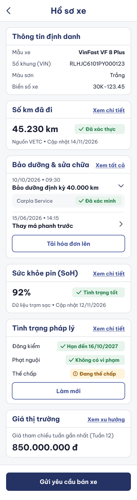
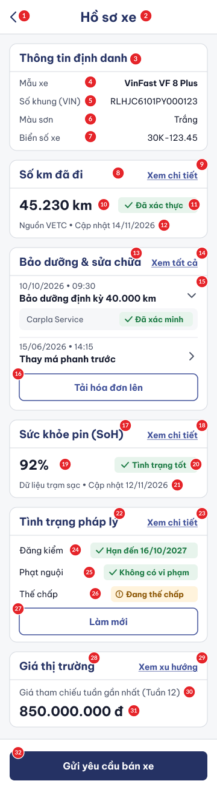
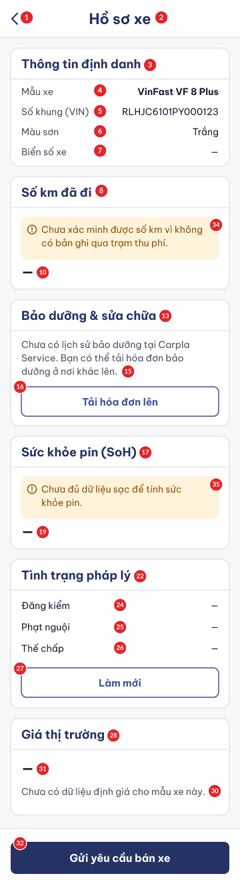
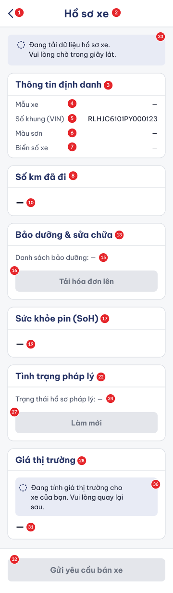
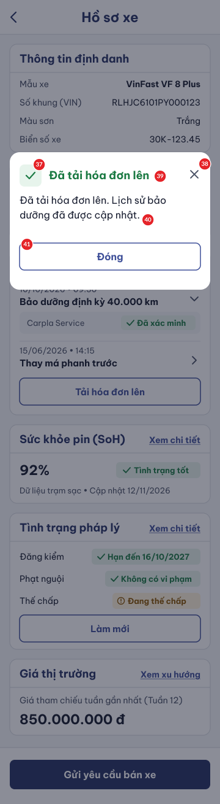

# Screen Spec: S-F01-02 Vehicle Profile

| Field | Value |
|---|---|
| Screen ID | `S-F01-02` |
| Screen name | Vehicle Profile (Vietnamese UI title: `"Hồ sơ xe"`) |
| Actor | Car Owner |
| Priority | Must |
| Feature | `F-01 Vehicle Passport` |
| Activity diagrams | `AD-UC-1.03`, `AD-UC-1.05`, `AD-UC-1.06`, `AD-UC-1.07` (entered after `AD-UC-1.01`) |
| Mockup image | `img/S-F01-02-default.png` |
| Status | Reviewed |

## 1. Purpose

**Shown when:** A signed-in Car Owner submits a valid 17-character VIN on `S-F01-01` to initialize a new `Verified vehicle report`, or taps `"Xem chi tiết"` on an existing vehicle card on the Home screen (`S-F00-01`).

**The user leaves this screen when:** The Car Owner taps the top-bar back button (`S-F00-01`), taps `"Xem chi tiết"` on the mileage card (`S-F01-03`), taps `"Xem tất cả"` on the maintenance card (`S-F01-04`), taps `"Xem chi tiết"` on the EV battery card (`S-F01-05`), taps `"Xem chi tiết"` on the legal status card (`S-F01-06`), taps `"Xem xu hướng"` on the market price card (`S-F02-01`), or taps `"Gửi yêu cầu bán xe"` to initiate a sale request (`S-F03-01` under Feature `F-03`).

## 2. Mockup

**Numbered:** Each number corresponds to the `#` column of the element inventory in Section 3 (`1–32` for the base profile cards and bottom CTA, `33–36` for state-specific banners, and `37–42` for result/error popups).

- Top loading banner (`33`) and market price loading banner (`36`) appear only in the `Loading` state.
- Empty warning banners (`34`, `35`) appear only in the `Empty` state.
- Popup elements `37–42` appear only in the `Error API` and `Success` states (`Retry popup button` `42` appears only in the `Error API` popup). When a popup is open, the dimmed background behind it is blocked and has no numbers.
- The Top bar, the grey page background, card/accordion containers, the fixed bottom bar container, and the dimmed layer behind a popup are layout containers and have no number.

| Default, numbered | Empty, numbered | Loading, numbered |
| :---: | :---: | :---: |
|  |  |  |

| Error API, numbered | Success, numbered |
| :---: | :---: |
|  |  |

| State | Image | Numbered image |
| :--- | :--- | :--- |
| Default | `img/S-F01-02-default.png` | `img/img-numbered/S-F01-02-default-numbered.png` |
| Empty | `img/S-F01-02-empty.png` | `img/img-numbered/S-F01-02-empty-numbered.png` |
| Loading | `img/S-F01-02-loading.png` | `img/img-numbered/S-F01-02-loading-numbered.png` |
| Error API | `img/S-F01-02-error-API.png` | `img/img-numbered/S-F01-02-error-API-numbered.png` |
| Success | `img/S-F01-02-success.png` | `img/img-numbered/S-F01-02-success-numbered.png` |

All colours, fonts, spacing, and corner radii come from the design tokens in `ui-conventions-car-owner.md`.

## 3. Element inventory

There are no text input fields directly on the base screen (`S-F01-02` is read-only with action triggers; invoice file picking occurs inside the upload modal `S-F01-04-modal-*` triggered by `16`). Elements that share the same number across states (`4`, `6`, `7`, `10`, `15`, `19`, `24`, `30`, `31`) adapt their text or placeholder depending on the state.

| # | Element | Type | Content / data source | Required | Validation |
|---|---|---|---|---|---|
| 1 | Back navigation button | Button (top bar back arrow) | Left chevron icon (`44 × 44px` tap target) in top bar | Yes | none |
| 2 | Screen title header | Header (top bar title) | Static text: `"Hồ sơ xe"` | Yes | none |
| 3 | Identification card header | Header (section card header) | Static text: `"Thông tin định danh"` | Yes | none |
| 4 | Vehicle model row | Text (read-only row) | Static label `"Mẫu xe"` + make & model (`"VinFast VF 8 Plus"`, or `"—"` in `Loading`) from `Verified vehicle report` (`UC-1.02`) | Yes | none |
| 5 | VIN row | Text (read-only row) | Static label `"Số khung (VIN)"` + 17-character VIN (`"RLHJC6101PY000123"`) from `Verified vehicle report` (`UC-1.02`) | Yes | none |
| 6 | Paint color row | Text (read-only row) | Static label `"Màu sơn"` + exterior colour (`"Trắng"`, or `"—"` in `Loading`) from `Verified vehicle report` (`UC-1.02`) | Yes | none |
| 7 | License plate row | Text (read-only row) | Static label `"Biển số xe"` + registered license plate (`"30K-123.45"`, or `"—"` in `Empty` / `Loading`) from `Verified vehicle report` / `VETC vehicle data` (`FR-01-10-INT`, `FR-01-11-INT`) | Yes | none |
| 8 | Mileage card header | Header (section card header) | Static text: `"Số km đã đi"` | Yes | none |
| 9 | Mileage details link | Button (underlined text link) | Static text: `"Xem chi tiết"` (`FR-01-03-FE`, `AD-UC-1.03` node `a1`). Hidden in `Empty` and `Loading` states. | No | none |
| 10 | Minimum mileage reading | Text (read-only metric) | Formatted odometer value (`"45.230 km"`, or `"—"` in `Empty` / `Loading`) computed via `BR-DIST-01` from `Verified vehicle report` / `VETC vehicle data` (`FR-01-03-BE`) | Yes | none |
| 11 | Mileage verification badge | Text (status badge: icon + text) | Checkmark icon + status label `"Đã xác thực"` (`#E7F4EC` fill, `#1B7A43` text) from `Verified vehicle report` / `VETC vehicle data`. Shown in `Default` state. | No | none |
| 12 | Mileage source & timestamp | Text (caption) | Source and sync date (`"Nguồn VETC • Cập nhật 14/11/2026"`) from `VETC vehicle data`. Shown in `Default` state. | No | none |
| 13 | Maintenance card header | Header (section card header) | Static text: `"Bảo dưỡng & sửa chữa"` | Yes | none |
| 14 | View all maintenance link | Button (underlined text link) | Static text: `"Xem tất cả"`. Hidden when maintenance list is empty (`0` entries) or loading. | No | none |
| 15 | Maintenance timeline list / state placeholder | List (accordion list) / Text | **Default:** Reverse-chronological expandable rows (`"10/10/2026 • 09:30 Bảo dưỡng định kỳ 40.000 km"` with source `"Carpla Service"` + badge `"✓ Đã xác minh"`, and `"15/06/2026 • 14:15 Thay má phanh trước"`) from `Carpla Service records` and `Uploaded maintenance invoice` (`FR-01-07-BE`). **Empty:** Static guidance `"Chưa có lịch sử bảo dưỡng tại Carpla Service. Bạn có thể tải hóa đơn bảo dưỡng ở nơi khác lên."` **Loading:** Static `"Danh sách bảo dưỡng: —"` | Yes | none |
| 16 | Upload invoice secondary button | Button (secondary outlined) | Static text: `"Tải hóa đơn lên"` (`FR-01-05-FE`, `AD-UC-1.05` node `a1`) | Yes | Disabled (`#E4E6EB` fill, `#6B7280` text) during `Loading` state; opens `S-F01-04-modal-*` on tap |
| 17 | Battery SoH card header | Header (section card header) | Static text: `"Sức khỏe pin (SoH)"` (rendered only for electric vehicles) | No | Rendered only when vehicle powertrain is electric (`EV`) |
| 18 | Battery SoH details link | Button (underlined text link) | Static text: `"Xem chi tiết"` (`FR-01-08-FE`, `AD-UC-1.06` node `a1`). Hidden in `Empty` and `Loading` states. | No | Rendered only when Battery SoH card (`#17`) is shown and data exists |
| 19 | Battery SoH percentage value | Text (read-only metric) | Percentage reading (`"92%"`, or `"—"` in `Empty` / `Loading`) from `EV charging station data` / `Verified vehicle report` (`FR-01-08-BE`) | No | none |
| 20 | Battery health status badge | Text (status badge: icon + text) | Checkmark icon + status label `"Tình trạng tốt"` (`#E7F4EC` fill, `#1B7A43` text) from `Verified vehicle report` (`FR-01-08-FE`). Shown in `Default` state. | No | none |
| 21 | Battery data source & timestamp | Text (caption) | Source and update date (`"Dữ liệu trạm sạc • Cập nhật 12/11/2026"`) from `EV charging station data`. Shown in `Default` state. | No | none |
| 22 | Legal status card header | Header (section card header) | Static text: `"Tình trạng pháp lý"` (`FR-01-09-FE`) | Yes | none |
| 23 | Legal status details link | Button (underlined text link) | Static text: `"Xem chi tiết"`. Hidden in `Empty` and `Loading` states. | No | none |
| 24 | Vehicle inspection status row / loading placeholder | Text (row + status badge) | **Default:** Static label `"Đăng kiểm"` + inline checkmark badge `"✓ Hạn đến 16/10/2027"` (`Vehicle inspection data`, `FR-01-10-INT`, `FR-01-13-FE`). **Empty:** Static label `"Đăng kiểm"` + `"—"`. **Loading:** Collapsed placeholder `"Trạng thái hồ sơ pháp lý: —"`. | Yes | none |
| 25 | Unpaid traffic fine status row | Text (row + status badge) | **Default:** Static label `"Phạt nguội"` + inline checkmark badge `"✓ Không có vi phạm"` (`Traffic fine data`, `FR-01-11-INT`, `FR-01-13-FE`). **Empty:** Static label `"Phạt nguội"` + `"—"`. | No | none |
| 26 | Mortgage status row | Text (row + status badge) | **Default:** Static label `"Thế chấp"` + inline warning badge `"! Đang thế chấp"` (`#FFF3DC` fill, `#8A5300` text; `Secured transaction registry data`, `FR-01-12-INT`, `FR-01-13-FE`). **Empty:** Static label `"Thế chấp"` + `"—"`. | No | none |
| 27 | Refresh legal status secondary button | Button (secondary outlined) | Static text: `"Làm mới"` (`FR-01-09-FE`, `AD-UC-1.07` node `a1`) | Yes | Disabled (`#E4E6EB` fill, `#6B7280` text) while loading or while a legal refresh request is active (`FR-01-09-FE`, `AD-UC-1.07` node `d1`) |
| 28 | Market price card header | Header (section card header) | Static text: `"Giá thị trường"` | Yes | none |
| 29 | Market trend link | Button (underlined text link) | Static text: `"Xem xu hướng"`. Hidden in `Empty` and `Loading` states. | No | none |
| 30 | Latest weekly price caption / empty notice | Text (caption) | **Default:** Static label `"Giá tham chiếu tuần gần nhất (Tuần 12)"` from `Weekly market price`. **Empty:** Static notice `"Chưa có dữ liệu định giá cho mẫu xe này."` | No | none |
| 31 | Preliminary market price value | Text (read-only metric) | Formatted VND currency (`"850.000.000 đ"`, or `"—"` in `Empty` / `Loading`) from `Weekly market price` | Yes | none |
| 32 | Submit sale request primary button | Button (fixed bottom primary CTA) | Fixed bottom primary CTA (`#253264`) with static text: `"Gửi yêu cầu bán xe"` (`F-03 Sell Request & Preliminary Quote`) | Yes | Disabled (`#E4E6EB` fill, `#6B7280` text) during `Loading` state |
| 33 | Profile loading top banner | Text (info loading banner) | Spinner icon + static text: `"Đang tải dữ liệu hồ sơ xe. Vui lòng chờ trong giây lát."` (`Loading` state only) | No | none |
| 34 | Empty mileage warning banner | Text (warning banner) | Warning icon (`!`) + static text: `"Chưa xác minh được số km vì không có bản ghi qua trạm thu phí."` (`Empty` state only) | No | none |
| 35 | Empty battery SoH warning banner | Text (warning banner) | Warning icon (`!`) + static text: `"Chưa đủ dữ liệu sạc để tính sức khỏe pin."` (`Empty` state only) | No | none |
| 36 | Market price loading banner | Text (info loading banner) | Spinner icon + static text: `"Đang tính giá thị trường cho xe của bạn. Vui lòng quay lại sau."` (`Loading` state only) | No | none |
| 37 | Popup status icon | Image (modal status icon) | **Error API:** Red warning icon (`!`) in `#FEE4E2` rounded box. **Success:** Green check icon (`✓`) in `#E7F4EC` rounded box. | No | none |
| 38 | Close popup icon button | Button (modal close icon) | Static close icon (`×`, `44 × 44px` tap target). Shown in every popup state (`37–42`). | No | none |
| 39 | Popup title | Header (modal title) | **Error API:** `"Lỗi kết nối hệ thống"` (`#B42318`) **Success:** `"Đã tải hóa đơn lên"` (`#1B7A43`) | No | none |
| 40 | Popup body message | Text (modal body) | **Error API:** `"Hệ thống chưa tải được dữ liệu hồ sơ xe. Vui lòng bấm Thử lại, hoặc đóng và quay lại sau."` **Success:** `"Đã tải hóa đơn lên. Lịch sử bảo dưỡng đã được cập nhật."` | No | none |
| 41 | Close popup button | Button (modal secondary button) | Static: `"Đóng"`. Left outlined button next to `Retry popup button` (`42`) in `Error API` popup; full-width button in `Success` popup. | No | none |
| 42 | Retry popup button | Button (modal primary button) | Static: `"Thử lại"`. Right primary button in `Error API` popup only. | No | none |

## 4. States

| State | What the user sees | Trigger |
|---|---|---|
| Default | Single vertically scrolling screen displaying all 6 section cards (`Thông tin định danh`, `Số km đã đi`, `Bảo dưỡng & sửa chữa`, `Sức khỏe pin (SoH)` for EVs, `Tình trạng pháp lý`, `Giá thị trường`) populated with verified values, icon + text status badges, active secondary buttons (`"Tải hóa đơn lên"`, `"Làm mới"`), and fixed bottom primary CTA `"Gửi yêu cầu bán xe"`. | Vehicle profile data is loaded (`UC-1.02`, `FR-01-13-FE`) and queried external sources return valid records. |
| Empty | Unavailable metrics display `"—"`; yellow warning banners (`#FFF3DC`) appear in `Số km đã đi` (`34`: *"Chưa xác minh được số km vì không có bản ghi qua trạm thu phí."*) and `Sức khỏe pin (SoH)` (`35`: *"Chưa đủ dữ liệu sạc để tính sức khỏe pin."*), empty guidance appears in `Bảo dưỡng & sửa chữa` (`15`: *"Chưa có lịch sử bảo dưỡng tại Carpla Service. Bạn có thể tải hóa đơn bảo dưỡng ở nơi khác lên."*), and `"Chưa có dữ liệu định giá cho mẫu xe này."` (`30`) appears in `Giá thị trường`, while `"Tải hóa đơn lên"` (`16`), `"Làm mới"` (`27`), and `"Gửi yêu cầu bán xe"` (`32`) remain enabled. | Newly initialized `Verified vehicle report` or vehicle with no VETC toll logs, Carpla Service records, EV charging telemetry, or weekly market price history. |
| Loading | Top loading banner (`33`: *"Đang tải dữ liệu hồ sơ xe. Vui lòng chờ trong giây lát."*) and market price loading banner (`36`: *"Đang tính giá thị trường cho xe của bạn. Vui lòng quay lại sau."*) appear; pending values display `"—"` (keeping `VIN` visible in `5`); and buttons `"Tải hóa đơn lên"` (`16`), `"Làm mới"` (`27`), and `"Gửi yêu cầu bán xe"` (`32`) are disabled (`#E4E6EB` fill, `#6B7280` text). | Initial load of `S-F01-02`, or while `"Làm mới"` dispatches parallel government portal queries (`FR-01-10-INT`, `FR-01-11-INT`, `FR-01-12-INT`, 5-second timeout per portal). |
| Error API | **1. System / API error popup (`37–42`):** `#FFFFFF` modal over `#161B2E` (50%) dimmed layer displays red warning icon (`37`), title `"Lỗi kết nối hệ thống"` (`39`), message `"Hệ thống chưa tải được dữ liệu hồ sơ xe. Vui lòng bấm Thử lại, hoặc đóng và quay lại sau."` (`40`), secondary button `"Đóng"` (`41`), primary button `"Thử lại"` (`42`), and `×` close icon (`38`). **2. Invoice upload validation / portal error (`AD-UC-1.05` `d1 [no]`, `d3 [no]`):** Inline `#B42318` file format/size error (`BR-FILE-01`) inside `S-F01-04-modal-*`, or rejection popup if Electronic Invoice Lookup Portal rejects the invoice (`BR-INV-01`). **3. Partial legal query failure (`BR-ERR-01`):** Successfully returned legal rows render normally while timed-out rows display `"Đang chờ cập nhật"` with a retry prompt. | 1. Backend API fails to load vehicle profile data or fails after max automatic retries. 2. Car Owner uploads an invalid invoice file (`> 10 MB` / unsupported extension) or Electronic Invoice Lookup Portal rejects it. 3. One or more legal portals time out during `"Làm mới"`. |
| Success | **1. Invoice upload success popup (`37–41`):** `#FFFFFF` modal over `#161B2E` (50%) dimmed layer displays green check icon (`37`), title `"Đã tải hóa đơn lên"` (`39`), message `"Đã tải hóa đơn lên. Lịch sử bảo dưỡng đã được cập nhật."` (`40`), full-width button `"Đóng"` (`41`), and `×` close icon (`38`); closing refreshes `15` with the newly verified entry (`"✓ Đã xác minh"`). **2. Unreadable OCR manual-review confirmation (`BR-OCR-01`):** Confirmation popup informs the Car Owner that the invoice is saved and queued for manual verification (`"Chờ xác minh"` badge in `15`). **3. Legal refresh success (`AD-UC-1.07`):** `"Tình trạng pháp lý"` updates all three status badges (`24–26`) and re-enables `"Làm mới"` (`27`). | 1. Electronic Invoice Lookup Portal validates the uploaded invoice (`d3 [yes]`) and backend merges it into `Uploaded maintenance invoice`. 2. OCR parsing fails (`d2 [no]`) and flags the file for manual confirmation. 3. Parallel legal queries complete (`j1`) and `FR-01-13-BE` stores the aggregated status. |

## 5. Interactions and navigation

| # | Element | User action | System response | Goes to screen |
|---|---|---|---|---|
| 1 | Back navigation button (`1`) | tap | Returns the Car Owner to the Home screen. | `S-F00-01` |
| 2 | Mileage details link (`"Xem chi tiết"`, `9`) | tap | Triggers `AD-UC-1.03` (`a1`) to request VETC station logs (`FR-01-03-BE` / `FR-01-03-INT` with `BR-RET-01`), compute minimum distance (`BR-DIST-01`), and open the toll history screen. | `S-F01-03` |
| 3 | View all maintenance link (`"Xem tất cả"`, `14`) | tap | Opens the complete maintenance & repair timeline (`S-F01-04` Maintenance & Repair History). | `S-F01-04` |
| 4 | Maintenance accordion item (`15`) | tap | Expands or collapses the maintenance entry row to reveal service provider (`"Carpla Service"` or `"Hóa đơn tải lên"`) and verification status badge (`"✓ Đã xác minh"`). | "stays" |
| 5 | Upload invoice secondary button (`"Tải hóa đơn lên"`, `16`) | tap | Triggers `AD-UC-1.05` (`a1`) and opens the invoice upload sheet (`S-F01-04-modal-*`, `Empty` file picker state) over `S-F01-02`. | "stays" |
| 6 | Battery SoH details link (`"Xem chi tiết"`, `18`) | tap | Triggers `AD-UC-1.06` (`a1`) to retrieve charging station telemetry (`FR-01-08-BE` / `FR-01-08-INT` with `BR-RET-02`) and open battery SoH details. | `S-F01-05` |
| 7 | Legal status details link (`"Xem chi tiết"`, `23`) | tap | Opens expanded inspection, traffic fine, and mortgage details. | `S-F01-06` |
| 8 | Refresh legal status secondary button (`"Làm mới"`, `27`) | tap | Executes `AD-UC-1.07` (`a1`–`a2`): checks if a request is active (`d1`); if inactive, disables `"Làm mới"` (`FR-01-09-FE`), forks parallel queries (`BR-REF-01`) to Inspection (`FR-01-10-INT`), Traffic Fine (`FR-01-11-INT`), and Secured Transaction (`FR-01-12-INT`), applies fault tolerance (`BR-ERR-01`), aggregates results (`FR-01-13-BE`), and renders the updated card (`FR-01-13-FE`). | "stays" |
| 9 | Market trend link (`"Xem xu hướng"`, `29`) | tap | Opens the 12-week market valuation trend chart and breakdown. | `S-F02-01` |
| 10 | Submit sale request primary button (`"Gửi yêu cầu bán xe"`, `32`) | tap | Initiates a sale request and preliminary quotation flow for the current `VIN` (`F-03 Sell Request & Preliminary Quote`). | `S-F03-01` |
| 11 | Retry popup button (`"Thử lại"`, `42` in `Error API` popup) | tap | Dismisses the error popup, enters `Loading` state (`33`), and re-triggers the failed backend request. | "stays" |
| 12 | Close popup button (`"Đóng"` `41` / `×` `38`) | tap | Dismisses the active popup and returns focus to `S-F01-02`. | "stays" |

## 6. Screen-level rules

| Rule ID | Rule | Source |
|---|---|---|
| SR-001 | **Duplicate Refresh Prevention (`FR-01-09-FE`):** When `"Làm mới"` (`27`) is tapped in `Tình trạng pháp lý`, the system must immediately disable the button (`#E4E6EB` fill, `#6B7280` text) and ignore duplicate clicks until all parallel queries complete or time out. | `AD-UC-1.07` (`d1`, `c1`), `Function List` (`FR-01-09-FE`) |
| SR-002 | **Concurrent Legal Queries & Partial Fault Tolerance (`BR-REF-01`, `BR-ERR-01`):** Inspection (`FR-01-10-INT`), Traffic Fine (`FR-01-11-INT`), and Secured Transaction (`FR-01-12-INT`) queries execute in parallel (5-second timeout per portal). If any portal fails or times out, the system logs that failure independently, displays `"Đang chờ cập nhật"` for the failed row, and renders all successfully retrieved rows normally. | `AD-UC-1.07` (`BR-REF-01`, `BR-ERR-01`, `FR-01-13-BE`, `FR-01-13-FE`) |
| SR-003 | **External Invoice Upload & Verification Pipeline (`BR-FILE-01`, `BR-OCR-01`, `BR-INV-01`):** Uploaded maintenance invoices must pass client-side format/size checks (`≤ 10 MB`), undergo OCR/XML extraction (flagging unreadable scans for manual review without bypassing tax portal checks), and be validated against the Electronic Invoice Lookup Portal before merging into `Bảo dưỡng & sửa chữa`. | `AD-UC-1.05` (`BR-FILE-01`, `BR-OCR-01`, `BR-INV-01`) |
| SR-004 | **Conditional EV Battery Card:** The `"Sức khỏe pin (SoH)"` card (`17–21`, `35`) is rendered exclusively for electric vehicles (`EV`) and omitted for internal combustion engine (`ICE`) vehicles. | `screen-list.md` (`S-F01-02`) |
| SR-005 | **Maintenance Timeline Ordering & Date Format:** Maintenance entries (`15`) are ordered newest-first, with `dd/MM/yyyy • HH:mm` timestamps placed at the start of each accordion row. | `ui-conventions-car-owner.md` (§2, §6.2) |

## 7. Linked requirements

| FR ID | What this screen does for it |
|---|---|
| `FR-01-01` | Serves as the immediate post-creation destination rendering the newly initialized `Verified vehicle report` identification details (`4–7`) upon transition from `S-F01-01` (`FR-01-01-FE`). |
| `FR-01-03` | Provides the `"Xem chi tiết"` entry link (`9`) on `Số km đã đi` and displays the verified minimum mileage summary (`10–12`) computed via `BR-DIST-01` (`FR-01-03-FE`, `FR-01-03-BE`). |
| `FR-01-05` | Provides the `"Tải hóa đơn lên"` trigger button (`16`) to open the invoice upload modal (`S-F01-04-modal-*`) and store uploaded invoice files (`FR-01-05-FE`, `FR-01-05-BE`). |
| `FR-01-06` | Supports OCR/XML metadata extraction and manual review queuing (`BR-OCR-01`) for uploaded external maintenance invoices (`FR-01-06-BE`). |
| `FR-01-07` | Cross-checks invoice authenticity with the Electronic Invoice Lookup Portal (`FR-01-07-INT`) and merges verified external invoices into the maintenance timeline (`15`, `FR-01-07-BE`). |
| `FR-01-08` | Displays the EV battery SoH summary card (`17–21`: `92%`, `"Tình trạng tốt"`) from charging station telemetry and provides the `"Xem chi tiết"` trigger (`18`) to open `S-F01-05` (`FR-01-08-FE`, `FR-01-08-BE`, `FR-01-08-INT`). |
| `FR-01-09` | Renders the `"Tình trạng pháp lý"` header (`22`) with `"Làm mới"` (`27`), triggers parallel legal queries on tap, and disables the button while requests are in progress (`FR-01-09-FE`). |
| `FR-01-10` | Queries the Vehicle Inspection Portal using license plate and `VIN` upon legal refresh and returns inspection validity (`"Hạn đến dd/MM/yyyy"`) or pending status on timeout (`FR-01-10-INT`). |
| `FR-01-11` | Queries the Traffic Fine Lookup Portal using license plate upon legal refresh and returns `"Không có vi phạm"` or violation details (`FR-01-11-INT`). |
| `FR-01-12` | Queries the Secured Transaction Registry Portal using `VIN` upon legal refresh and returns `"Đang thế chấp"` warning status or unencumbered status (`FR-01-12-INT`). |
| `FR-01-13` | Aggregates payloads from the three parallel government portal queries (`FR-01-13-BE`) and renders the consolidated `"Tình trạng pháp lý"` card (`24–26`, `FR-01-13-FE`), including partial failure retry prompts. |

## 8. Responsive and accessibility notes

- Smallest supported width: `360px`
- What collapses or stacks on a narrow screen: All six section cards stack in a single vertical scrolling column (`16px` horizontal outer margins, `16px` vertical card spacing) above the fixed bottom CTA bar (`80px` height); card headers and right-aligned action links (`"Xem chi tiết"`, `"Xem tất cả"`, `"Xem xu hướng"`) maintain at least `8px` horizontal clearance without wrapping or overlapping on `360px` viewports.
- Information never carried by colour alone: All status badges (`"Đã xác thực"`, `"Đã xác minh"`, `"Tình trạng tốt"`, `"Hạn đến 16/10/2027"`, `"Không có vi phạm"`, `"Đang thế chấp"`) and warning/loading banners (`33–36`) pair semantic fill/text tokens (`#E7F4EC`/`#1B7A43`, `#FFF3DC`/`#8A5300`, `#E8EBF5`/`#253264`) with distinct vector icons (checkmark, warning exclamation mark, or spinner) and explicit Vietnamese labels.
- Text contrast and minimum size: Minimum font size across all body text, metadata, and badges is `14px` (`Be Vietnam Pro`); primary text (`#161B2E` on `#FFFFFF`) achieves >15:1 contrast, secondary text (`#4A5266` on `#FFFFFF`) achieves 7.7:1 contrast, and all buttons and back icons meet the `44 × 44px` minimum tap target.

## 9. Open questions

| # | Question | Blocking? | Status |
|---|---|---|---|
| 1 | [NEEDS CLARIFICATION: `screen-list.md` specifies that `"Thông tin định danh"` includes `VIN`, `engine number`, `make`, `model`, `year of manufacture`, `paint color`, and `number of seats`, whereas `img/S-F01-02-default.png` currently shows `Mẫu xe` (combined make/model), `Số khung (VIN)`, `Màu sơn`, and `Biển số xe`, omitting `Năm sản xuất`, `Số máy`, and `Số chỗ ngồi`. Should `S-F01-02` add rows for `Năm sản xuất`, `Số máy`, and `Số chỗ ngồi` while keeping `Biển số xe` (required by `FR-01-10-INT` and `FR-01-11-INT`)?] | Yes | Default: Follow img/S-F01-02-default.png as the UI baseline by displaying Mẫu xe, Số khung (VIN), Màu sơn, and Biển số xe (required for FR-01-10 and FR-01-11 lookups), and defer adding Năm sản xuất, Số máy, and Số chỗ ngồi unless updated in Figma. |
| 2 | [NEEDS CLARIFICATION: `AD-UC-1.05` (`Screens touched`) references `S-F01-04 (Upload invoice modal)` and `AD-UC-1.06` (`Screens touched`) references `S-F01-05` for viewing EV battery SoH details, whereas in the screen flow `S-F01-04` is Maintenance & Repair History (`"Xem tất cả"`, `#14`) and upload invoice is a modal overlay on `S-F01-02`. Confirm exact Screen IDs for `"Xem tất cả"` (`#14`), `"Xem chi tiết"` on Battery SoH (`#18`), `"Xem chi tiết"` on Legal status (`#23`), and `"Xem xu hướng"` on Market price (`#29`).] | Yes | Default: Route "Xem tất cả" (#14) to S-F01-04 (with "Tải hóa đơn lên" opening the S-F01-04-modal-* overlay sheet per AI Log #3), "Xem chi tiết" on Battery SoH (#18) to S-F01-05, "Xem chi tiết" on Legal status (#23) to S-F01-06, and "Xem xu hướng" on Market price (#29) to S-F02-01 (Feature F-02). |
| 3 | [NEEDS CLARIFICATION: `BR-FILE-01` in `AD-UC-1.05` allows `.pdf`, `.xml`, `.jpg`, and `.png` invoice files (`≤ 10 MB`), whereas the UI upload modal copy only lists `JPG, PNG hoặc PDF`. Should `.xml` (e-invoice XML format) be added to the allowed file picker extensions and helper text?] | No | Default: Accept .pdf, .xml, .jpg, and .png (≤ 10 MB) in the upload file picker per SyR-06, FR-01-05, FR-01-06, and BR-FILE-01, and align the helper copy in S-F01-04-modal-* to "JPG, PNG, PDF hoặc XML". |
| 4 | [NEEDS CLARIFICATION: What is the exact destination `Screen ID` in `screen-list.md` (under Feature `F-03 Sell Request & Preliminary Quote`) when the Car Owner taps the fixed bottom CTA `"Gửi yêu cầu bán xe"` (`32`) on `S-F01-02`?] | Yes | Default: Navigate to S-F03-01 (Sale Request screen under Feature F-03 Sell Request & Preliminary Quote, as referenced in the project Glossary under Declared mileage). |

---

## Completion checklist

- [x] The mockup is a separate cropped image file, named with the Screen ID.
- [x] Every visible element in the mockup appears in the element inventory (`1` through `42`).
- [x] Every input element has a validation rule or an explicit "none".
- [x] All five states are filled in, with corresponding clean and numbered mockup images.
- [x] Every navigation target is a Screen ID that exists in the Screen List.
- [x] Every element that displays data names the field it displays.
- [x] Every linked FR exists in the Function List, and every action of this screen in an activity diagram is covered by an interaction row.

---

Template source: DBIZ3 Session 4 Screen Spec template (VJCBI College - FTU, 2026), adopted
unchanged in structure for DBIZ2 Lesson 8, with Feature and Activity diagram fields added.mockup images.
- [x] Every navigation target is a Screen ID that exists in the Screen List.
- [x] Every element that displays data names the field it displays.
- [x] Every linked FR exists in the Function List, and every action of this screen in an activity diagram is covered by an interaction row.
