# Screen Spec: S-F01-05 Maintenance & Repair History

| Field | Value |
| --- | --- |
| Screen ID | S-F01-05 |
| Screen name | Maintenance & Repair History (Vietnamese UI title in Top bar: "Bảo dưỡng và sửa chữa"). Includes the Upload invoice sheet (bottom sheet), its result popups and the camera steps |
| Actor | Car Owner |
| Priority | Must |
| Feature | F-01 Vehicle Identification & Status |
| Activity diagrams | AD-UC-1.05 |
| Linked requirements | FR-01-04, FR-01-05, FR-01-06, FR-01-07 (FE, INT, BE), see section 7 |
| Mockup images | `img/S-F01-05-default.png`, `img/img-numbered/S-F01-05-default-numbered.png`, state images of the main screen, the Upload invoice sheet, its popups and the camera steps (section 2) |
| Frame width | 360 px |
| Figma frame | [Vehicle Identification & Status \- S-F01-05 ](https://www.figma.com/design/ahzD4prkBFDCttQimszLWw/Vehicle-Identification---Status?node-id=0-1&p=f&t=jIrF9erJRZuQXgpQ-0) |
| Status | Reviewed |

## 1. Purpose

**Shown when:** the car owner taps "Xem tất cả" in the section "Bảo dưỡng và sửa chữa" of S-F01-02 Vehicle Profile.

**The user leaves this screen when:** the user taps the Back arrow (1) in the Top bar and returns to S-F01-02. The Upload invoice sheet opened by the Upload button (13) is part of this screen and closes back to it.

## 2. Mockup

Default screen, without numbers:

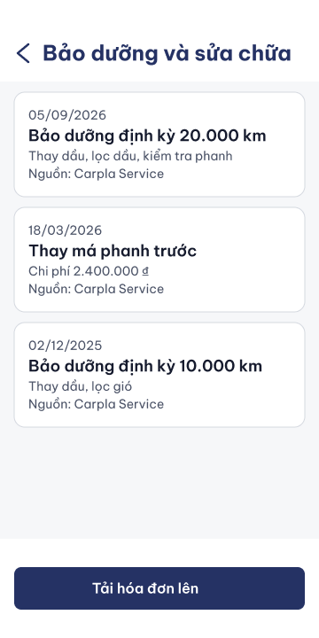

Screens with numbered elements, one per state.

Main screen (numbers of section 3.1):

| Default, numbered | Empty, numbered | Loading, numbered | Error API, numbered | Success, numbered |
| --- | --- | --- | --- | --- |
| 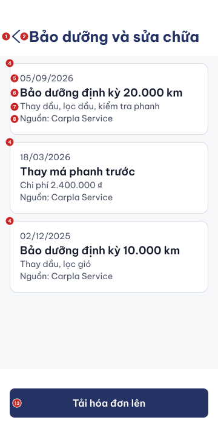 | 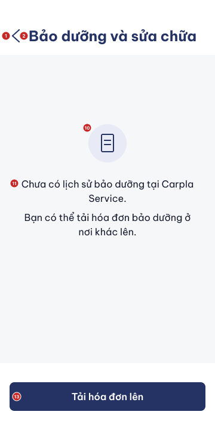 | 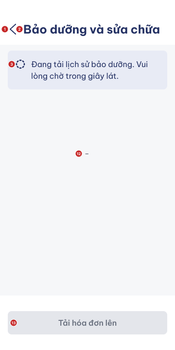 | 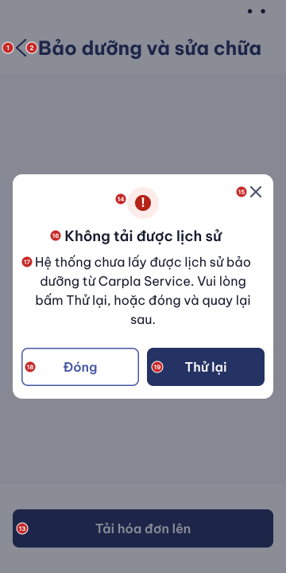 | 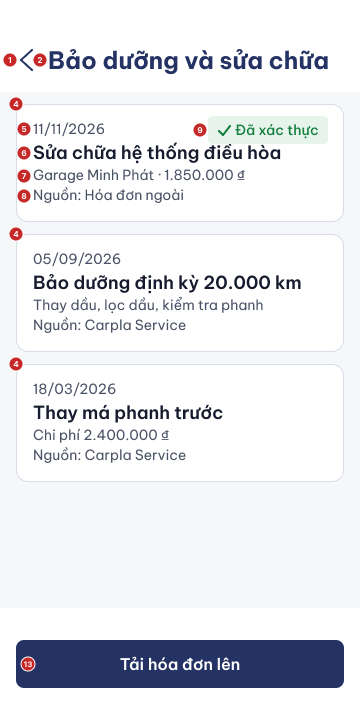 |

Upload invoice sheet (numbers of section 3.2):

| Upload Invoice Sheet Default, numbered | Upload Invoice Sheet Loading, numbered | Upload Invoice Sheet Error validate FE, numbered | Upload Invoice Sheet OCR incomplete, numbered | Review Invoice Sheet, numbered |
| --- | --- | --- | --- | --- |
| 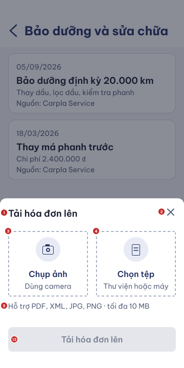 | 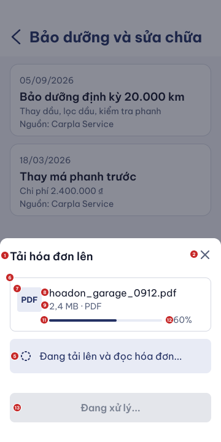 | 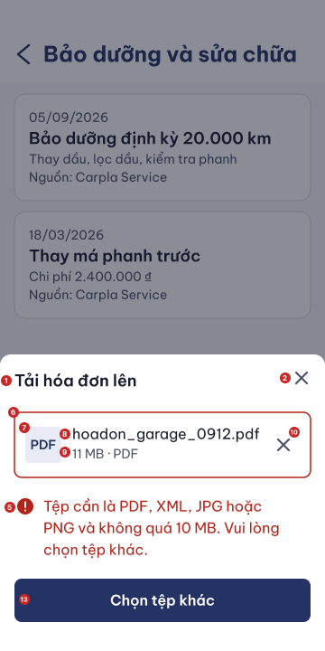 | 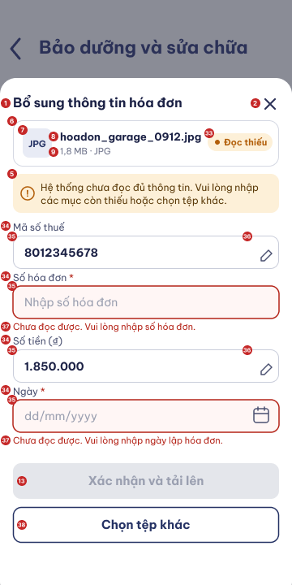 | 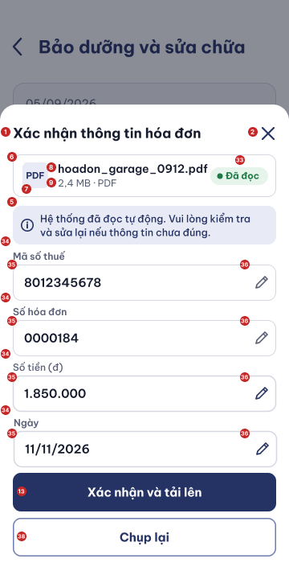 |

Result popups of the sheet and camera steps (numbers of section 3.2):

| Upload Invoice Sheet Error validate BE, numbered | Upload Invoice Sheet Success, numbered | Camera, numbered | Camera preview, numbered |
| --- | --- | --- | --- |
| 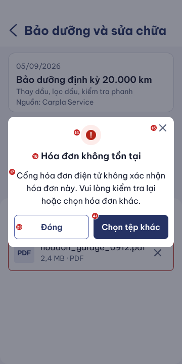 | 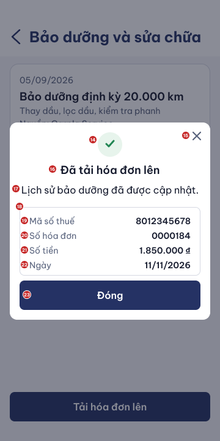 |  |  |

| Group | State | Image |
| --- | --- | --- |
| Main screen | Default | `img/S-F01-05-default.png` |
| Main screen | Empty | `img/S-F01-05-empty.png` |
| Main screen | Loading | `img/S-F01-05-loading.png` |
| Main screen | Error API | `img/S-F01-05-error-API.png` |
| Main screen | Success | `img/S-F01-05-success.png` |
| Upload invoice sheet | Default | `img/S-F01-05-modal-default.png` |
| Upload invoice sheet | Loading | `img/S-F01-05-modal-loading.png` |
| Upload invoice sheet | Error validate FE | `img/S-F01-05-modal-error-validate-FE.png` |
| Upload invoice sheet | OCR incomplete | `img/S-F01-05-modal-ocr-incomplete.png` |
| Upload invoice sheet | Review | `img/S-F01-05-modal-review.png` |
| Upload invoice sheet | Error validate BE (popup) | `img/S-F01-05-modal-error-validate-BE.png` |
| Upload invoice sheet | Success (popup) | `img/S-F01-05-modal-success.png` |
| Camera steps | Camera | `img/S-F01-05-modal-camera.png` |
| Camera steps | Camera preview | `img/S-F01-05-modal-camerapreview.png` |

Each number is the # of the element inventory in section 3. The main screen and the Upload invoice sheet are separate mockups, so their numbers are two different sequences: the main screen uses 1 to 19 elements (section 3.1); the Upload invoice sheet, its popups and the camera steps use 1 to 39 elements (section 3.2). Always read a number together with the element name, for example Upload button (13) on the main screen and Primary action button (13) in the sheet.

Main screen: Loading banner (3) and Loading placeholder (12) appear only in the Loading state; Empty icon (10) and Empty message (11) only in the Empty state; elements 14 to 19 (popup) only in the Error API state; Verified badge (9) only in the Success state. Record card (4) is repeated once for every record, and its number is shown on every card.

Upload invoice sheet: Take photo tile (3) and Choose file tile (4) appear only in the Default state; Remove file (10) only in the Error validate FE state; Upload progress bar (11) and Upload percent (12) only in the Loading state; elements 24 to 32 only in the camera steps; File status badge (33), Field label (34) and Field input (35) in the OCR incomplete and Review states; Edit icon (36) in the Review state (four icons) and in the OCR incomplete state (two icons); Field error message (37) only in the OCR incomplete state (two messages); Secondary action button (38) in the OCR incomplete and Review states. Field label (34), Field input (35), Edit icon (36) and Field error message (37) are repeated (one per field); the number is shown on every repeat.

Popups of the sheet: Popup icon (14), Close popup (15), Popup title (16), Popup message (17) and Close (23) are shared by the Error validate BE popup and the Success popup. Invoice summary card (18) and its four rows (19, 20, 21, 22) appear only in the Success popup; Choose other file (39) appears only in the Error validate BE popup. Every number means one element in every image.

The Top bar, the white background, the sheet container and the dimmed layer behind a popup are layout containers and have no number. All colors, fonts, and corners come from the design tokens in [ui-conventions-car-owner](https://github.com/giangnhk63db/DBIZ-2_GROUP-A/blob/4f88e331210049e04b7fd420b043700c352bec19/External%20Design/ui-conventions-car-owner.md).

## 3. Element inventory

The main screen is read-only; its only action is the Upload button (13). The only input elements are the four Field inputs (35) of the OCR incomplete and Review states of the sheet; the Selected file card (6) is the Upload element. Elements that sit at the same position keep the same number in every state, even when their content changes. For these elements the column "Content / data source" says, state by state, which content is shown (written as **State:** content). Elements that are repeated (Record card (4), Field label (34), Field input (35), Edit icon (36), Field error message (37)) carry the same number on every repeat.

Elements with one number and several contents:

* Main screen: Record detail (7) (work description, cost, or garage and amount of an external invoice); Record source (8) (Carpla Service or external invoice); Upload button (13) (enabled, disabled, or dimmed behind the popup).
* Upload invoice sheet: Sheet title (1), Status message (5), Selected file card (6), File thumbnail (7), File name (8), File size and type (9), Primary action button (13), File status badge (33), Field label (34), Field input (35), Edit icon (36), Secondary action button (38).
* Popups of the sheet: Popup icon (14), Popup title (16), Popup message (17), Close (23).
* Camera steps: Camera title (25), Camera view (26).

### 3.1 Main screen (numbers 1 to 19)

| # | Element | Category | Type | Content / data source | Required | Validation |
| --- | --- | --- | --- | --- | --- | --- |
| 1 | Back | Selection | Top bar, back arrow (button) | static; hit area 44 x 44. Shown in every state | Yes | none |
| 2 | Title | Display | Read-only text (Top bar screen name) | static: "Bảo dưỡng và sửa chữa" | Yes | none |
| 3 | Loading banner | Feedback | Banner (icon + read-only text) | Has no button. Info banner with loading icon, text "Đang tải lịch sử bảo dưỡng. Vui lòng chờ trong giây lát.". **Loading state:** shown, disappears when data is available. Hidden in the other states. | No | none |
| 4 | Record card | Display | Card (timeline item) | One card per maintenance or repair record, newest on top. Holds elements 5 to 9. Not tappable. **Default state:** one card per Carpla Service record (example: three cards). **Success state:** the new external invoice card on top (example "11/11/2026", "Sửa chữa hệ thống điều hòa"), followed by the earlier cards. **Empty, Loading and Error API state:** no card. **Data source:** carpla_service_records (FR-01-04-BE) merged with uploaded_maintenance_invoice (FR-01-07-BE) | Yes | none |
| 5 | Record date | Display | Read-only text | Date of the service or of the invoice, format dd/MM/yyyy, example "05/09/2026". **Data source:** maintenance_record.service_date | Yes | none |
| 6 | Record title | Display | Read-only text | Service or repair name, example "Bảo dưỡng định kỳ 20.000 km". **Data source:** maintenance_record.service_title | Yes | none |
| 7 | Record detail | Display | Read-only text | One line, the content depends on the record: **Carpla Service record with work items:** work description, example "Thay dầu, lọc dầu, kiểm tra phanh". **Carpla Service record with a cost:** "Chi phí" + amount, example "Chi phí 2.400.000 ₫". **External invoice (Success state):** garage name · amount, example "Garage Minh Phát · 1.850.000 ₫". **Data source:** maintenance_record.details, maintenance_record.cost, invoice.garage_name (proposed name), invoice.total_amount | No | none |
| 8 | Record source | Display | Read-only text | The content depends on the record: **Carpla Service record:** "Nguồn: Carpla Service". **External invoice:** "Nguồn: Hóa đơn ngoài". **Data source:** maintenance_record.source_type | Yes | none |
| 9 | Verified badge | Display | Status badge (icon + text in a pill) | "Đã xác thực" (success style, green pill, check icon), at the top right of the Record card (4). Only on a card of an external invoice; Carpla Service cards have no badge. **Success state:** shown on the new invoice card. **Other states:** hidden. **Data source:** invoice.verification_status | No | none |
| 10 | Empty icon | Display | Icon (document icon in a circle) | static, centred in the list area. **Empty state** only | No | none |
| 11 | Empty message | Display | Read-only text | static: "Chưa có lịch sử bảo dưỡng tại Carpla Service." and "Bạn có thể tải hóa đơn bảo dưỡng ở nơi khác lên.", centred under the Empty icon (10). **Empty state** only | No | none |
| 12 | Loading placeholder | Display | Read-only text | "—" in the centre of the list area. **Loading state** only | No | none |
| 13 | Upload button | Selection | Primary button | static: "Tải hóa đơn lên", fixed at the bottom, full width inside 16 px side margins, height 48 px. Opens the Upload invoice sheet. **Loading state:** disabled. **Error API state:** dimmed behind the popup, cannot be used. **Other states:** enabled. | Yes | none |
| 14 | Popup icon | Dialogue | Icon in the Modal (popup) | red error (warning) icon. **Error API state** only | No | none |
| 15 | Close popup | Selection | Icon button (X) in the Modal | static; hit area 44 x 44 | No | none |
| 16 | Popup title | Dialogue | Read-only text in the Modal | static: "Không tải được lịch sử" | No | none |
| 17 | Popup message | Dialogue | Read-only text in the Modal | static: "Hệ thống chưa lấy được lịch sử bảo dưỡng từ Carpla Service. Vui lòng bấm Thử lại, hoặc đóng và quay lại sau." | No | none |
| 18 | Close | Selection | Secondary (outlined) button in the Modal | static: "Đóng", on the left of Retry (19) | No | none |
| 19 | Retry | Selection | Primary button in the Modal | static: "Thử lại" | No | none |

### 3.2 Upload invoice sheet, its result popups and the camera steps (numbers 1 to 39)

The sheet is a bottom sheet opened by the Upload button (13) of the main screen. It sits over the dimmed main screen. The camera steps (24 to 32) are full-screen steps opened by the Take photo tile (3). Close (23) is shared by both popups; the elements 33 to 38 belong to the OCR incomplete and Review states; Choose other file (39) is the last element and belongs to the Error validate BE popup.

| # | Element | Category | Type | Content / data source | Required | Validation |
| --- | --- | --- | --- | --- | --- | --- |
| 1 | Sheet title | Display | Read-only text (sheet header) | The content depends on the state: **Review state:** "Xác nhận thông tin hóa đơn". **OCR incomplete state:** "Bổ sung thông tin hóa đơn". **All other sheet states:** "Tải hóa đơn lên". | Yes | none |
| 2 | Close sheet | Selection | Icon button (X) | static; hit area 44 x 44. Closes the sheet and discards the selected file. Shown in every sheet state | Yes | none |
| 3 | Take photo tile | Selection | Button (tile) | Camera icon, "Chụp ảnh", sub-text "Dùng camera". Opens the camera steps (24 to 32). **Default state** only | No | none |
| 4 | Choose file tile | Selection | Button (tile) | File icon, "Chọn tệp", sub-text "Thư viện hoặc máy". Opens the system file picker. **Default state** only | No | none |
| 5 | Status message | Feedback | Read-only text, banner or inline error | The content depends on the state: **Default state:** hint text "Hỗ trợ PDF, XML, JPG, PNG · tối đa 10 MB", under the tiles (3, 4). **Loading state:** info banner with loading icon, "Đang tải lên và đọc hóa đơn…". **Error validate FE state:** inline error with error icon, "Tệp cần là PDF, XML, JPG hoặc PNG và không quá 10 MB. Vui lòng chọn tệp khác.". **OCR incomplete state:** warning banner (amber) with warning icon, "Hệ thống chưa đọc đủ thông tin. Vui lòng nhập các mục còn thiếu hoặc chọn tệp khác.". **Review state:** info banner with info icon, "Hệ thống đã đọc tự động. Vui lòng kiểm tra và sửa lại nếu thông tin chưa đúng.". Has no button. | Yes | FE validation in Error validate FE: no request is sent |
| 6 | Selected file card | Upload | File upload item (card) | Holds elements 7 to 12 and, in the OCR incomplete and Review states, the File status badge (33). Shown while a file is selected; not shown in the Default state. The content depends on the state: **Loading state:** grey border, with Upload progress bar (11) and Upload percent (12). **Error validate FE state:** red border, with Remove file (10). **OCR incomplete state:** grey border, with File status badge (33) "Đọc thiếu". **Review state:** grey border, with File status badge (33) "Đã đọc". **Data source:** uploaded_maintenance_invoice.file_object | No | Type is PDF, XML, JPG or PNG; size is at most 10 MB (BR-FILE-01) |
| 7 | File thumbnail | Display | Tag | Type tag of the file, left of the File name (8): "PDF", "XML", "JPG" or "PNG". **Loading, Error validate FE and Review states (mockup):** "PDF". **OCR incomplete state (mockup):** "JPG". | No | none |
| 8 | File name | Display | Read-only text | Name of the chosen file. **Loading, Error validate FE and Review states (mockup):** "hoadon_garage_0912.pdf". **OCR incomplete state (mockup):** "hoadon_garage_0912.jpg". Truncated with "..." if too long. **Data source:** uploaded_maintenance_invoice.file_name (proposed name) | No | none |
| 9 | File size and type | Display | Read-only text | Size and type, comma for decimals. **Loading and Review states (mockup):** "2,4 MB · PDF". **Error validate FE state (mockup):** "11 MB · PDF" (larger than 10 MB, so the file is rejected). **OCR incomplete state (mockup):** "1,8 MB · JPG". | No | none |
| 10 | Remove file | Selection | Icon button (X) | static; hit area 44 x 44. Clears the selection. **Error validate FE state** only | No | none |
| 11 | Upload progress bar | Feedback | Progress bar | Upload progress inside the Selected file card (6). **Loading state** only | No | none |
| 12 | Upload percent | Feedback | Read-only text | Percent of the upload, example "60%", right of the Upload progress bar (11). **Loading state** only | No | none |
| 13 | Primary action button | Selection | Primary button | Fixed at the bottom of the sheet, full width; in the OCR incomplete and Review states it sits above the Secondary action button (38). The content depends on the state: **Default state:** "Tải hóa đơn lên", disabled. **Loading state:** "Đang xử lý…", disabled. **Error validate FE state:** "Chọn tệp khác", enabled, opens the file picker. **OCR incomplete state:** "Xác nhận và tải lên", disabled until all four Field inputs (35) are filled and valid, then enabled; sends the confirmed information. **Review state:** "Xác nhận và tải lên", enabled, sends the confirmed information. | Yes | Disabled until a valid input is provided: 1. For uploaded files: must be PDF, XML, JPG, or PNG format and at most 10 MB. 2. For captured photos: must be successfully taken via the camera and preview steps and meet the file rules in 1. 3. In the OCR incomplete state: all four Field inputs (35) must be filled and valid (BR-OCR-01 (7)). 4. Stays disabled while processing. |
| 14 | Popup icon | Dialogue | Icon in the Modal (popup) | The icon depends on the popup: **Error validate BE state:** red error (warning) icon. **Success state:** green check icon. | No | none |
| 15 | Close popup | Selection | Icon button (X) in the Modal | static; hit area 44 x 44, top right of the popup. Same in the Error validate BE popup and the Success popup | No | none |
| 16 | Popup title | Dialogue | Read-only text in the Modal | **Error validate BE state:** "Hóa đơn không tồn tại". **Success state:** "Đã tải hóa đơn lên". | No | none |
| 17 | Popup message | Dialogue | Read-only text in the Modal | **Error validate BE state:** "Cổng hóa đơn điện tử không xác nhận hóa đơn này. Vui lòng kiểm tra lại hoặc chọn hóa đơn khác." **Success state:** "Lịch sử bảo dưỡng đã được cập nhật." | No | none |
| 18 | Invoice summary card | Dialogue | Card (read-only rows) in the Modal | Holds Tax code row (19), Invoice number row (20), Amount row (21) and Date row (22). **Success state** only. **Data source:** invoice fields confirmed by the Electronic Invoice Portal (FR-01-06-BE, FR-01-07-INT) | No | none |
| 19 | Tax code row | Display | Label + read-only text | label "Mã số thuế"; value: seller tax code, example "8012345678". **Data source:** invoice.seller_tax_code (proposed name). **Success state** only | No | none |
| 20 | Invoice number row | Display | Label + read-only text | label "Số hóa đơn"; value: invoice number, example "0000184". **Data source:** invoice.invoice_number (proposed name). **Success state** only | No | none |
| 21 | Amount row | Display | Label + read-only text | label "Số tiền"; value: total amount, dot as thousands separator and ₫, example "1.850.000 ₫". **Data source:** invoice.total_amount. **Success state** only | No | none |
| 22 | Date row | Display | Label + read-only text | label "Ngày"; value: invoice date, format dd/MM/yyyy, example "11/11/2026". **Data source:** invoice.invoice_date (proposed name). **Success state** only | No | none |
| 23 | Close | Selection | Button in the Modal | static: "Đóng". Closes the popup. The style and place depend on the popup: **Error validate BE state:** Secondary (outlined) button, half width, on the left of Choose other file (39). **Success state:** Primary button, full width, under the Invoice summary card (18). | No | none |
| 24 | Camera back | Selection | Top bar, back arrow (button) | static; hit area 44 x 44. Shown in both camera steps | Yes | none |
| 25 | Camera title | Display | Read-only text (Top bar screen name) | The content depends on the step: **Camera step:** "Chụp hóa đơn". **Camera preview step:** "Xem lại ảnh". | Yes | none |
| 26 | Camera view | Display | Camera view or image | The content depends on the step: **Camera step:** live camera view on a dark background. **Camera preview step:** the photo that was taken. | Yes | none |
| 27 | Scan frame | Display | Frame (four corner marks) | Guides where to place the invoice. **Camera step** only | No | none |
| 28 | Camera hint | Display | Read-only text | static: "Đặt hóa đơn vào khung, đủ sáng và rõ nét", under the Scan frame (27). **Camera step** only | No | none |
| 29 | Library button | Selection | Button (icon + text) | Gallery icon + "Chọn từ thư viện", hit area 64 x 64. Opens the system gallery. **Camera step** only | No | none |
| 30 | Shutter button | Selection | Button (round) | Round capture button, hit area 64 x 64. **Camera step** only | No | none |
| 31 | Retake button | Selection | Secondary (outlined) button | static: "Chụp lại", on the left of Use photo button (32). **Camera preview step** only | No | none |
| 32 | Use photo button | Selection | Primary button | static: "Dùng ảnh này". **Camera preview step** only | No | none |
| 33 | File status badge | Display | Status badge (dot + text in a pill) | At the right end of the Selected file card (6). The content depends on the state: **Review state:** "Đã đọc" (success style, green pill). **OCR incomplete state:** "Đọc thiếu" (warning style, amber pill). Hidden in the other states. | No | none |
| 34 | Field label | Display | Read-only text (4 labels) | static, in this order from top to bottom: "Mã số thuế", "Số hóa đơn", "Số tiền (₫)", "Ngày", each above its Field input (35). **OCR incomplete state:** the label of a field that was not read carries a red asterisk "*" (mockup: "Số hóa đơn *", "Ngày *"). **OCR incomplete and Review states** only | Yes | none |
| 35 | Field input | Input | Text input (4 fields) | Four fields, in this order from top to bottom: Mã số thuế, Số hóa đơn, Số tiền, Ngày. The user can edit every field. The content depends on the state: **Review state:** pre-filled with the information the system read (examples "8012345678", "0000184", "1.850.000", "11/11/2026"). **OCR incomplete state:** a field that was read keeps its value (mockup: Mã số thuế "8012345678", Số tiền "1.850.000"); a field that was not read is empty, with a red border, a light red fill and a placeholder (mockup: Số hóa đơn "Nhập số hóa đơn"; Ngày "dd/mm/yyyy" with a calendar icon at the right end of the input). The owner fills in the missing fields. **Data source:** invoice.seller_tax_code, invoice.invoice_number, invoice.total_amount, invoice.invoice_date (proposed names; FR-01-06-BE) | Yes | Mã số thuế: not empty, 10 or 13 digits. Số hóa đơn: not empty, digits only (leading zeros are kept). Số tiền: a whole number greater than 0. Ngày: a valid date, format dd/MM/yyyy. See open questions 4 and 6 |
| 36 | Edit icon | Display | Icon (pencil) | At the right end of a Field input (35) that holds a value read by the system; shows that the value can be edited. **Review state:** four icons, one per field. **OCR incomplete state:** two icons, only on the fields that were read (mockup: Mã số thuế, Số tiền); a field that was not read has no pencil (the Ngày input shows a calendar icon instead) | No | none |
| 37 | Field error message | Feedback | Read-only text (inline error under a field) | Under each Field input (35) that was not read, in red: "Chưa đọc được. Vui lòng nhập {tên trường}." Mockup: "Chưa đọc được. Vui lòng nhập số hóa đơn." and "Chưa đọc được. Vui lòng nhập ngày lập hóa đơn.". Disappears when the field holds a valid value. **OCR incomplete state** only | No | none |
| 38 | Secondary action button | Selection | Secondary (outlined) button | Under the Primary action button (13), full width. The content depends on the state: **OCR incomplete state:** "Chọn tệp khác", opens the file picker. **Review state:** "Chụp lại", opens the camera. | No | none |
| 39 | Choose other file | Selection | Primary button in the Modal | static: "Chọn tệp khác", half width, on the right of Close (23). Closes the popup and opens the file picker. **Error validate BE state** only | No | none |

**Note**: the field names (`maintenance_record.*`, `invoice.*`, `uploaded_maintenance_invoice.*`) come from the Function List; names marked "proposed name" will be finalized with the data dictionary.

## 4. States

This screen has no form on the main screen, so the main screen has no Error validate FE state. The Upload invoice sheet has one Error validate FE state (wrong file type or size) and one OCR incomplete state (the system could not read all four fields), see the table in section 4.2.

### 4.1 Main screen states

| State | What the user sees | Trigger |
| --- | --- | --- |
| Default | Record cards (4), each with Record date (5), Record title (6), Record detail (7) and Record source (8), newest on top; Upload button (13) at the bottom. No banner, no popup. | Maintenance & Repair records loaded successfully (FR-01-04). |
| Empty | Empty icon (10) and Empty message (11) "Chưa có lịch sử bảo dưỡng tại Carpla Service. Bạn có thể tải hóa đơn bảo dưỡng ở nơi khác lên." in the list area; Upload button (13) stays enabled. No banner, no popup. | Carpla Service returns no record and the owner has no uploaded invoice (FR-01-04). |
| Loading | Loading banner (3) at the top; Loading placeholder (12) "—" in the list area; Upload button (13) disabled. No card, no popup. | The screen opens and the system fetches the records from Carpla Service (FR-01-04-BE). |
| Error API | List area empty and dimmed behind the error popup (14, 15, 16, 17, 18, 19) with Popup title (16) "Không tải được lịch sử", buttons Close (18) "Đóng" and Retry (19) "Thử lại" (and Close popup (15) X). Upload button (13) dimmed behind the popup. | The fetch from Carpla Service fails after the maximum retries (SR-006). |
| Success | The new external invoice at the top of the Record cards (4) with Verified badge (9) "Đã xác thực", and its Record date (5), Record title (6), Record detail (7) and Record source (8). It appears after the success popup of the sheet is closed. | The Electronic Invoice Portal confirms the invoice and the system merges it into the history (FR-01-07-BE). |

### 4.2 Upload invoice sheet states

| State | What the user sees | Trigger |
| --- | --- | --- |
| Default | Sheet title (1) "Tải hóa đơn lên", Close sheet (2), Take photo tile (3), Choose file tile (4), Status message (5) as the hint, Primary action button (13) "Tải hóa đơn lên" disabled. No Selected file card. | The owner taps the Upload button (13) of the main screen. |
| Loading | Sheet title (1), Close sheet (2), Selected file card (6) with File thumbnail (7), File name (8), File size and type (9), Upload progress bar (11) and Upload percent (12); Status message (5) as info banner "Đang tải lên và đọc hóa đơn…"; Primary action button (13) "Đang xử lý…" disabled. After the upload the sheet goes to the Review state (all four fields read), the OCR incomplete state (one or more fields not read) or the Error validate FE state. | A valid file is chosen, or a photo is accepted with Use photo button (32) (see open question 3). |
| Error validate FE | Sheet title (1) "Tải hóa đơn lên", Close sheet (2); Selected file card (6) with a red border (7, 8, 9) and Remove file (10); Status message (5) as inline error "Tệp cần là PDF, XML, JPG hoặc PNG và không quá 10 MB. Vui lòng chọn tệp khác."; Primary action button (13) "Chọn tệp khác". No request is sent. | The chosen file is not a PDF, XML, JPG or PNG, or is larger than 10 MB (BR-FILE-01). |
| OCR incomplete | Sheet title (1) "Bổ sung thông tin hóa đơn", Close sheet (2); Selected file card (6) with a grey border, File thumbnail (7), File name (8) "hoadon_garage_0912.jpg", File size and type (9) "1,8 MB · JPG" and File status badge (33) "Đọc thiếu"; Status message (5) as warning banner; four fields, each with Field label (34) and Field input (35): the fields that were read keep their value and show an Edit icon (36) (Mã số thuế, Số tiền); the fields that were not read are empty, marked with a red border and an asterisk in the label, and show a Field error message (37) (Số hóa đơn, Ngày); Primary action button (13) "Xác nhận và tải lên" disabled until all four fields are filled and valid; Secondary action button (38) "Chọn tệp khác". | The system stored the file but could not read one or more of the four mandatory fields (BR-OCR-01 (6), FR-01-06-BE; AD-UC-1.05 d2 [no]). The file is not rejected. |
| Review | Sheet title (1) "Xác nhận thông tin hóa đơn"; Close sheet (2); Selected file card (6) with 7, 8, 9 and File status badge (33) "Đã đọc"; Status message (5) as info banner; four fields, each with Field label (34), Field input (35) and Edit icon (36): Mã số thuế, Số hóa đơn, Số tiền (₫), Ngày; Primary action button (13) "Xác nhận và tải lên"; Secondary action button (38) "Chụp lại". | The system read all four fields in a valid format (FR-01-06-BE). |
| Error validate BE | Rejected popup (14, 15, 16, 17, 23, 39) with red Popup icon (14), Popup title (16) "Hóa đơn không tồn tại", Popup message (17), buttons Close (23) "Đóng" and Choose other file (39) "Chọn tệp khác" (and Close popup (15) X), over the dimmed sheet. The content behind it cannot be used. | The Electronic Invoice Portal does not confirm the invoice (BR-INV-01, FR-01-07-INT). |
| Success | Success popup (14 with green check icon, 15, 16, 17, 18, 19, 20, 21, 22, 23) with Popup title (16) "Đã tải hóa đơn lên", Popup message (17), the Invoice summary card (18) with Tax code row (19), Invoice number row (20), Amount row (21) and Date row (22), and Close (23) "Đóng" (and Close popup (15) X), over the dimmed screen. After "Đóng" the sheet closes and the main screen shows the Success state. | The Electronic Invoice Portal confirms the invoice and the history is updated (FR-01-07-BE). |
| Camera | Full-screen capture view: Camera back (24), Camera title (25) "Chụp hóa đơn", Camera view (26), Scan frame (27), Camera hint (28), Library button (29), Shutter button (30). | The owner taps the Take photo tile (3). |
| Camera preview | Full-screen review of the photo taken: Camera back (24), Camera title (25) "Xem lại ảnh", Camera view (26) showing the photo, Retake button (31), Use photo button (32). | The owner taps the Shutter button (30). |

## 5. Interactions and navigation

### 5.1 Main screen

| # | Element | User action | System response | Goes to screen |
| --- | --- | --- | --- | --- |
| 1 | Back (1) | tap | Return to the vehicle profile | S-F01-02 |
| 2 | Record card (4) | scroll | Scroll the list of cards; the Top bar and the Upload button (13) stay in place. The cards are not tappable | stays |
| 3 | Upload button (13) | tap | Open the Upload invoice sheet in the Default state | stays (sheet) |
| 4 | Close popup (15) | tap (error popup) | Closes the popup. The list area stays empty and the Upload button (13) can be used | stays |
| 5 | Close (18) | tap (error popup) | Same as Close popup (15) | same as Close popup (15) |
| 6 | Retry (19) | tap (error popup) | Closes the popup, shows the Loading state and repeats the request with a fresh retry count | stays (loading, then default, empty or error) |

### 5.2 Upload invoice sheet and camera steps

| # | Element | User action | System response | Goes to screen |
| --- | --- | --- | --- | --- |
| 1 | Close sheet (2) | tap | Closes the sheet and discards the selected file. Nothing is saved | stays |
| 2 | Take photo tile (3) | tap | Asks for the camera permission if needed and opens the Camera step | stays (camera step) |
| 3 | Choose file tile (4) | tap | Opens the system file picker. After a file is chosen the system checks type and size: valid shows the Loading state; invalid shows the Error validate FE state | stays (sheet) |
| 4 | Remove file (10) | tap | Clears the selection and returns to the Default state | stays (sheet) |
| 5 | Primary action button (13) | tap | **Error validate FE:** opens the file picker; the previous file is replaced. **OCR incomplete:** when enabled (all four Field inputs (35) filled and valid), sends the confirmed information for the Electronic Invoice Portal check (FR-01-07-INT), then shows the Success popup or the Error validate BE popup. **Review:** same as in the OCR incomplete state. Disabled in the Default and Loading states, and in the OCR incomplete state until all four fields are filled and valid | stays (sheet) |
| 6 | Close popup (15) | tap (rejected or success popup) | **Error validate BE:** closes the popup; the sheet stays open with the rejected file marked. **Success:** closes the popup and the sheet and refreshes the history (new card with the Verified badge (9) of the main screen) | stays |
| 7 | Close (23) | tap (rejected popup) | Same as Close popup (15) in the Error validate BE popup | same as Close popup (15) |
| 8 | Close (23) | tap (success popup) | Same as Close popup (15) in the Success popup | same as Close popup (15) |
| 9 | Choose other file (39) | tap (rejected popup) | Closes the popup and opens the file picker; the rejected file is replaced | stays (sheet) |
| 10 | Camera back (24) | tap | Camera step: returns to the sheet, nothing is selected. Camera preview step: returns to the Camera step | stays (sheet or camera step) |
| 11 | Library button (29) | tap | Opens the system gallery | stays (camera step) |
| 12 | Shutter button (30) | tap | Takes the photo and opens the Camera preview step | stays (camera step) |
| 13 | Retake button (31) | tap | Discards the photo and returns to the Camera step | stays (camera step) |
| 14 | Use photo button (32) | tap | Uses the photo as the selected file, returns to the sheet and checks it like a chosen file (see open question 3) | stays (sheet) |
| 15 | Secondary action button (38) | tap | **OCR incomplete:** opens the file picker; the previous file is replaced. **Review:** discards the read result and opens the Camera step | stays (sheet or camera step) |
| 16 | Field input (35) | edit | **Review:** the owner corrects Mã số thuế, Số hóa đơn, Số tiền or Ngày if the information was read incorrectly. **OCR incomplete:** the owner fills in the fields that were not read; a field that was read can also be corrected. When a field holds a valid value its red border and Field error message (37) disappear. The value is checked as in the column "Validation"; the Primary action button (13) is enabled when all four fields are filled and valid | stays (sheet) |

## 6. Screen-level rules

| Rule ID | Rule | Source |
| --- | --- | --- |
| SR-001 | The Record cards (4) are sorted by date, newest on top; each card starts with the Record date (5) in dd/MM/yyyy. | ui-conventions-car-owner §2, §3 (Timeline item) |
| SR-002 | Carpla Service records and external invoice records share one list. Every card shows its Record source (8). Only external invoice cards carry the Verified badge (9). | FR-01-04, FR-01-07-BE |
| SR-003 | The Empty state is shown only when there is no Carpla Service record and no external invoice. The Upload button (13) stays enabled in the Empty state. | FR-01-04; ui-conventions §4 (Empty state) |
| SR-004 | The main screen has one Primary button, the Upload button (13), fixed at the bottom. It is disabled while Loading. While loading, show the info Loading banner (3) and "—" (12) in the list area; the banner disappears when data is available. | ui-conventions §3 (Primary button), §4 (Waiting / loading) |
| SR-005 | A banner sits at the top of the content, never covers it and has no button. This holds for the Loading banner (3) and for the Status message (5) in the banner form. | ui-conventions §3 (Banner), §4 |
| SR-006 | A failed fetch from Carpla Service is retried automatically; after the maximum retries the system shows the error popup (14 to 19) with Retry (19) "Thử lại" and Close (18) "Đóng". Assumed maximum: 3 retries after the first attempt (4 attempts in total), 2 seconds apart. | ui-conventions §4 (System error); assumption, see open question 1 |
| SR-007 | Accepted file types are PDF, XML, JPG and PNG; the maximum size is 10 MB. A wrong file is rejected on the client with the inline error in the Status message (5) and no request to the server (Error validate FE state). | BR-FILE-01; FR-01-05-FE; AD-UC-1.05 open question 1 |
| SR-008 | The Primary action button (13) of the sheet is disabled in the Default state, while processing, and in the OCR incomplete state until all four Field inputs (35) are filled and valid. Closing the sheet with Close sheet (2) discards an unsent file. | FR-01-05-FE; BR-OCR-01 (7) |
| SR-009 | If the file is unreadable or any of the four mandatory fields (seller tax code, invoice number, total amount, invoice date) cannot be read, the file is not rejected: the sheet shows the OCR incomplete state with the values that were read kept, the missing fields marked with a Field error message (37), and the owner either fills in the missing fields or chooses another file with Secondary action button (38). When all four fields can be read, the owner checks them in the Review state and may correct them in the Field inputs (35). A manual entry or correction never bypasses the Electronic Invoice Portal check. | BR-OCR-01; FR-01-06-BE |
| SR-010 | An invoice is valid only if the Electronic Invoice Portal confirms it (tax code exists, details match, not cancelled or replaced). If not valid, the invoice is rejected, not added to the list, and the owner sees the rejected popup (14 to 17, 23, 39). | BR-INV-01; FR-01-07-BE |
| SR-011 | Only one popup is shown at a time, and every popup has a Close popup X (15). While a popup is open, the controls behind it cannot be used. The popup buttons trigger an action (Retry (19) on the main screen, Choose other file (39) in the sheet) or only close the popup (Close (18) on the main screen, Close (23) in the sheet). A popup is never used for navigation. | ui-conventions §3 (Modal) |
| SR-012 | Dates are dd/MM/yyyy; currency is written 1.850.000 ₫; file size uses a comma for decimals (2,4 MB). | ui-conventions §2 |
| SR-013 | All visible text is Vietnamese, addresses the user as "bạn", no emoji, no exclamation marks. Proper names stay: Carpla Service, PDF, XML, JPG, PNG. | ui-conventions §1 |

## 7. Linked requirements

| FR ID | What this screen does for it |
| --- | --- |
| FR-01-04-FE | Displays the Record cards (4 to 8), the Verified badge (9), the Empty icon and Empty message (10, 11), the Loading banner and Loading placeholder (3, 12) and the Upload button (13). |
| FR-01-04-BE | Provides the records fetched from Carpla Service (source of elements 4 to 8). Its failure after the retries triggers the Error API state (14 to 19). |
| FR-01-05-FE | Upload invoice sheet: source choice (Take photo tile (3), Choose file tile (4)), Selected file card (6 to 12), inline rejection of a wrong file (Status message (5)), camera steps (24 to 32), and manual entry of the missing fields in the OCR incomplete state (Field inputs (35)). |
| FR-01-05-BE | Stores the uploaded file; the sheet shows the progress (Upload progress bar (11), Upload percent (12)) and the result. |
| FR-01-06-BE | Reads the invoice information; if not all four fields can be read, the sheet shows the OCR incomplete state (Field inputs (35), Field error messages (37)); the read information appears in the Review state (Field inputs (35)) and in the Invoice summary card (18). |
| FR-01-07-INT | The Electronic Invoice Portal check; an invalid result leads to the rejected popup (14 to 17, 23, 39). |
| FR-01-07-BE | Merges the valid invoice into the list (Verified badge (9)), or returns the rejection shown to the owner. |

## 8. Responsive and accessibility notes

* Smallest supported width: 360px. Mockup frame 360 x 720, portrait, single column, vertical scroll only.

* What collapses or stacks on a narrow screen: the text of a Record card (4) wraps and the card grows in height; the Top bar Title (2) stays on one line and is truncated with "..." if too long; the Upload button (13) stays fixed and the list scrolls above it; the Take photo tile (3) and the Choose file tile (4) share the row width equally; the two popup buttons Close (18) and Retry (19) on the main screen, and Close (23) and Choose other file (39) in the Error validate BE popup, share one row; in the Invoice summary card (18) each label stays on the left and its value on the right (19, 20, 21, 22); a long File name (8) is truncated with "..." and the Remove file (10) stays at the right. In the OCR incomplete and Review states the four Field inputs (35) stay in one column, each Field error message (37) stays under its field, and the sheet scrolls if it does not fit.

* Information is never carried by colour alone: the Verified badge (9) and the File status badge (33) carry text; the Loading banner (3), the Status message (5) and the Popup icon (14) carry an icon and text; the invalid Selected file card (6) is shown by a red border plus the error icon and Status message (5); in the OCR incomplete state the missing fields are shown by the red border plus the asterisk in the Field label (34) and the Field error message (37), and the card by the text "Đọc thiếu" in the File status badge (33); the upload progress (11) also shows the percent (12).

* Text contrast and minimum size: body text 16 px, supporting text and badges 14 px, never smaller; colours only from ui-conventions-car-owner §6.1, which passes the 4.5:1 check in §6.6. The layout must hold when the user enlarges the system font.

* Tap targets at least 44 x 44 px: Back (1), Close popup (15), Close sheet (2), Remove file (10), Camera back (24); Library button (29) and Shutter button (30) are 64 x 64; the Upload button (13) is 48 px high; popup buttons Close (18), Retry (19), Close (23) and Choose other file (39) are at least 44 px high.

* The Loading banner (3), the Status message (5) and the popups must be readable by a screen reader (loading icon, warning icon, error icon, info icon and check icon have a text alternative). The Field inputs (35) have a visible Field label (34).

## 9. Open questions

| # | Question | Blocking? | Status |
| --- | --- | --- | --- |
| 1 | [NEEDS CLARIFICATION: No retry rule exists for the Carpla Service fetch (BR-RET-01 is VETC, BR-RET-02 is charging stations).] | No | Open. Default: Same as BR-RET-02, 3 retries after the first attempt, 4 attempts, 2 seconds apart. |
| 2 | [NEEDS CLARIFICATION: The Camera step and the Camera preview step are not in the Screen List or the Modals table.] | No | Open. Default: They are steps of the Upload invoice sheet inside S-F01-05. The behaviour when the camera permission is denied is not drawn. |
| 3 | [NEEDS CLARIFICATION: Validation of the four Field inputs (35) in the Review and OCR incomplete states (Mã số thuế, Số hóa đơn, Số tiền, Ngày) is not defined in the Function List.] | No | Open. Default: Mã số thuế not empty, 10 or 13 digits; Số hóa đơn not empty, digits only; Số tiền a whole number greater than 0; Ngày a valid date in dd/MM/yyyy. |

## Completion checklist

* [x] The mockup is a separate cropped image file, named with the Screen ID, at the frame width. 

* [x] The numbered images exist, and their numbers match the # column of the element inventory (1 to 19 for the main screen, 1 to 39 for the sheet, the popups and the camera steps). Every number means one element; elements at the same position with a different content keep one number, and section 3 says which content applies in which state.

* [x] Every visible element in the mockup appears in the element inventory (main screen, sheet, popups, camera steps).

* [x] Every input element has a validation rule or an explicit "none" (the validation of Field input (35) is proposed, open question 4).

* [x] All five main screen states and the nine sheet states are filled in.

* [x] Every navigation target is a Screen ID that exists in the Screen List (S-F01-02).

* [x] Every element that displays data names the field it displays.

* [x] Every linked FR exists in the Function List, and every action of this screen in an activity diagram is covered by an interaction row (sections 5.1 and 5.2).
