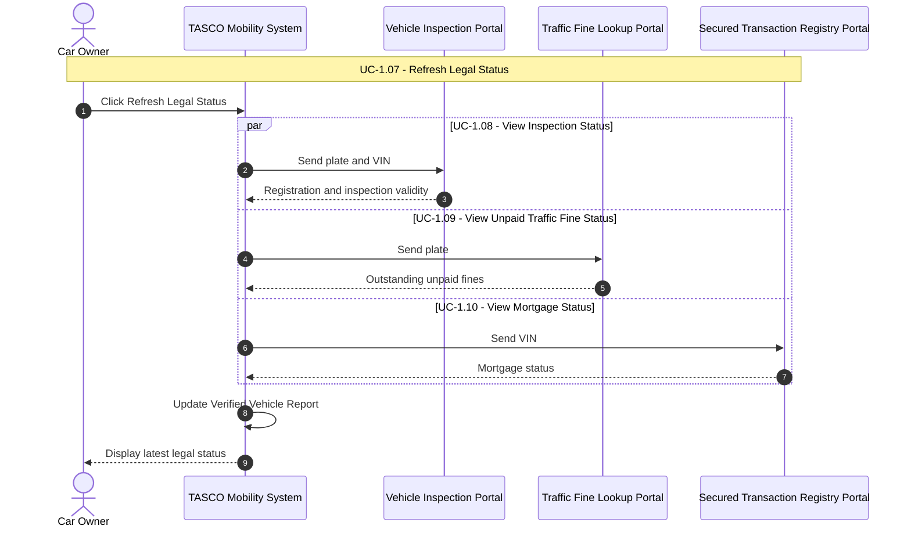

# Sequence Diagram: S-04 Refresh Legal Status

| Field | Value |
|---|---|
| Use case |UC-1.07 Refresh Legal Status, UC-1.08 View Inspection Status, UC-1.09 View Unpaid Traffic Fine Status, UC-1.10 View Mortgage Status|
| Version | v2 |
| FRs | FR-01-09, FR-01-10, FR-01-11, FR-01-12, FR-01-13|

