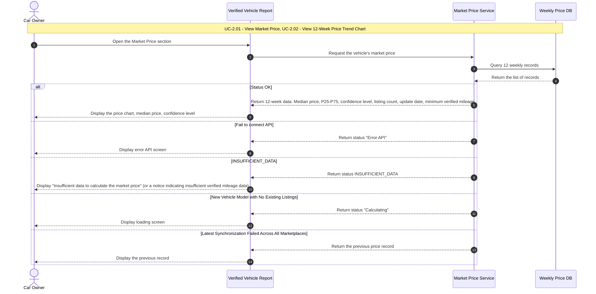

# Sequence Diagram: S-05 View Market Price and 12 Week Chart

| Field | Value |
|---|---|
| Use case |UC-2.01 View Market Price, UC-2.02 View 12-Week Price Trend Chart|
| Version | v3 |
| FRs | FR-02-10, FR-02-11|

